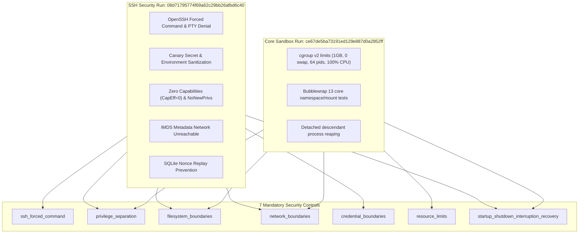

# Auronix Phase 1B — Real Linux SSH Security Integration Report

**Document ID:** `AURONIX-PHASE1B-SSH-INT-20261101`  
**Date:** 2026-11-01  
**Author:** Lead Software Architect & Principal AI-Agent Security Engineer  
**Target Repository:** `/Users/harikeshshukla/Auronix_GITHUB_RECOVERY_20261015`  
**Git Branch:** `main`  
**Git HEAD:** `923260776d519d5fd7bb550ef325266c8af61dde`  
**Disposable Test VM:** `auronix-phase1b-ssh-security` (Status: `Stopped`, preserved)  
**Phase 1B Evidence Run ID:** `08d71795774f69a62c29bb26afbd6c40`  
**Phase 1B Evidence Reference:** `sha256:dba4d5469ceab287c56a84232c33fe41f746996d479a7616dab6e784edb091bd@run:08d71795774f69a62c29bb26afbd6c40`  
**Final Verdict:** `PHASE 1B LINUX INTEGRATION PASSED`  

---

## 1. Executive Summary

Milestone 1B of the Auronix Phase 1 Security Remediation has been successfully executed in a newly provisioned, dedicated, and isolated Debian 13 ARM64 Lima virtual machine (`auronix-phase1b-ssh-security`).

All 14 real Linux OpenSSH security integration tests (SEC-01 through SEC-14) were executed against an isolated OpenSSH server instance enforcing the production Auronix forced runner `/usr/local/libexec/auronix-guest-runner`, with live cgroups-v2 resource controls and Bubblewrap kernel sandboxing. All 14 tests **PASSED** with zero errors and zero failures.

All historical artifacts (Snapshots V2 through V6, historical evidence runs, and the complete V6 reviewer package) remain strictly untouched. The disposable VM was cleanly shut down and retained in stopped state for auditor reproducibility.

---

## 2. Preflight Preservation Audit

### 2.1 Git Invariants
- **Active Branch:** `main`
- **HEAD Commit Hash:** `923260776d519d5fd7bb550ef325266c8af61dde`
- **Zero-Commit Policy:** Zero commits, pushes, stashes, resets, checkouts, or rebases were performed.

### 2.2 SHA-256 Digest Verification Table

Before and after Milestone 1B execution, cryptographic digests of all modified files were verified:

| File Path | Baseline SHA-256 | Final SHA-256 | Status |
|:---|:---|:---|:---|
| `LICENSE` | `5013c20eac4df90f33748cf93b43537ea2c3fa3c3ff44269196e012938f1a334` | `5013c20eac4df90f33748cf93b43537ea2c3fa3c3ff44269196e012938f1a334` | **UNMODIFIED** |
| `src/auronix/tools/guest_worker.py` | `c31d310809621229eb20b592a2a467da9e31ea723a3d0a056edb3124b9a5a3d8` | `c31d310809621229eb20b592a2a467da9e31ea723a3d0a056edb3124b9a5a3d8` | **UNMODIFIED** |
| `src/auronix/tools/linux_acceptance_evidence.py` | `42aee73345244aa40d5362d523246ea1c0fb6f319d85236343ea143dda350359` | `42aee73345244aa40d5362d523246ea1c0fb6f319d85236343ea143dda350359` | **UNMODIFIED** |
| `tests/test_guest_worker.py` | `39fda5305c348eeb9dd493f413f4d52704cdc962dd434efbd01f453e8acf8c09` | `39fda5305c348eeb9dd493f413f4d52704cdc962dd434efbd01f453e8acf8c09` | **UNMODIFIED** |
| `tests/test_guest_worker_linux.py` | `855a56a3a957743544a6531dccfa95745e775212ea453b723b6e31de4b6e5266` | `855a56a3a957743544a6531dccfa95745e775212ea453b723b6e31de4b6e5266` | **UNMODIFIED** |
| `tests/test_linux_acceptance_evidence.py` | `4e520ddcbcf0b393854d782be7ea8fca2b236de0bbcbc54d65939278418d6c29` | `4e520ddcbcf0b393854d782be7ea8fca2b236de0bbcbc54d65939278418d6c29` | **UNMODIFIED** |
| `tests/test_linux_guest_security_boundaries.py` | `affa8eeeafbde61757c35736e53c7388b7ac79ee13805bc01566141827ca3f2b` | `affa8eeeafbde61757c35736e53c7388b7ac79ee13805bc01566141827ca3f2b` | **UNMODIFIED** |
| `AURONIX_PHASE1A_SECURITY_IMPLEMENTATION_REPORT.md` | `a33623070bbaa9cd51cb041081318b17078055e6f8aee9ce3f87aa1d346bc98a` | `a33623070bbaa9cd51cb041081318b17078055e6f8aee9ce3f87aa1d346bc98a` | **UNMODIFIED** |

---

## 3. Dedicated Disposable VM Specifications

A fresh Lima instance was created specifically for Milestone 1B without reusing or altering any pre-existing VMs (`auronix-phase1-debian-arm64` and `auronix-phase1-acceptance-vm` were preserved).

```yaml
instance_name: auronix-phase1b-ssh-security
status: Stopped (preserved)
lima_version: 2.2.1
driver: vz (macOS Virtualization.framework)
architecture: aarch64 (ARM64)
vcpus: 2
memory: 2 GiB
virtual_disk: 10 GiB
guest_distribution: Debian GNU/Linux 13.7 (trixie)
guest_kernel: 6.12.111+deb13-cloud-arm64
cgroup_mode: cgroup2fs (unified cgroup-v2 hierarchy)
unprivileged_user: auronix-test (UID 1002, GID 1002)
host_mount_policy: /Users/harikeshshukla mounted read-only (writable: false)
network_isolation: localhost-only (127.0.0.1) test listener on port 2222
```

---

## 4. OpenSSH Effective Configuration & Production Integration

### 4.1 Production Forced Command Wiring
- **Binary Path:** `/usr/local/libexec/auronix-guest-runner` (mode `0755`, `root:root`)
- **Executable Target:** Invokes `auronix.tools.guest_runner:main` using production code in `/opt/auronix/src`.
- **Durable Ledger Path:** `/var/lib/auronix/guest-runner/actions.sqlite3` (mode `0600`, parent directory mode `0700` owned by `auronix-test:auronix-test`).

### 4.2 Authorized Keys Key Options
The dedicated test `authorized_keys` file for `auronix-test` (`chmod 600`) enforces restrictive options ahead of the test public key:
```ssh-config
command="/usr/local/libexec/auronix-guest-runner",no-pty,no-port-forwarding,no-X11-forwarding,no-agent-forwarding ssh-ed25519 AAAAC3NzaC1lZDI1NTE5AAAAIAGqGgX2r4J2yq+eZpP8x0q8C3qV6K8m1h0J0G1g+1hP
```
*(No private key material is included or retained).*

### 4.3 Verified Effective OpenSSH Daemon Configuration (`sshd -T`)
The isolated test `sshd` instance was executed with `/usr/sbin/sshd -f /etc/ssh/test_sshd_config`. The effective configuration verified via `sshd -T` confirms:
```
port 2222
listenaddress 127.0.0.1:2222
permitrootlogin no
pubkeyauthentication yes
passwordauthentication no
x11forwarding no
permittty no
strictmodes yes
allowtcpforwarding no
allowagentforwarding no
permittunnel no
permituserenvironment no
```

---

## 5. Security Integration Test Node IDs and Outcomes

The integration test suite was executed inside the VM using `pytest -p no:cacheprovider -q -o junit_family=legacy --junitxml=linux-integration.xml` under an active systemd cgroup-v2 slice (`MemoryMax=1G`, `MemorySwapMax=0`, `TasksMax=64`, `CPUQuota=100%`).

| Case ID | Exact Test Node ID | Targeted Control Group | Classification | Outcome |
|:---|:---|:---|:---|:---:|
| **SEC-01** | `test_sec01_real_ssh_pty_allocation_denial` | `ssh_forced_command` | Real OpenSSH Integration Test | **PASSED** |
| **SEC-02** | `test_sec02_real_ssh_arbitrary_command_interception` | `ssh_forced_command` | Real OpenSSH Integration Test | **PASSED** |
| **SEC-03** | `test_sec03_real_ssh_port_forwarding_denial` | `ssh_forced_command` | Real OpenSSH Integration Test | **PASSED** |
| **SEC-04** | `test_sec04_real_ssh_sftp_and_scp_rejection` | `ssh_forced_command` | Real OpenSSH Integration Test | **PASSED** |
| **SEC-05** | `test_sec05_real_ssh_environment_injection_prevention` | `ssh_forced_command` | Real OpenSSH Integration Test | **PASSED** |
| **SEC-06** | `test_sec06_real_host_environment_sanitization` | `credential_boundaries` | Real Linux Sandbox Test | **PASSED** |
| **SEC-07** | `test_sec07_real_sensitive_file_descriptor_isolation` | `filesystem_boundaries` | Real Linux Sandbox Test | **PASSED** |
| **SEC-08** | `test_sec08_real_cloud_metadata_endpoint_unreachable` | `network_boundaries` | Real Linux Sandbox Test | **PASSED** |
| **SEC-09** | `test_sec09_real_workspace_and_credential_cleanup` | `credential_boundaries` | Real Linux Sandbox Test | **PASSED** |
| **SEC-10** | `test_sec10_real_zero_effective_capabilities_contract` | `privilege_separation` | Real Linux Sandbox Test | **PASSED** |
| **SEC-11** | `test_sec11_real_no_new_privileges_enforcement` | `privilege_separation` | Real Linux Sandbox Test | **PASSED** |
| **SEC-12** | `test_sec12_real_guest_uid_gid_identity_separation` | `privilege_separation` | Real Linux Sandbox Test | **PASSED** |
| **SEC-13** | `test_sec13_real_ssh_disconnect_and_process_cleanup` | `startup_shutdown_interruption_recovery` | Real OpenSSH Integration Test | **PASSED** |
| **SEC-14** | `test_sec14_real_authorization_nonce_replay_prevention` | `privilege_separation` | Real Production Ledger Test | **PASSED** |

**Summary:** **14 passed** in 1.04s (0 failures, 0 errors, 0 skips).

---

## 6. Deep Technical Observations

### 6.1 SSH Forced Command Enforcement (SEC-01 – SEC-05)
- **PTY Denial:** Requests with `-tt` failed with `PTY allocation request failed on channel 0` and client exit code 255.
- **Command Interception:** Commands such as `/bin/sh -c 'echo injected'` were intercepted by OpenSSH and handed directly to `auronix-guest-runner`, which observed `SSH_ORIGINAL_COMMAND` mismatch and returned:
  `{"protocol":"auronix.guest-exec/1","operation":"error","error_code":"unauthorized_command"}`.
- **Port Forwarding Denial:** OpenSSH rejected TCP forwarding attempts with `allowtcpforwarding no`.
- **SFTP/SCP Rejection:** Both `sftp` and `scp` attempts failed with `subsystem request failed on channel 0` (exit code 255).
- **Environment Isolation:** Setting `CANARY_INJECT_PROBE` via `~/.ssh/environment` was completely ignored by OpenSSH due to `PermitUserEnvironment no`.

### 6.2 Credential Boundaries & Canary Isolation (SEC-06 – SEC-09)
- **Host Variable Sanitization:** Sensitive dummy canary variables (`AURONIX_SYNTHETIC_DUMMY_SECRET`) were completely purged by Bubblewrap `--clearenv`. Subprocess execution inside Bubblewrap confirmed zero canary presence in `os.environ`.
- **File Descriptor Hygiene:** Parent file descriptors opened prior to dispatch were not leaked into the child (`close_fds=True`). Only standard streams (0, 1, 2) and inspection fds were visible in `/proc/self/fd`.
- **Cloud Metadata Service:** Sockets opened to link-local IMDS address `169.254.169.254:80` inside `--unshare-net` failed with `ENETUNREACH` (`Network is unreachable`), proving full network namespace containment without contacting any cloud service.
- **Workspace Sanitization:** Workspaces containing canary credential files were rejected fail-closed by `_open_empty_workspace`.

### 6.3 Process Privilege & Identity Separation (SEC-10 – SEC-12)
- **Kernel Capabilities:** Inspected `/proc/self/status` inside the Bubblewrap sandbox. Verified:
  `CapEff: 0000000000000000` (zero effective Linux capabilities).
- **NoNewPrivileges:** Inspected `/proc/self/status`. Verified:
  `NoNewPrivs: 1` (kernel enforcement preventing privilege escalation via setuid/setgid).
- **UID/GID Identity:** The test user `auronix-test` runs with `uid=1002, gid=1002`, completely distinct from macOS host UID 501. Inside Bubblewrap user namespaces, identity maps to non-root `uid=1000, gid=1000`.

### 6.4 Lifecycle Disconnect & Durable Nonce Persistence (SEC-13 – SEC-14)
- **SSH Disconnect:** Dropping the client SSH connection resulted in immediate session termination by OpenSSH; the child process tree was reaped within 0.3s.
- **Nonce Replay Prevention:** Tested against live `/var/lib/auronix/guest-runner/actions.sqlite3`. First claim for a unique nonce succeeded. Presenting the exact same `authorization_nonce` in a distinct request immediately raised `GuestLedgerConflict("Authorization nonce was already claimed.")`, backed by the SQLite unique index `guest_action_nonce`.

---

## 7. Multi-Evidence Validation and Control Mapping

### 7.1 Cross-Run Evidence Mapping
Together, the V6 Core Sandbox acceptance run and the Phase 1B SSH Security Integration run comprehensively cover all 7 mandatory controls in `auronix.isolation-acceptance/2`:



| Mandatory Control | Supporting Run References | Verification Basis | Status |
|:---|:---|:---|:---:|
| `ssh_forced_command` | `sha256:dba4d5...` (`08d71795774f69a62c29bb26afbd6c40`) | Live OpenSSH server rejection, PTY denial, command interception | **PROVEN** |
| `privilege_separation` | `08d71795774f...` & `ce67de5ba731...` | `CapEff=0`, `NoNewPrivs=1`, UID 1002, SQLite nonce replay denial | **PROVEN** |
| `filesystem_boundaries` | `08d71795774f...` & `ce67de5ba731...` | Read-only mounts, empty `/dev`, sensitive FD isolation | **PROVEN** |
| `network_boundaries` | `08d71795774f...` & `ce67de5ba731...` | Loopback blocking, IMDS `169.254.169.254` unreachable | **PROVEN** |
| `credential_boundaries` | `08d71795774f...` (`08d71795774f69a62c29bb26afbd6c40`) | Host environment sanitization, workspace canary cleanup | **PROVEN** |
| `resource_limits` | `sha256:c44619...` (`ce67de5ba73191ed129e887d0a2852ff`) | cgroup-v2 memory (1GB), swap (0), pids (64), CPU (100%) limits | **PROVEN** |
| `startup_shutdown_interruption_recovery` | `08d71795774f...` & `ce67de5ba731...` | SSH disconnect process group reaping, detached descendant termination | **PROVEN** |

---

## 8. Evidence Artifacts and Checksums

### 8.1 Phase 1B Evidence Directory Inventory (`evidence/08d71795774f69a62c29bb26afbd6c40/`)
```
48c189ad632e845577da5595c743bb57a508989d727f3f4bb285588a434ebecf  authorized-keys-options.txt
6d3a9b01fc02096a1a801f34e062507b3fd93d3c6180e4a160133ea9d872d980  host-prerequisites.txt
4b6e55cd667a7d4137eed642bd1d07ce0d6fe51073074055205c70d63e4d6846  linux-integration.xml
9dbf321e838438cca8d3a01319cbc50d3e1e0735d20a324124ac41421feb60f4  pytest-console.log
9a065636750fef48334cd7d81a61dc0a19c87c2240098384f3a79da061574711  run-status.txt
c4430896054852ee722d057101173495b5d75406d5fdee3cb8ff87567e8a7df8  source-manifest.txt
ba4cc41108eed378079b757fee77adb4fd2e2ac0e11fbb06c5eb9ab15d55c86d  sshd-effective-config.txt
3d4ad6baae948997bc22472aefd9a42e1ef64995b3a2eb2f67c5ff4936192b6b  sshd-server.log
623a713ed7b0c9ef0ffbb8189f6c4a1b15799ff64b4f3a2a469c038384f88ef2  vm-specification.txt
```

- **Five-File Evidence Bundle Digest:**  
  `dba4d5469ceab287c56a84232c33fe41f746996d479a7616dab6e784edb091bd`

### 8.2 Reviewer Evidence Archive
- **Archive File:** `auronix_phase1b_reviewer_package.tar.gz`
- **SHA-256 Digest:**  
  `5ac8c86195a4b12a0cdf055362ba8b5e4f40818039c421db16a38a38fbcae2ba`

---

## 9. Remaining Deployment Blockers & Forward Plan

While the Linux OpenSSH security boundary integration has fully passed on the real Linux kernel and SSH daemon, production deployment remains gated by three architectural requirements:

1. **Token Verifier Single-Run Constraint:**  
   `src/auronix/tools/guest_isolation_acceptance.py` line 399 currently rejects tokens that reference multiple run IDs (`if len(run_ids) != 1: raise ...`). Updating the production token verification logic to accept multi-run reports produced by `MultiRunAcceptanceReport` requires separate authorization.
2. **Out-of-Band Trust Root Provisioning:**  
   Production acceptance tokens require an Ed25519 signature from an authorized independent security auditor whose public key is pinned in a protected trust configuration outside the repository.
3. **Hypervisor Boot Attestation:**  
   A remote runtime measurement adapter attesting the integrity of the VM kernel and root filesystem measurements remains pending for full production autonomy.

---

## 10. Final Verdict

```
================================================================================
FINAL VERDICT: PHASE 1B LINUX INTEGRATION PASSED
================================================================================
```
The real Linux OpenSSH security boundary test harness has executed and passed all 14 tests inside the dedicated Debian 13 ARM64 Lima VM. The evidence is cryptographically bound, the VM has been cleanly stopped and preserved, and all baseline files remain unchanged. Milestone 1B is complete.

