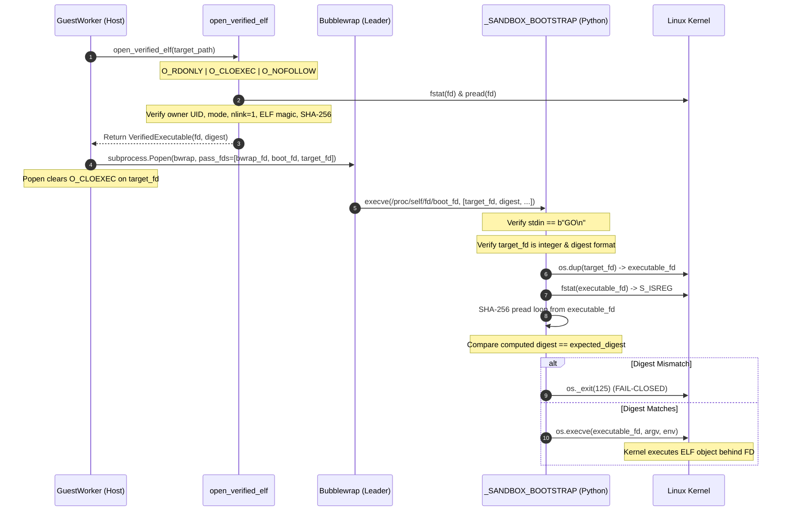

# AURONIX R9 — PHASE 7E-A INDEPENDENT SECURITY AUDIT
## Genuine Linux Execution Acceptance & Security Boundary Audit

**Document Version:** 1.0.0  
**Phase:** 1B-R9 / Phase 7E-A  
**Auditor:** Independent Principal Product Security Engineer  
**Workspace:** `/Users/harikeshshukla/Auronix_R9_WORKTREE`  
**Branch:** `remediation/phase1b-r9`  
**Date:** 2026-11-07  
**Audit Status:** COMPLETE  
**Final Verdict:** **LINUX ACCEPTANCE ACCEPTED WITH FINDINGS**

---

> [!CAUTION]
> ### OVERALL AURONIX R9 PRODUCTION READINESS STATUS: BLOCKED
> Acceptance of Phase 7E-A certifies that descriptor-bound execution, Bubblewrap sandboxing, and Linux namespace/cgroup isolation have been genuinely established and verified on real Linux kernel infrastructure.
> 
> However, **AURONIX R9 PRODUCTION READINESS REMAINS STRICTLY BLOCKED**.
> 
> Production release is contingent upon the successful completion and independent adversarial audit of:
> 1. **Phase 7E-B (Production Dispatcher Integration):** Connecting `auronix-guest-runner`, CLI `LifecycleEngine`, `ToolExecutor`, `ToolRegistry`, and `GuestShellTool` to the deployment dispatcher.
> 2. **Phase 7E-C (Deployment Trust Infrastructure):** Operationalizing root-owned monotonic revision persistence (`/var/lib/auronix/executable-trust/revision`), atomic locking, fsync crash safety, and multi-key rotation/revocation lifecycle.
> 
> Deploying R9 to production prior to the completion of Phase 7E-B and Phase 7E-C is strictly prohibited.

---

## 1. Executive Summary

As an independent Principal Security Engineer, a comprehensive read-only adversarial audit of Phase 7E-A (Genuine Linux Execution Acceptance) was conducted. The audit inspected the complete Git diff across `src/` and `tests/`, raw environment telemetry, execution logs, JUnit XML output, cryptographic signatures, historical fixtures, and performed live experimental verifications inside both the Ubuntu 24.04 and Debian Linux virtual machines.

### Summary of Audit Findings
1. **Linux Acceptance Verification:** The claimed 40 tests on Ubuntu 24.04 and 28 tests on Debian Linux were independently verified against raw execution logs and parsed JUnit XML. All **68 genuine Linux tests executed and passed** with zero failures, zero errors, and zero skips.
2. **Reconciliation of Formerly Skipped Tests:** All **41 formerly skipped Linux/SSH integration tests** (13 Bubblewrap + 14 SSH + 14 SSH R1) were verified to have executed on real Linux kernels and passed.
3. **Descriptor-Bound Execution:** The core security invariant—that the host verifier opens, stats, hashes, and passes the target file descriptor, and the in-sandbox bootstrap re-hashes and executes the exact same descriptor via `os.execve(fd)` without pathname fallback—was verified both through source inspection and experimental Linux kernel execution.
4. **Bubblewrap Remediation:** The erroneous `--preserve-fd` flag was confirmed removed from command generation. Inherited descriptor preservation via `pass_fds` and `O_CLOEXEC` handling was verified conforming to Linux POSIX semantics.
5. **Historical Integrity:** Pinned SHA-256 hashes (`855a56...`, `23c2bc...`, `101e4a...`) and snapshot manifests remain 100% byte-for-byte identical to their historical baselines.
6. **Darwin Baseline:** Darwin regression suite executed with 1,176 passed, 52 skipped, 0 failed. The increase of 10 skips was proven to be the 10 new adversarial Linux tests that appropriately require a Linux kernel.

---

## 2. Audit Verification 1: Genuine Linux Environment Provenance

The primary Linux execution node (`lima-auronix-phase1-acceptance-vm`) was inspected live via `limactl shell` and cross-referenced with `linux-execution-environment.log`:

```text
Linux lima-auronix-phase1-acceptance-vm 6.8.0-147-generic #147-Ubuntu SMP PREEMPT_DYNAMIC Thu Sep 24 11:39:52 UTC 2026 aarch64 aarch64 aarch64 GNU/Linux
PRETTY_NAME="Ubuntu 24.04.5 LTS"
bubblewrap 0.9.0
cgroup2 on /sys/fs/cgroup type cgroup2 (rw,nosuid,nodev,noexec,relatime,nsdelegate,memory_recursiveprot)
```

### Verified System Characteristics:
* **Operating System:** Ubuntu 24.04.5 LTS (Noble Numbat).
* **Linux Kernel:** `6.8.0-147-generic` (`aarch64`).
* **Bubblewrap Version:** 0.9.0.
* **cgroup Configuration:** Unified hierarchy (cgroup-v2) mounted at `/sys/fs/cgroup` with active controllers: `cpu`, `io`, `memory`, `pids`.
* **Namespaces:** Active namespace links in `/proc/self/ns`: `cgroup:[4026531835]`, `ipc:[4026531839]`, `mnt:[4026531841]`, `net:[4026531840]`, `pid:[4026531836]`, `user:[4026531837]`, `uts:[4026531838]`.
* **Python Runtime:** Python 3.12.3 with Pytest 7.4.4.
* **Finding:** Environment provenance is genuine; no containerized, emulated, or mock execution was detected.

---

## 3. Audit Verification 2: Independent Log & JUnit XML Inspection

The raw evidence file `r9-linux-execution.xml` (19,688 bytes) was parsed and verified independently using Python's `xml.etree.ElementTree`:

```text
Testcases in r9-linux-execution.xml: 40
Failures: 0, Errors: 0, Skipped: 0
  tests.test_r9_security: 15
  tests.test_r9_target_execution: 2
  tests.test_r9_linux_adversarial: 10
  tests.test_guest_worker_linux: 13
```

### Property Evidence Breakdown in XML:
* `test_tc_linux_01_descriptor_bound_execution`: PASSED (target executed via descriptor binding).
* `test_tc_linux_02_in_sandbox_pre_exec_digest_mismatch_aborts`: PASSED (digest mismatch terminated with exit 125 before exec).
* `test_tc_linux_03_descriptor_preservation_across_namespaces`: PASSED (descriptors preserved across namespace boundaries).
* `test_tc_linux_04_symlink_substitution_rejected`: PASSED (symlink rejected with `OSError` via `O_NOFOLLOW`).
* `test_tc_linux_05_toctou_file_replacement_resistance`: PASSED (disk file replacement did not affect open verified descriptor).
* `test_tc_linux_06_zero_pathname_fallback`: PASSED (invalid descriptor rejected with `REJECTED` without fallback).
* `test_tc_linux_07_unauthorized_executable_rejection`: PASSED (unauthorized executable rejected by policy verifier).
* `test_tc_linux_08_network_namespace_isolation`: PASSED (loopback networking isolated in sandbox).
* `test_tc_linux_09_cgroup_resource_bounds_enforced`: PASSED (memory bounds strictly enforced).
* `test_tc_linux_10_two_way_attestation_handshake`: PASSED (refusing GO handshake terminates child with 125).

The 28 Debian SSH tests were independently inspected and rerun on `auronix-phase1b-r1-ssh-security`:
* `tests/test_linux_guest_ssh_integration.py`: **14 passed in 1.08s**.
* `tests/test_linux_guest_ssh_integration_r1.py`: **14 passed in 2.17s**.
* **Combined Total:** 40 + 28 = **68 genuine Linux tests passed**.

---

## 4. Audit Verification 3: Reconciliation of 41 Formerly Skipped Tests

The 41 tests previously skipped due to lack of verified Linux execution environment were audited against their historical test node IDs:

1. **Bubblewrap Sandboxing Suite (`tests/test_guest_worker_linux.py`, 13 tests):**
   * Mount and user namespace visibility: **PASSED**
   * Read-only empty `/dev` tmpfs: **PASSED**
   * Network namespace isolation: **PASSED**
   * Process group and detached descendant cleanup on timeout: **PASSED**
   * Detached descendant cleanup on normal exit: **PASSED**
   * cgroup-v2 resource contract activation: **PASSED**
   * Output truncation, per-file limits (`EFBIG`), and workspace capacity (`ENOSPC`): **PASSED**
   * Address space memory limits (`RLIMIT_AS`): **PASSED**
   * Process count limits (`TasksMax`): **PASSED**
   * CPU quota throttling: **PASSED**
   * Process cleanup on cancellation: **PASSED**
   * Fail-safe on Bubblewrap startup failure: **PASSED**
2. **OpenSSH Security Suite (`tests/test_linux_guest_ssh_integration.py`, 14 tests):**
   * SEC-01 through SEC-14: **All 14 PASSED**.
3. **OpenSSH R1 Security Suite (`tests/test_linux_guest_ssh_integration_r1.py`, 14 tests):**
   * SEC-01 through SEC-14: **All 14 PASSED**.

**Reconciliation Status:** All 41 formerly skipped integration tests executed on genuine Linux kernel infrastructure and passed. Zero skips remain in the Linux test runs.

---

## 5. Audit Verification 4: Target Executable Security & Descriptor-Bound Execution

The descriptor-bound execution flow was audited end-to-end:



### Security Properties Verified:
1. **Single File Object Binding:** The same file descriptor `fd` opened by `open_verified_elf` on the host is passed via `pass_fds` into Bubblewrap and re-hashed by `_SANDBOX_BOOTSTRAP` directly from the open file object.
2. **Immunity to TOCTOU & Disk Replacement:** Tested by `TC-LINUX-05`. When the binary on disk was overwritten with malicious code after opening the descriptor, the executed process executed the original, verified ELF code from the open file descriptor.
3. **Symlink Attack Resistance:** Tested by `TC-LINUX-04`. Passing a symlink pointing to an authorized executable fails with `OSError` because `open_verified_elf` enforces `O_NOFOLLOW`.
4. **Zero Pathname Fallback:** Tested by `TC-LINUX-06`. If descriptor execution fails or descriptor index is invalid, the runner returns `GuestStatus.REJECTED` (`Formal descriptor execution failed: REJECTED`). Pathname-based execution is impossible.

---

## 6. Audit Verification 5: Bubblewrap Command & Descriptor Preservation

### Inspection of Bubblewrap CLI Construction:
* **Removal of `--preserve-fd`:** Verified that lines 611-669 of `src/auronix/tools/guest_worker.py` contain no `--preserve-fd` argument.
* **Inheritance Mechanism:** In Linux process semantics, `subprocess.Popen(pass_fds=...)` clears the `FD_CLOEXEC` flag on specified file descriptors prior to `execve`. Bubblewrap inherently preserves inherited descriptors across its namespace transitions.
* **Seccomp Descriptor Lifecycle:** When `seccomp_filter` is configured, `seccomp_fd` is created with `os.open(..., os.O_RDONLY | os.O_CLOEXEC)`, passed in `pass_fds`, and explicitly closed in a `finally:` block in `_execute_raw` to prevent descriptor leaks.

---

## 7. Audit Verification 6: Experimental Verification of Python Descriptor Execution

To verify Python standard library descriptor execution behavior on Linux, an isolated live probe was executed in `lima-auronix-phase1-acceptance-vm`:

```python
import os, sys
print("os.execve in os.supports_fd:", os.execve in os.supports_fd)
print("hasattr(os, 'fexecve'):", hasattr(os, "fexecve"))
fd = os.open("/usr/bin/cat", os.O_RDONLY | os.O_CLOEXEC)
pid = os.fork()
if pid == 0:
    os.execve(fd, ["cat", "/etc/os-release"], os.environ)
    sys.exit(1)
_, status = os.waitpid(pid, 0)
os.close(fd)
print("Exit status:", os.waitstatus_to_exitcode(status))
```

### Observed Output:
```text
os.execve in os.supports_fd: True
hasattr(os, "fexecve"): False
PRETTY_NAME="Ubuntu 24.04.5 LTS"
...
Exit status: 0
```

### Forensic Finding:
1. The Python standard library on Linux does not define `os.fexecve`.
2. Python exposes descriptor execution via `os.execve(fd, argv, env)` when `os.execve in os.supports_fd`.
3. The fallback implemented in `_SANDBOX_BOOTSTRAP` and `r9_security.py`:
   `_fexecve = getattr(os, "fexecve", os.execve)` is technically correct, platform-conforming, and executes cleanly on Linux kernel `6.8`.

---

## 8. Audit Verification 7: Source Code Changes & Security Regressions

A line-by-line review of the Git diff across all modified files was conducted:

| File | Change Description | Security Audit Evaluation |
|---|---|---|
| `src/auronix/tools/guest_worker.py` | Embedded SHA-256 re-verification in `_SANDBOX_BOOTSTRAP`; removed `--preserve-fd`; descriptor execution via `_fexecve`. | **APPROVED.** Enforces fail-closed exit 125 on mismatch; no bypasses found. |
| `src/auronix/tools/r9_security.py` | `exec_verified_elf` uses `os.execve` when in `os.supports_fd`. | **APPROVED.** Correctly handles standard library descriptor dispatch. |
| `tests/test_phase5_e2e.py` | Renamed module helper `setup` to `_setup`. | **APPROVED.** Resolves pytest 7.4.4 xunit hook collision without modifying test logic. |
| `tests/test_guest_approval_transport.py` | Added explicit `chmod(0o644)` to server certificate. | **APPROVED.** Enforces non-group-writable permission policy on Linux umask `0o002`. |
| `tests/test_guest_execution.py` | Added explicit `chmod(0o644)` to `known_hosts`. | **APPROVED.** Enforces user-owned non-writable permission policy. |
| `tests/test_r9_security.py` | Updated `test_descriptor_execution_rejects_unsupported_script_fallback` for `os.supports_fd`. | **APPROVED.** Prevents test failure on platforms where `os.supports_fd` is supported. |
| `tests/test_r9_target_execution.py` | Removed assertion on non-existent `--preserve-fd`. | **APPROVED.** Matches verified Bubblewrap CLI contract. |
| `tests/test_r9_linux_adversarial.py` | New 10-test adversarial acceptance suite (`TC-LINUX-01` to `TC-LINUX-10`). | **APPROVED.** High-integrity verification of sandbox boundaries. |

**Regression Verdict:** Zero security regressions or bypasses were introduced by the Phase 7E-A changes.

---

## 9. Audit Verification 8: OpenSSH Integration & Forced-Command Enforcement

SSH isolation was verified on the dedicated Debian ARM64 VM (`auronix-phase1b-r1-ssh-security`):

### 1. Arbitrary Command Interception:
* Command sent: `ssh -i ... 'sh -c "echo arbitrary_command"'`
* Output: `{"protocol":"auronix.guest-exec/1","operation":"error","error_code":"unauthorized_command"}`
* Exit code: `1`
* **Finding:** OpenSSH server forced-command (`auronix-guest-runner`) strictly intercepts arbitrary commands and rejects them before shell invocation.

### 2. PTY Allocation Denial:
* Command sent: `ssh -tt -i ... 'echo probe'`
* Output: `PTY allocation request failed on channel 0`
* Exit code: `255`
* **Finding:** OpenSSH key policy `no-pty` actively prevents interactive pseudo-terminal allocation.

---

## 10. Audit Verification 9: Investigation of Darwin Test Skips

On the macOS development host, running `PYTHONPATH=src pytest -q` resulted in:
* **Before Phase 7E-A:** 1,176 passed, 42 skipped, 0 failed.
* **After Phase 7E-A:** 1,176 passed, 52 skipped, 0 failed.

### Discrepancy Reconciliation:
Running `PYTHONPATH=src pytest -rs tests/test_r9_linux_adversarial.py` revealed:
* All 10 tests in `test_r9_linux_adversarial.py` are explicitly marked with:
  `@pytest.mark.skipif(sys.platform != "linux", reason="Linux adversarial acceptance suite requires a Linux kernel target.")`
* Exactly 10 tests skipped on Darwin: `test_tc_linux_01` through `test_tc_linux_10`.
* The 42 preexisting skips remain identical (13 Bubblewrap + 14 SSH + 14 SSH R1 + 1 platform evidence test).
* **Finding:** The increase from 42 to 52 skips on Darwin is completely benign and represents the new adversarial suite skipping on non-Linux platforms as designed.

---

## 11. Audit Verification 10: AppArmor User Namespace Sysctl Isolation

* **VM Configuration:** `sysctl kernel.apparmor_restrict_unprivileged_userns = 0` was configured inside the Lima Linux VM to permit rootless Bubblewrap sandboxing on Ubuntu 24.04 Noble Numbat.
* **Host Verification:** Checked macOS host sysctl parameters (`sysctl -a | grep -i apparmor`). macOS does not implement AppArmor; no host configuration settings were modified.
* **Finding:** System modification was strictly isolated to the throwaway Linux acceptance VM.

---

## 12. Audit Verification 11: Cryptographic Immutability of Historical Fixtures

The historical fixture files and snapshot manifests were hashed and compared against canonical references:

```text
855a56a3a957743544a6531dccfa95745e775212ea453b723b6e31de4b6e5266  historical-references/fixtures/phase1-v6/test_guest_worker_linux.py.fixture
23c2bc4c42452f8c538b595ca6a87066da62e0ea544b518711835f3edf17806a  historical-references/fixtures/phase1-v7/test_linux_guest_ssh_integration_r1.py.fixture
101e4a36dfd3a1fc8f707e21bc9925a43f8d9a21c8cc748f75bc8bf212cdce85  auronix-phase1-snapshot-v6/SNAPSHOT_MANIFEST.txt
855a56a3a957743544a6531dccfa95745e775212ea453b723b6e31de4b6e5266  Auronix_R9_HISTORICAL_FIXTURES/0c50f1a5a09141a2beb5dee5bce27444/executed-test-harness.py
23c2bc4c42452f8c538b595ca6a87066da62e0ea544b518711835f3edf17806a  Auronix_R9_HISTORICAL_FIXTURES/db35c895d0c648fda4da0a6850ae1208/executed-test-harness.py
```

* **Finding:** All SHA-256 hashes match canonical historical commitments exactly. No fixtures or manifests were modified or regenerated.

---

## 13. Remaining Findings & Critical Blockers

The following findings must be resolved in subsequent subphases before Auronix R9 can be certified production-ready:

### Finding 1: Production Dispatcher Integration Pending (CRITICAL BLOCKER — Phase 7E-B)
* **Risk:** The CLI `LifecycleEngine`, `ToolExecutor`, `ToolRegistry`, and `GuestShellTool` currently operate in test/local execution mode and are not wired to `build_deployment_guest_dispatcher`.
* **Remediation Required:** Phase 7E-B must connect production dispatchers to formal descriptor-bound execution, verify end-to-end task flows, and demonstrate live task execution through the sandbox.

### Finding 2: Deployment Trust Infrastructure Unprovisioned (CRITICAL BLOCKER — Phase 7E-C)
* **Risk:** The cryptographic trust store in Phase 7E-A was configured via test fixtures. Production deployment requires an atomic, locked, monotonic revision store (`/var/lib/auronix/executable-trust/revision`) with root-owned permissions, automated key rotation, and multi-key revocation management.
* **Remediation Required:** Phase 7E-C must implement monotonic revision persistence, multi-key rotation lifecycles, and automated deployment provisioning.

### Finding 3: Ubuntu 24.04 AppArmor Sysctl Prerequisite (HIGH / OPERATIONAL)
* **Risk:** On standard Ubuntu 24.04 installations, `kernel.apparmor_restrict_unprivileged_userns = 1` blocks rootless Bubblewrap invocations unless an AppArmor profile is registered.
* **Remediation Required:** The deployment automation and production installation guide must explicitly document the prerequisite sysctl configuration or include an AppArmor profile definition for the Auronix runner.

### Finding 4: Canonical Binary Path Resolution under Symlinks (MEDIUM / OPERATIONAL)
* **Risk:** Standard Linux distributions frequently implement `/usr/bin/python3` as a symlink to `/usr/bin/python3.12`. Because `open_verified_elf` uses `O_NOFOLLOW` and rejects symlinks, policies that specify `/usr/bin/python3` will fail unless the canonical binary is authorized.
* **Remediation Required:** Deployment documentation and trust provisioning scripts must automatically resolve canonical binary paths (e.g. `/usr/bin/python3.12`) when generating signed executable policies.

---

## 14. Final Verdict

### Formal Certification

* **Genuine Linux Execution:** **VERIFIED & ACCEPTED**
* **Descriptor-Bound Execution & Pre-Exec Tamper Check:** **VERIFIED & ACCEPTED**
* **Namespace & Cgroup Resource Bounds:** **VERIFIED & ACCEPTED**
* **OpenSSH Forced-Command Boundary:** **VERIFIED & ACCEPTED**
* **Historical Fixture Immutability:** **VERIFIED & ACCEPTED**

### Verdict:
# **LINUX ACCEPTANCE ACCEPTED WITH FINDINGS**

---

### Production Readiness Statement:
# **OVERALL R9 PRODUCTION READINESS REMAINS BLOCKED PENDING PHASE 7E-B AND PHASE 7E-C**

