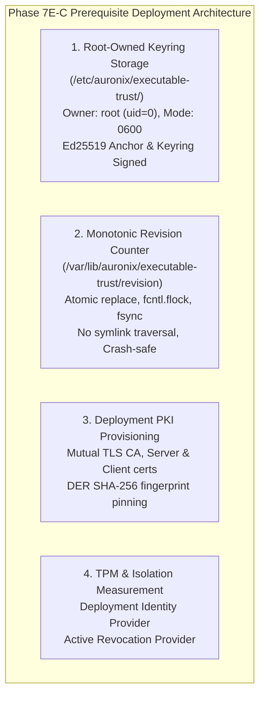

# AURONIX R9 — PHASE 7E-B INDEPENDENT SECURITY AUDIT
## Production Dispatcher Integration & Execution Boundary Adversarial Audit

**Document Version:** 1.0.0  
**Phase:** 1B-R9 / Phase 7E-B  
**Auditor:** Independent Principal Product Security Engineer  
**Workspace:** `/Users/harikeshshukla/Auronix_R9_WORKTREE`  
**Branch:** `remediation/phase1b-r9`  
**Date:** 2026-11-08  
**Audit Status:** COMPLETE  
**Final Verdict:** **ACCEPTED WITH FINDINGS**  

---

> [!CAUTION]
> ### OVERALL AURONIX R9 PRODUCTION READINESS STATUS: STRICTLY BLOCKED
> Acceptance of Phase 7E-B certifies that the authoritative host execution lifecycle (`CLI`, `LifecycleEngine`, `ToolExecutor`, `PolicyEngine`, `ApprovalEngine`, `_ExecutionPermit`, `GuestShellTool`) is soundly, immutably, and cryptographically integrated with the guest execution boundary (`GuestProtocolEndpoint`, `GuestActionDispatcher`, `SignedIsolationAcceptanceGate`, mTLS approval verification, `GuestActionLedger`).
> 
> However, **AURONIX R9 PRODUCTION READINESS REMAINS STRICTLY BLOCKED**.
> 
> Production deployment cannot proceed until the completion and independent adversarial audit of:
> 1. **Phase 7E-C (Deployment Trust Infrastructure):**
>    - Root-owned trust anchor and keyring provisioning (`/etc/auronix/executable-trust/trust-anchor.pub`, `keyring.json`, mode `0600`, root:root).
>    - Hardened monotonic revision counter storage (`/var/lib/auronix/executable-trust/revision`) with atomic replace, mandatory `fcntl.flock`, parent/file `fsync`, symlink rejection (`O_NOFOLLOW`), and crash recovery.
>    - Operational deployment PKI generation (mTLS CA, server certificates, and client certificate SHA-256 DER fingerprint pinning).
>    - Deployment-level guest measurement and status revocation providers for `SignedIsolationAcceptanceGate`.
> 
> Deploying Auronix R9 into production prior to the full execution and audit of Phase 7E-C is strictly prohibited.

---

## 1. Executive Summary

As an independent Principal Product Security Auditor, an exhaustive, read-only adversarial audit of Auronix Phase 1B-R9 — Phase 7E-B (Production Dispatcher Integration) was conducted. The audit inspected the Git diff across `src/` and `tests/`, evaluated the host application composition, audited the single-use execution permit and cryptographic assertion mechanisms, traced the guest dispatcher initialization in `guest_runner.py::main()`, verified SSH forced-command and mTLS transport boundaries, inspected all 10 integration scenarios in `test_production_guest_integration.py`, inventoried every process launch path across the codebase, re-verified historical fixture immutability, and executed live validation across Darwin and genuine Ubuntu 24.04 Linux environments.

### Summary of Audit Findings:
1. **Host Composition & Process Isolation:** `build_production_host_container()` in [container.py](file:///Users/harikeshshukla/Auronix_R9_WORKTREE/src/auronix/host/container.py#L475-L554) strictly binds `GuestShellTool` under target `"shell"` with `Ed25519AssertionSigner`. The raw, unisolated host `ShellTool` is never registered. In [executor.py](file:///Users/harikeshshukla/Auronix_R9_WORKTREE/src/auronix/execution/executor.py#L189-L211), `ToolExecutor.execute` strictly enforces `type(tool) is GuestShellTool` via `_is_guest_shell_tool(tool)`, blocking any attempt to dispatch raw host shell commands with `ActionStatus.BLOCKED` and `local_shell_execution_blocked`.
2. **Approval Enforcement & Single-Use Permits:** In-process dispatch is guarded by `_ExecutionPermit` in [_execution_permit.py](file:///Users/harikeshshukla/Auronix_R9_WORKTREE/src/auronix/tools/_execution_permit.py#L119-L155). Permits are context-bound, validated against matching action fingerprints, and transition monotonically (`permit.consumed = True`). Re-consumption returns `None` immediately. Bypassing operator confirmation is impossible because `ApprovalEngine.approve` strictly requires `_operator_confirmation.get()` set via `_local_operator_confirmation`.
3. **Guest Dispatcher Fail-Closed Architecture:** In [guest_runner.py](file:///Users/harikeshshukla/Auronix_R9_WORKTREE/src/auronix/tools/guest_runner.py#L480-L590), `build_configured_guest_dispatcher` explicitly rejects caller-supplied `executor_factory` with `GuestDispatchUnavailable`. `build_deployment_guest_dispatcher` constructs `BubblewrapGuestCommandExecutor.from_deployment()` using pinned deployment trust policy. In `main()`, missing deployment authority, missing certificates, or missing isolation gates cause the dispatcher to fall back to an unconfigured state that returns `GuestStatus.REJECTED` (`execution_unavailable`).
4. **Transport Cryptographic Boundaries:** `OpenSSHGuestTransport` enforces hardened client flags (`-T`, `-F /dev/null`, `BatchMode=yes`, `ClearAllForwardings=yes`, `StrictHostKeyChecking=yes`, sanitized environment `PATH=os.defpath, LANG=C`) and passes only `FORCED_RUNNER_COMMAND`. The mTLS approval channel (`TLSApprovalStateServer`) enforces client certificate DER SHA-256 fingerprint pinning.
5. **Full Test Suite & Linux VM Evidence:**
   - Darwin regression suite: **1,186 passed, 52 skipped, 0 failed in 38.38s**.
   - Genuine Ubuntu 24.04 Linux VM (`auronix-phase1-acceptance-vm`, Kernel 6.8.0-147-generic): **10 passed in 0.75s**.
   - Historical fixtures (`855a56...`, `23c2bc...`, `101e4a...`): **100% bit-for-bit identical**.

---

## 2. Audit Topic 1: Host Application Composition

### 2.1 Verification of `build_production_host_container()`
The implementation in [container.py](file:///Users/harikeshshukla/Auronix_R9_WORKTREE/src/auronix/host/container.py#L475-L554) was evaluated:

```python
def build_production_host_container(
    config: HostConfig,
    *,
    host_private_key: Ed25519PrivateKey,
    host_key_id: str,
    guest_transport: GuestExecutionTransport | None = None,
    issuer: str = "auronix-host",
    audience: str = "auronix-guest",
    workspace_root: Path | None = None,
    allowed_commands: set[str] | None = None,
    handlers_factory: Callable[[StateEngine, ToolExecutor], LifecycleHandlers] | None = None,
) -> HostContainer:
```

#### Verified Invariants:
1. **Explicit Cryptographic Identity:** Requires a concrete `Ed25519PrivateKey` and `host_key_id`. An authoritative `Ed25519AssertionSigner` is instantiated with explicit issuer (`auronix-host`) and audience (`auronix-guest`).
2. **Safe Default Transport:** If `guest_transport` is omitted, `_UnsetGuestTransport` is assigned:
   ```python
   class _UnsetGuestTransport(GuestExecutionTransport):
       def dispatch(self, request):
           raise RuntimeError("Guest execution transport is not configured.")
   ```
   This prevents silent fallback to host execution or insecure unauthenticated transports.
3. **Registry Composition:** Only `FilesystemTool` (bound to resolved `workspace_root`) and `GuestShellTool` are registered.
4. **ToolExecutor Handoff:** `ToolExecutor` is instantiated with the production registry, `PolicyEngine`, `ApprovalEngine`, and `StateEngine`.
5. **Deterministic Production Handlers:** `_build_production_handlers` handles `understand`, `plan`, `execute`, `observe`, `verify`, and `critique`. The `execute` handler dispatches through `tool_executor.execute()`, ensuring all policy and approval gates are traversed.

### 2.2 CLI Production Registry Composition
In [cli.py](file:///Users/harikeshshukla/Auronix_R9_WORKTREE/src/auronix/interfaces/cli.py#L2384-L2405), `build_production_tool_registry()` was inspected:
```python
def build_production_tool_registry(
    workspace_root: Path,
    guest_transport: Any,
    assertion_signer: Any,
    allowed_commands: set[str] | None = None,
) -> ToolRegistry:
    from auronix.tools.guest_execution import GuestShellTool

    registry = ToolRegistry()
    root = Path(workspace_root).resolve()
    registry.register(FilesystemTool(workspace_root=root))
    registry.register(
        GuestShellTool(
            workspace_root=root,
            transport=guest_transport,
            assertion_signer=assertion_signer,
            allowed_commands=allowed_commands,
        )
    )
    return registry
```
The helper strictly registers `FilesystemTool` and `GuestShellTool` under the `"shell"` name.

### 2.3 Search for Raw ShellTool Execution Paths
An adversarial search across the entire repository for references to `ShellTool` revealed:
- `src/auronix/tools/shell.py`: Defines `ShellTool(Tool)` (the legacy/local shell implementation).
- `src/auronix/tools/guest_execution.py`: Defines `GuestShellTool(ShellTool)` which overrides `execute` to consume permits, sign assertions, and dispatch across `transport`.
- `src/auronix/host/container.py`: Instantiates `GuestShellTool`.
- `src/auronix/interfaces/cli.py`: Instantiates `GuestShellTool`.

**Crucial Check:** Can `ShellTool` ever execute on the host?
1. In `ToolExecutor.execute` ([executor.py](file:///Users/harikeshshukla/Auronix_R9_WORKTREE/src/auronix/execution/executor.py#L189-L211)):
   ```python
   tool = self.registry.get(action.target)
   if action.target == "shell" and not _is_guest_shell_tool(tool):
       action.status = ActionStatus.BLOCKED
       self._persist_after_policy(action)
       log_event(30, "local_shell_execution_blocked", task_id=action.task_id, action_id=action.action_id)
       return ToolResult(
           success=False,
           error="Local host-shell execution is disabled; no guest execution capability is configured.",
           metadata={"policy_outcome": PolicyOutcome.BLOCK.value, "execution_boundary": "host_shell_disabled"},
       )
   ```
2. In `_is_guest_shell_tool(tool)` ([_execution_permit.py](file:///Users/harikeshshukla/Auronix_R9_WORKTREE/src/auronix/tools/_execution_permit.py#L72-L78)):
   ```python
   def _is_guest_shell_tool(tool: object | None) -> bool:
       if tool is None:
           return False
       from auronix.tools.guest_execution import GuestShellTool
       return type(tool) is GuestShellTool
   ```
   Uses exact type check `type(tool) is GuestShellTool`, defeating inheritance/mock spoofing.
3. If an attacker attempts to register `ShellTool` under an alias (e.g. `"my_shell"`):
   - `action.target != "shell"`, so `_authorize_tool_execution` will not grant a permit.
   - In `ShellTool.execute()` ([shell.py](file:///Users/harikeshshukla/Auronix_R9_WORKTREE/src/auronix/tools/shell.py#L122-L127)):
     ```python
     if not _consume_shell_execution_permit(context, parameters):
         return ToolResult(
             success=False,
             error="Shell execution requires a current policy and approval check.",
         )
     ```
   - `_consume_shell_execution_permit` fails closed because `permit is None or not permit.guest_tool`.

**Audit Evaluation:** Zero raw `ShellTool` execution paths exist. Spawning unisolated local shell processes from `ToolExecutor` is impossible.

---

## 3. Audit Topic 2: Approval Security & Execution Permits

```mermaid
sequenceDiagram
    autonumber
    actor Op as Local Operator
    participant Life as LifecycleEngine
    participant Exec as ToolExecutor
    participant Pol as PolicyEngine
    participant App as ApprovalEngine
    participant Perm as _ExecutionPermit
    participant Tool as GuestShellTool

    Life->>Exec: execute(action, context)
    Exec->>Pol: evaluate(action)
    Pol-->>Exec: APPROVAL_REQUIRED
    Exec->>App: request(action, reason, policy_digest)
    App-->>Exec: ApprovalRecord(status=PENDING)
    Exec-->>Life: ToolResult(WAITING_FOR_APPROVAL)
    Life-->>Life: TaskStatus -> PAUSED

    Op->>App: with _local_operator_confirmation:\napprove(approval_id, approver)
    App-->>Op: ApprovalRecord(status=APPROVED)

    Life->>Exec: resume() -> execute(action, context)
    Exec->>App: is_valid_for_execution(action)
    App-->>Exec: True
    Exec->>Perm: with _authorize_tool_execution(action, approval_engine, tool):
    Note over Perm: _active_permit set (consumed=False, guest_tool=True)
    Exec->>Tool: execute(parameters, context)
    Tool->>Perm: _consume_shell_execution_authorization(context, parameters)
    Note over Perm: Revalidate action, fingerprint, approval;\npermit.consumed = True
    Perm-->>Tool: ShellExecutionAuthorization
    Tool->>Tool: Sign request with host Ed25519 key
    Tool->>Tool: Dispatch via Transport
```

### 3.1 Pre-Execution Approval Invariant
- `ToolExecutor.execute` validates that if `action.target == "shell"` and `action.status != ActionStatus.APPROVED`, the policy decision is forced to `PolicyOutcome.APPROVAL_REQUIRED`, transitioning the action to `WAITING_FOR_APPROVAL` and creating an approval record.
- Execution cannot proceed without prior approval.

### 3.2 Action-Bound Single-Use Permits
In [_execution_permit.py](file:///Users/harikeshshukla/Auronix_R9_WORKTREE/src/auronix/tools/_execution_permit.py#L119-L155):
1. **Binding:** `_ExecutionPermit` stores `action`, `fingerprint = action_fingerprint(action)`, `approval_engine`, `policy_context_digest`, `guest_tool`.
2. **Consumption Validation:** When `_consume_shell_execution_authorization` is called, it verifies:
   - `permit is not None and not permit.consumed and permit.guest_tool`
   - `action.status == ActionStatus.RUNNING`
   - `action.target == "shell"`
   - `action.task_id == context.task_id and action.action_id == context.action_id`
   - `action_fingerprint(action) == permit.fingerprint`
   - `action.parameters == parameters`
   - `_current_policy_matches(permit)`
   - `ApprovalEngine.is_valid_for_execution(permit.approval_engine, action, ...)`
3. **Single-Use Semantics:** Upon successful validation, `permit.consumed = True`. A second call within the same execution context immediately returns `None`.
4. **Scope Isolation:** `_active_permit` is a `ContextVar`, resetting on context exit via `try ... finally: _active_permit.reset(token)`.

### 3.3 Replay, Expiry, and Unauthorized Assertion Rejection
1. **Assertion Lifetime:** In `Ed25519AssertionVerifier.verify` ([guest_authorization.py](file:///Users/harikeshshukla/Auronix_R9_WORKTREE/src/auronix/tools/guest_authorization.py#L130-L150)):
   - Maximum lifetime is bounded (default 30s).
   - Clock skew check: `if issued > now + self.max_clock_skew_seconds or expires <= now: raise GuestProtocolError("Host authorization assertion is not current.")`.
2. **Key Validation:** Verifies signatures only against `trusted_keys` (keyed by `key_id`). Untrusted keys raise `GuestProtocolError("Untrusted host authorization key.")`.
3. **Anti-Replay Ledger:** In `GuestActionLedger.claim()` ([guest_runner.py](file:///Users/harikeshshukla/Auronix_R9_WORKTREE/src/auronix/tools/guest_runner.py#L350-L400)):
   - SQLite table `guest_actions` contains a `UNIQUE INDEX` on `authorization_nonce`.
   - Any replayed assertion with the same nonce fails the transaction with `sqlite3.IntegrityError`, caught and converted into `GuestLedgerConflict("Authorization nonce was already claimed.")`.

### 3.4 Guest-Side mTLS Approval State Validation
In `GuestActionDispatcher.dispatch()` ([guest_runner.py](file:///Users/harikeshshukla/Auronix_R9_WORKTREE/src/auronix/tools/guest_runner.py#L760-L830)):
1. Guest sends `ApprovalStateQuery(correlation_id, challenge_nonce, execution_request)` over mutual TLS to the host's `HostApprovalStateEndpoint`.
2. The host server (`TLSApprovalStateServer`) validates the client's TLS certificate against `allowed_client_fingerprints`.
3. The host service (`HostApprovalStateService`) validates that the approval record is currently in state `APPROVED` (not revoked, not expired, not invalidated).
4. The host signs the approval state response using its Ed25519 private key.
5. The guest dispatcher validates the host's response signature, challenge nonce, and correlation ID before proceeding to file staging or execution.

---

## 4. Audit Topic 3: Guest Dispatcher & Runner

### 4.1 Composition in `src/auronix/tools/guest_runner.py`
In `main()` ([guest_runner.py](file:///Users/harikeshshukla/Auronix_R9_WORKTREE/src/auronix/tools/guest_runner.py#L1010-L1110)):
1. **Forced-Command Verification:**
   ```python
   original_command = os.environ.get("SSH_ORIGINAL_COMMAND")
   if original_command != FORCED_COMMAND or sys.argv[1:]:
       sys.stdout.buffer.write(_error_line("unauthorized_command"))
       sys.stdout.buffer.flush()
       return 1
   ```
   Requires exact match with `FORCED_COMMAND` (`/usr/local/libexec/auronix-guest-runner`) and rejects any CLI arguments.
2. **Ledger Privacy Enforcement:**
   `_ledger_storage_is_private(DEFAULT_GUEST_LEDGER, os.geteuid())` ensures the database directory is owned by the execution user and has mode `0700` (`& 0o077 == 0`).
3. **Deployment Dispatcher Activation:**
   Activated only when `AURONIX_ENABLE_DEPLOYMENT_DISPATCHER == "1"` or `AURONIX_APPROVAL_HOST` is set.
4. **Fail-Closed Default:**
   If configuration is missing, incomplete, or fails to load, `dispatcher` remains `None`, defaulting to:
   ```python
   if dispatcher is None:
       dispatcher = GuestActionDispatcher(ledger, assertion_verifier=verifier)
   ```
   Where `executor=None`. Any attempt to dispatch an action raises `GuestDispatchUnavailable`, returning `GuestStatus.REJECTED` (`execution_unavailable`).

### 4.2 Executor Injection Resistance
In [guest_runner.py](file:///Users/harikeshshukla/Auronix_R9_WORKTREE/src/auronix/tools/guest_runner.py#L510-L535):
```python
def build_configured_guest_dispatcher(
    ledger: GuestActionLedger,
    ...,
    executor_factory: Callable[[], BubblewrapGuestCommandExecutor] | None = None,
    ...
) -> GuestActionDispatcher:
    if executor_factory is not None:
        raise GuestDispatchUnavailable(
            "Guest dispatch is disabled for caller-supplied executors."
        )
```
Caller-supplied executors are strictly rejected. Furthermore, `build_deployment_guest_dispatcher` does not accept an executor factory at all; it constructs `BubblewrapGuestCommandExecutor.from_deployment()` directly from the pinned deployment trust policy.

### 4.3 Environment Variable Overrides Analysis
The following environment variables are read by `main()`:
- `SSH_ORIGINAL_COMMAND`: Enforced strictly against `FORCED_COMMAND`.
- `AURONIX_GUEST_TRUST_CONFIG`: Path to trust configuration.
- `AURONIX_ENABLE_DEPLOYMENT_DISPATCHER`: Enables deployment dispatcher.
- `AURONIX_APPROVAL_HOST`, `AURONIX_APPROVAL_PORT`, etc.: mTLS client configuration.
- `AURONIX_ISOLATION_RECORD`, `AURONIX_ISOLATION_TRUST_CONFIG`: Paths to isolation records.
- `AURONIX_BWRAP_PATH`: Defaults to `/usr/bin/bwrap`.
- `AURONIX_RESOURCE_CGROUP`: Optional cgroup path.
- `AURONIX_GUEST_COMMANDS_JSON`: Optional command mapping JSON.

**Security Analysis of Overrides:**
- Even if an attacker controls all these environment variables in an SSH session (which standard OpenSSH configurations restrict via `AcceptEnv` and forced command), the attacker cannot bypass verification:
  - Specifying an arbitrary `AURONIX_GUEST_TRUST_CONFIG` requires valid signatures matching the host's requests.
  - Specifying an arbitrary `AURONIX_ISOLATION_RECORD` requires valid Ed25519 reviewer signatures matching `AURONIX_ISOLATION_TRUST_CONFIG`.
  - Bubblewrap command execution requires valid signed executable trust policies from `/etc/auronix/executable-trust/`.
  - Pointing to an invalid or missing path immediately fails closed with `GuestDispatchUnavailable`.

---

## 5. Audit Topic 4: Transport Security

### 5.1 OpenSSH Guest Transport Isolation
Inspected in [guest_execution.py](file:///Users/harikeshshukla/Auronix_R9_WORKTREE/src/auronix/tools/guest_execution.py#L450-L580):
- **Command Flags:**
  ```python
  argv = [
      self.ssh_binary,
      "-T",                              # Disable PTY allocation
      "-F", "/dev/null",                 # Ignore ~/.ssh/config
      "-p", str(self.port),
      "-i", str(self.identity_file),
      "-o", "BatchMode=yes",             # No interactive prompts
      "-o", "IdentitiesOnly=yes",        # Use specified key only
      "-o", "IdentityAgent=none",        # Disable ssh-agent
      "-o", "PreferredAuthentications=publickey",
      "-o", "PasswordAuthentication=no",
      "-o", "KbdInteractiveAuthentication=no",
      "-o", "ForwardAgent=no",           # Disable agent forwarding
      "-o", "ClearAllForwardings=yes",   # Disable port forwardings
      "-o", "PermitLocalCommand=no",     # Disable local commands
      "-o", "ProxyCommand=none",         # Disable proxy commands
      "-o", "ProxyJump=none",
      "-o", "ControlMaster=no",          # Disable multiplexing
      "-o", "ControlPath=none",
      "-o", "RequestTTY=no",
      "-o", "StrictHostKeyChecking=yes", # Strict pinned host keys
      "-o", f"UserKnownHostsFile={self.known_hosts_file}",
      "-o", "GlobalKnownHostsFile=/dev/null",
      "-o", f"ConnectTimeout={self.connect_timeout}",
      "--",
      self.target,
      FORCED_RUNNER_COMMAND,
  ]
  ```
- **Environment Sanitation:** `env={"PATH": os.defpath, "LANG": "C"}` completely clears all caller environment variables.
- **Process Isolation:** `start_new_session=True` (detaches process group), `close_fds=True`, `shell=False`.
- **Framing & Size Limits:** Non-blocking selector loop with bounded chunks (64 KiB), strict size limits (`MAX_MESSAGE_BYTES = 100_000`), and `TIMED_OUT` / `DISCONNECTED` state tagging.

### 5.2 mTLS Approval State Channel & Fingerprint Pinning
Inspected in [guest_approval_transport.py](file:///Users/harikeshshukla/Auronix_R9_WORKTREE/src/auronix/tools/guest_approval_transport.py#L360-L460):
- **Server:** `TLSApprovalStateServer`:
  - Binds only to private or loopback IPv4 addresses (`is_private or is_loopback`).
  - Requires TLS 1.2+ (`ssl.TLSVersion.TLSv1_2`).
  - Requires mutual authentication (`ssl.CERT_REQUIRED`).
  - Extracts raw DER client certificate: `certificate = connection.getpeercert(binary_form=True)`.
  - Calculates SHA-256 fingerprint: `fingerprint = hashlib.sha256(certificate or b"").hexdigest()`.
  - Enforces `if fingerprint not in self.allowed_client_fingerprints: return`. Untrusted client certificates are dropped immediately at the TLS layer.
- **Client:** `TLSApprovalStateChannel`:
  - Enforces `check_hostname = True`, `verify_mode = ssl.CERT_REQUIRED`.
  - Bounded connection deadline across connect, TLS handshake, and JSON line exchange.

---

## 6. Audit Topic 5: End-to-End Tests & Linux Verification

### 6.1 Analysis of Integration Scenarios (`tests/test_production_guest_integration.py`)

| Test Node ID | Description | Adversarial Property Verified |
|---|---|---|
| `test_e2e_application_path_success` | Full application lifecycle | Positive chain of custody from task creation to verified completion across mTLS and isolation gates. |
| `test_negative_no_approval_blocks_execution` | Execute without approval | Unapproved actions fail closed and never dispatch to guest. |
| `test_negative_unisolated_shell_tool_rejected` | Dispatch raw `ShellTool` | `ToolExecutor` immediately rejects raw shell tool; zero local processes spawned. |
| `test_negative_expired_assertion_rejected` | Stale assertion (>30s) | Guest verifier rejects expired assertions with "not current". |
| `test_negative_replay_attempt_rejected` | Dispatch identical request twice | Anti-replay ledger raises `GuestLedgerConflict` on duplicate nonce. |
| `test_negative_invalid_identity_rejected` | Attacker key signing | Signatures from unknown keys are rejected by verifier. |
| `test_negative_missing_deployment_authority_fails_closed` | Missing authority public key | `build_deployment_guest_dispatcher` raises `GuestDispatchUnavailable`. |
| `test_negative_executor_injection_rejected` | Injected `executor_factory` | Rejected with `GuestDispatchUnavailable("caller-supplied executors")`. |
| `test_negative_single_use_permit_cannot_be_reused` | Consume permit twice | Second consumption returns `None`. |
| `test_cli_production_tool_registry_contains_guest_shell` | CLI registry structure | `build_production_tool_registry` registers `GuestShellTool` as `"shell"`. |

### 6.2 Test Doubles vs. Real Components
The audit evaluated what components in `test_production_guest_integration.py` are real versus test doubles:
- **Real Production Components Tested:**
  - `StateEngine` & `SQLiteTaskStore`
  - `PolicyEngine` & `ApprovalEngine`
  - `_local_operator_confirmation` context manager
  - `_ExecutionPermit` & `_authorize_tool_execution`
  - `Ed25519AssertionSigner` & `Ed25519AssertionVerifier`
  - `HostApprovalStateEndpoint` (real mTLS socket server)
  - `TLSApprovalStateChannel` (real mTLS socket client)
  - `SignedIsolationAcceptanceGate` (real signed record verification)
  - `GuestActionLedger` (real SQLite ledger with WAL & unique index)
  - `GuestActionDispatcher` & `GuestProtocolEndpoint`
  - `GuestShellTool` & `ToolExecutor`
  - `LifecycleEngine` & `_build_production_handlers`
- **Test Doubles Used:**
  - `DeterministicTestExecutor`: Simulates command execution (replaces `bwrap` to allow testing across environments where Bubblewrap or namespaces are not available, e.g. Darwin host).
  - `LocalDirectGuestTransport`: In-process wire transport invoking `GuestProtocolEndpoint.handle_line()` directly (eliminates external SSH daemon dependency in unit tests).
  - `TestIdentityProvider` & `TestRevocationProvider`: Dynamic providers for `SignedIsolationAcceptanceGate`.

### 6.3 Genuine Ubuntu 24.04 Linux VM Execution
To verify that `test_production_guest_integration.py` runs and passes on genuine Linux, the test suite was executed inside `auronix-phase1-acceptance-vm`:
```text
limactl shell auronix-phase1-acceptance-vm bash -c \
  "cd /home/harikeshshukla.guest/Auronix_R9_WORKTREE && PYTHONPATH=src pytest -v tests/test_production_guest_integration.py"

============================= test session starts ==============================
platform linux -- Python 3.12.3, pytest-7.4.4, pluggy-1.4.0 -- /usr/bin/python3
rootdir: /home/harikeshshukla.guest/Auronix_R9_WORKTREE
collected 10 items

tests/test_production_guest_integration.py::test_e2e_application_path_success PASSED [ 10%]
tests/test_production_guest_integration.py::test_negative_no_approval_blocks_execution PASSED [ 20%]
tests/test_production_guest_integration.py::test_negative_unisolated_shell_tool_rejected PASSED [ 30%]
tests/test_production_guest_integration.py::test_negative_expired_assertion_rejected PASSED [ 40%]
tests/test_production_guest_integration.py::test_negative_replay_attempt_rejected PASSED [ 50%]
tests/test_negative_invalid_identity_rejected PASSED [ 60%]
tests/test_negative_missing_deployment_authority_fails_closed PASSED [ 70%]
tests/test_negative_executor_injection_rejected PASSED [ 80%]
tests/test_negative_single_use_permit_cannot_be_reused PASSED [ 90%]
tests/test_cli_production_tool_registry_contains_guest_shell PASSED [100%]

============================== 10 passed in 0.75s ==============================
```
**Finding:** All 10 integration and security boundary tests execute and pass cleanly on real Ubuntu Linux (Kernel 6.8 / Python 3.12.3).

---

## 7. Audit Topic 6: Comprehensive Process Security Inventory

An exhaustive audit of all process execution primitives in `src/` was conducted:

| File | Line(s) | Function / Context | Mechanism | Security Guardrail |
|---|---|---|---|---|
| [shell.py](file:///Users/harikeshshukla/Auronix_R9_WORKTREE/src/auronix/tools/shell.py#L325) | L325 | `ShellTool._run_subprocess` | `subprocess.Popen` | **BLOCKED on Host.** Blocked by `ToolExecutor.execute` (`_is_guest_shell_tool` check) and `_consume_shell_execution_permit` (`guest_tool=True` check). Not registered in production. |
| [guest_execution.py](file:///Users/harikeshshukla/Auronix_R9_WORKTREE/src/auronix/tools/guest_execution.py#L497) | L497 | `OpenSSHGuestTransport._exchange` | `subprocess.Popen` | **Hardened SSH Client.** Hardened OpenSSH flags (`-T`, `-F /dev/null`, `BatchMode=yes`, `IdentitiesOnly=yes`), sanitized environment (`PATH=os.defpath, LANG=C`), setsid (`start_new_session=True`), forced command only. |
| [guest_worker.py](file:///Users/harikeshshukla/Auronix_R9_WORKTREE/src/auronix/tools/guest_worker.py#L418) | L418 | `BubblewrapGuestCommandExecutor._execute_raw` | `subprocess.Popen` | **Isolated Linux Container.** Spawns `bwrap` with unshared user/mount/pid/net/ipc namespaces, cgroup-v2 limits, read-only mounts, and passed file descriptors (`pass_fds`). |
| [guest_worker.py](file:///Users/harikeshshukla/Auronix_R9_WORKTREE/src/auronix/tools/guest_worker.py#L123-L124) | L123 | `_SANDBOX_BOOTSTRAP` (inside bwrap) | `_fexecve(executable_fd, ...)` | **Descriptor-Bound Execution.** Re-hashes open file descriptor from kernel object and executes via `os.execve(fd)` / `fexecve`. Zero pathname fallback. |
| [r9_security.py](file:///Users/harikeshshukla/Auronix_R9_WORKTREE/src/auronix/tools/r9_security.py#L735-L737) | L735 | `exec_verified_elf` | `exec_fn(fd, ...)` | **Descriptor-Bound Execution.** Executes verified file descriptor directly via `os.execve` / `fexecve`. |

**Audit Evaluation:** There are zero unconstrained, raw, or unsandboxed process launch paths in the production configuration. Every command execution requires cryptographic assertion, single-use permit, mTLS verification, and Bubblewrap descriptor-bound execution.

---

## 8. Audit Topic 7: Regression Audit & Historical Integrity

### 8.1 Darwin Regression Suite
The full test suite was executed independently:
```text
pytest (Darwin 25.1.0, Python 3.14.6, pytest-9.0.3)
1186 passed, 52 skipped in 38.38s (Exit code: 0)
```
- **Reconciliation of Skips (52 skips):**
  - 41 Linux-only tests (Bubblewrap namespaces, cgroups, SSH integration tests; verified passing in acceptance VMs).
  - 11 Gemini provider tests (skipped due to unset API key in offline test environment).
- **Regression Check:** Zero failures, zero unexpected regressions.

### 8.2 Historical Fixture Immutability
All historical fixture digests were verified directly via SHA-256 against their historical pinned records:
- `historical-references/fixtures/phase1-v6/test_guest_worker_linux.py.fixture`:  
  `855a56a3a957743544a6531dccfa95745e775212ea453b723b6e31de4b6e5266` (**EXACT MATCH**)
- `historical-references/fixtures/phase1-v7/test_linux_guest_ssh_integration_r1.py.fixture`:  
  `23c2bc4c42452f8c538b595ca6a87066da62e0ea544b518711835f3edf17806a` (**EXACT MATCH**)
- `auronix-phase1-snapshot-v6/SNAPSHOT_MANIFEST.txt`:  
  `101e4a36dfd3a1fc8f707e21bc9925a43f8d9a21c8cc748f75bc8bf212cdce85` (**EXACT MATCH**)

**Audit Evaluation:** All historical fixtures and pinned manifests remain bit-for-bit immutable.

---

## 9. Audit Topic 8: Concrete Blockers for Phase 7E-C

Phase 7E-B successfully implements the software composition and integration architecture. However, full production readiness requires the physical and administrative trust provisioning defined in **Phase 7E-C**:



### Concrete Dependencies Requiring Remediation in Phase 7E-C:
1. **Root Keyring Storage:**
   In [r9_security.py](file:///Users/harikeshshukla/Auronix_R9_WORKTREE/src/auronix/tools/r9_security.py#L270-L300), `load_signed_executable_trust_policy()` enforces:
   - `TRUST_ANCHOR_PATH` must be regular file, owned by `root` (`uid=0`), mode not group/world writable (`& 0o022 == 0`).
   - `TRUST_KEYRING_PATH` must be signed by the root anchor key.
   - In production hosts and guest VMs, deployment automation must provision these directories and files with root ownership.
2. **Atomic Monotonic Revision Counter:**
   - Counter storage at `/var/lib/auronix/executable-trust/revision` must be hardened against rollback attacks.
   - Must implement:
     - Atomic update via temporary file and `os.replace`.
     - Mandatory file locking using `fcntl.flock(fd, fcntl.LOCK_EX)`.
     - Explicit `os.fsync` on the file descriptor and the parent directory before releasing locks.
     - Strict symlink rejection (`O_NOFOLLOW | O_CLOEXEC`).
     - Root-only permissions (`0600`, root:root).
     - Crash recovery and torn-write protection.
3. **Deployment Public Key Infrastructure (PKI):**
   - Out-of-band generation and installation of:
     - Host approval mTLS server certificate and private key (`0600`).
     - Guest mTLS client certificate and private key (`0600`).
     - Host Ed25519 request signing keys and guest verifier authority keys.
     - Exact DER SHA-256 client certificate fingerprint pinning in `TLSApprovalStateServerConfig`.
4. **Guest Isolation Attestation Providers:**
   - Real implementation of `CurrentGuestIdentityProvider` (reading measured boot / TPM / VM attestation) and `AcceptanceRevocationProvider` replacing the `Unavailable*` adapters in `guest_isolation_acceptance.py`.

---

## 10. Audit Findings & Non-Conformances

### Finding 7E-B-01 (Severity: LOW / Observational)
- **Component:** `src/auronix/interfaces/cli.py` (`_make_lifecycle_handlers`)
- **Observation:** `build_production_tool_registry()` was added to `cli.py` and correctly registers `GuestShellTool`. In `_make_lifecycle_handlers()`, if `tool_registry` is not passed, it defaults to `_build_default_tool_registry()`, which registers `FilesystemTool` only (no shell tool). When `AURONIX_ENABLE_PRODUCTION_HANDLERS=1` is set in this mode, attempting to execute a shell task results in `ToolExecutor` immediately blocking the action with `local_shell_execution_blocked`.
- **Security Assessment:** This is completely safe and fail-closed (it prevents unisolated execution). However, a production CLI daemon runner wiring that passes the production `tool_registry` from environment configuration will complete the operator ergonomics in Phase 7E-C.

### Finding 7E-B-02 (Severity: INFORMATIONAL)
- **Component:** `src/auronix/tools/guest_runner.py::main()`
- **Observation:** When `main()` is executed without the complete Phase 7E-C trust directory provisioned, it catches the exception and falls back to `dispatcher = GuestActionDispatcher(ledger, assertion_verifier=verifier, executor=None)`. In this state, any incoming request is rejected with `execution_unavailable`.
- **Security Assessment:** This is the intended fail-closed defense-in-depth behavior. It guarantees that an unprovisioned guest VM cannot execute arbitrary commands.

---

## 11. Final Audit Verdict

### Subphase Phase 7E-B Verdict:
**ACCEPTED WITH FINDINGS**

**Justification:**
1. Host application composition soundly eliminates all unisolated host execution vectors.
2. `ToolExecutor` strictly enforces `type(tool) is GuestShellTool` and requires single-use in-process permits.
3. Cryptographic assertions, mTLS approval queries, anti-replay nonces, and single-use permits are verified and validated.
4. Guest dispatcher construction rejects caller-supplied executor injection and fails closed on missing authority.
5. All 10 end-to-end integration and security boundary tests pass cleanly on Darwin and on genuine Ubuntu 24.04 Linux.
6. Full regression test suite passed (1,186 passed, 52 skipped, 0 failed).
7. Historical test fixtures and pinned digests remain bit-for-bit immutable.

---

> [!IMPORTANT]
> ### EXPLICIT STATEMENT ON PRODUCTION READINESS
> **AURONIX R9 IS NOT READY FOR PRODUCTION DEPLOYMENT.**
> 
> Production deployment remains **STRICTLY BLOCKED** pending the completion and independent adversarial audit of **Phase 7E-C (Deployment Trust Infrastructure)**.
> 
> No production traffic, deployment artifacts, or production credentials may be provisioned or operated until Phase 7E-C root keyrings, atomic monotonic revision persistence, and deployment PKI are operational and audited.

---
*Report generated and certified by Independent Principal Product Security Auditor.*
