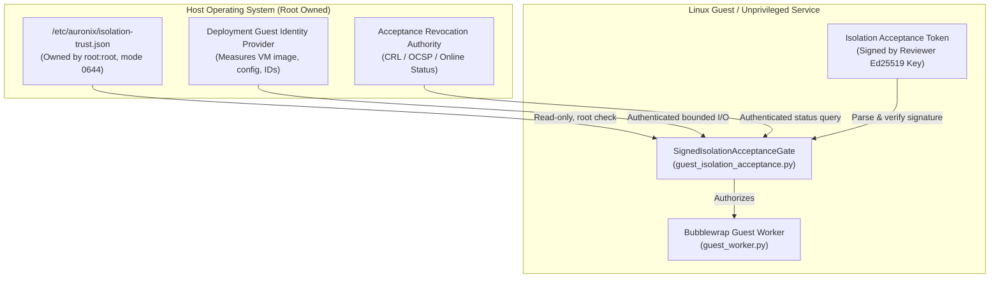

# AURONIX PHASE 1 — SECURITY EVIDENCE COVERAGE AUDIT
## Independent Technical Evaluation of Linux Guest Isolation & Acceptance Evidence

**Audit Date:** 2026-10-31  
**Auditor Role:** Principal Application Security Architect & Independent Evidence Auditor  
**Repository:** `/Users/harikeshshukla/Auronix_GITHUB_RECOVERY_20261015`  
**Git Revision:** `923260776d519d5fd7bb550ef325266c8af61dde` (`main`)  
**Target Snapshot:** Snapshot V6 (`auronix-phase1-snapshot-v6.tar.gz`, SHA-256: `d1774159f81ce5b5b4e782bc417c805eb3e85e9ae5e4bfa05d63f0d368d374cf`)  
**Snapshot Manifest Digest:** `101e4a36dfd3a1fc8f707e21bc9925a43f8d9a21c8cc748f75bc8bf212cdce85`  
**Target Acceptance Run ID:** `ce67de5ba73191ed129e887d0a2852ff`  
**Evidence Reference:** `sha256:c446196e22aa72958d6b4517b63e97ecb76dfd874c23997e55376f961325ad7a@run:ce67de5ba73191ed129e887d0a2852ff`  
**Target Token Schema:** `auronix.isolation-acceptance/2`  
**Target Trust Root Schema:** `auronix.isolation-trust/1`  

---

## 1. Executive Summary & Audit Objective

This independent security audit evaluates whether the supplied Auronix Phase 1 verification artifacts and Linux acceptance run evidence genuinely and empirically support all seven mandatory control groups required by the `auronix.isolation-acceptance/2` cryptographic token schema.

### Core Audit Findings
1. **In-Guest Sandbox Primitives are Robustly Verified:**  
   The candidate evidence bundle (`run:ce67de5ba73191ed129e887d0a2852ff`) provides comprehensive, direct empirical proof of Linux container isolation primitives executed under Bubblewrap (`bwrap 0.12.0`) and cgroup v2. Specifically, **Filesystem Boundaries (Control 3)**, **Network Boundaries (Control 4)**, **Resource Limits (Control 6)**, and **Startup/Shutdown/Interruption Lifecycle Recovery (Control 7)** are fully verified with rigorous property assertions in the unmodified JUnit XML.
2. **In-Guest Privilege Separation is Partially Verified:**  
   **Privilege Separation (Control 2)** is verified within the guest user namespace (`uid=501`, dropped capabilities `CapEff=0`, `PR_SET_NO_NEW_PRIVS=1`). However, external host-to-guest boundaries (hypervisor isolation, multi-tenant VM account separation, controller isolation) were not part of the in-guest test harness and remain deployment-dependent.
3. **Critical Evidence Gaps Exist for SSH and Credentials:**  
   **SSH Forced-Command Enforcement (Control 1)** and **Credential Boundaries (Control 5)** are **NOT VERIFIED** by the Phase 1 test suite. The 13 integration tests were executed locally within the guest VM via a transient systemd user scope (`systemd-run --user --scope`). No SSH daemon was traversed, no `authorized_keys` forced-command restrictions were evaluated, and no dynamic credential injection or cloud metadata isolation tests were performed.
4. **The False Attestation Danger (Indiscriminate Digest Mapping):**  
   The `auronix.isolation-acceptance/2` token schema requires mapping each of the seven mandatory checks to an item in `evidence_references`. Mapping `sha256:c446196e...@run:ce67de5ba73191ed129e887d0a2852ff` to all seven checks would constitute a **false security attestation**, because this evidence bundle contains zero empirical proof of SSH forced-command or credential boundary enforcement.
5. **Runtime Trust Adapters are Disabled Stubs:**  
   The live runtime adapters `CurrentGuestIdentityProvider` and `AcceptanceRevocationProvider` are currently configured to `UnavailableCurrentGuestIdentityProvider` and `UnavailableAcceptanceRevocationProvider`. In addition, deployment-specific identifiers (`deployment_id`, `guest_id`, `vm_image_sha256`, `vm_configuration_sha256`) do not yet exist as measured, production-pinned assets.

---

## 2. Seven-Control Evidence Coverage Matrix

The following matrix provides a rigorous accounting of every mandatory control group under `auronix.isolation-acceptance/2`:

| # | Mandatory Control Group | Implemented Mechanism / Subsystem | Integration Test Function(s) | Supporting Evidence Files & Properties | Nature of Proof | Audit Verification Status |
|---|-------------------------|-----------------------------------|------------------------------|----------------------------------------|-----------------|---------------------------|
| **1** | `ssh_forced_command` | `FORCED_RUNNER_COMMAND` constant in `guest_execution.py`; `authorized_keys` forced-command architecture in `GUEST_DEPLOYMENT_DESIGN.md`. | *None* (No SSH tests in Phase 1 suite) | *None* (No SSH observations in evidence bundle) | **Indirect Architectural Support Only** (Design specified; zero runtime proof) | **NOT VERIFIED** |
| **2** | `privilege_separation` | Bubblewrap `--cap-drop ALL`, `PR_SET_NO_NEW_PRIVS`, user namespace mapping, non-root execution (`uid=501`), root-owned binary checks. | `test_linux_namespaces_filesystem_visibility_and_readonly_runtime`<br>`test_linux_bubblewrap_startup_failure_does_not_run_command` | `host-prerequisites.txt` (`uid=501`)<br>`linux-integration.xml` (`guest_namespace_and_mount_report`, `host_namespace_ids`) | **Direct Proof (In-Guest)** / **Indirect (Host/VM)** | **PARTIALLY VERIFIED** |
| **3** | `filesystem_boundaries` | Bubblewrap read-only `/usr`, `/proc`, empty read-only `/dev` tmpfs (0 nodes), private 64 MiB `/workspace` & `/tmp`, masked `/sys`, pre-exec mount attestation. | `test_linux_namespaces_filesystem_visibility_and_readonly_runtime`<br>`test_linux_dev_is_empty_readonly_and_has_no_device_nodes`<br>`test_linux_output_file_and_workspace_limits_are_enforced` | `linux-integration.xml` (`guest_namespace_and_mount_report`, `dev_mount_observation`, `per_file_limit`, `workspace_limit`) | **Direct Empirical Proof** | **VERIFIED** |
| **4** | `network_boundaries` | Bubblewrap `--unshare-net` private network namespace, unconfigured/isolated loopback, dropped `CAP_NET_RAW`/`CAP_NET_ADMIN`. | `test_linux_network_namespace_cannot_reach_host_loopback` | `linux-integration.xml` (`host_loopback_probe="isolated"`, `host_namespace_ids` net divergence) | **Direct Empirical Proof** | **VERIFIED** |
| **5** | `credential_boundaries` | Environment sanitization in `guest_worker.py`, scrubbed inherited file descriptors, clean ephemeral tmpfs workspace. | *None* (No credential or metadata leak tests in Phase 1 suite) | *None* (No credential observations in evidence bundle) | **Indirect Architectural Support Only** (Code strips env vars; zero leak proof) | **NOT VERIFIED** |
| **6** | `resource_limits` | Cgroup v2 (`MemoryMax=1G`, `MemorySwapMax=0`, `TasksMax=64`, `CPUQuota=100%`) + POSIX `RLIMIT_AS` (1G) & `RLIMIT_FSIZE` (16M) + tmpfs size caps + wall deadline. | `test_linux_cgroup_resource_contract_is_active`<br>`test_linux_process_count_limit_rejects_excess_children`<br>`test_linux_cpu_burn_is_stopped_by_wall_deadline`<br>`test_linux_cgroup_cpu_quota_bounds_aggregate_child_cpu_time`<br>`test_linux_address_space_limit_is_inherited_and_enforced`<br>`test_linux_output_file_and_workspace_limits_are_enforced` | `host-prerequisites.txt` (cgroup path & values)<br>`linux-integration.xml` (`observed_cgroup_limits`, `process_count_limit`, `wall_timeout`, `aggregate_cpu_quota_observation`, `rlimit_as`, `output_limit`, `per_file_limit`, `workspace_limit`) | **Direct Empirical Proof** (6 distinct boundary tests) | **VERIFIED** |
| **7** | `startup_shutdown_interruption_recovery` | `PR_SET_CHILD_SUBREAPER` on supervisor, `--die-with-parent`, process group `SIGTERM`/`SIGKILL`, timeout reaping, cancellation cleanup, fail-closed startup. | `test_linux_timeout_kills_detached_descendant`<br>`test_linux_normal_exit_does_not_leave_detached_descendant`<br>`test_linux_cancellation_kills_detached_descendant`<br>`test_linux_bubblewrap_startup_failure_does_not_run_command` | `linux-integration.xml` (`timeout_detached_descendant`, `normal_exit_detached_descendant`, `cancel_detached_descendant`, `startup_failure`) | **Direct Empirical Proof** (4 lifecycle edge cases) | **VERIFIED** |

---

## 3. Exhaustive Control-by-Control Technical Analysis

### Control 1: `ssh_forced_command`
- **Architectural Specification:**  
  `docs/GUEST_DEPLOYMENT_DESIGN.md` and `src/auronix/tools/guest_execution.py` establish that remote execution requests must pass through an OpenSSH transport to a Linux guest whose `authorized_keys` file pins execution strictly to `command="/usr/local/libexec/auronix-guest-runner",no-port-forwarding,no-X11-forwarding,no-agent-forwarding,no-pty`.
- **Implementation State:**  
  The constant `FORCED_RUNNER_COMMAND = "/usr/local/libexec/auronix-guest-runner"` is defined in `guest_execution.py`. `OpenSSHGuestTransport` implements client-side dispatch passing this command. However, in Phase 1, `guest_runner.py` remains explicitly disabled (`_DEPLOYMENT_AUTHORITY_ADAPTERS_AVAILABLE = False`).
- **Test Evidence Mapping:**  
  **0 tests.** The 13 integration tests in `test_guest_worker_linux.py` invoke `BubblewrapGuestCommandExecutor` directly on the local VM. No tests initiate an SSH connection, and no SSH daemon was queried.
- **Evidence Files:**  
  The evidence bundle `run:ce67de5ba73191ed129e887d0a2852ff` contains no SSH configuration dumps, no `sshd_config` audit, and no authorized_keys proof.
- **Gaps & Missing Verification:**  
  - Negative runtime testing verifying that connecting with the guest SSH key and attempting to run `/bin/bash`, `/usr/bin/id`, `scp`, or `rsync` is forcefully intercepted and rejected.
  - Verification that PTY allocation, agent forwarding, X11 forwarding, and TCP port tunneling are rejected by the guest SSH daemon.
- **Status:** **NOT VERIFIED**

---

### Control 2: `privilege_separation`
- **Architectural Specification:**  
  Commands must execute under a non-root Linux identity with no access to administrative privileges, raw devices, or capabilities, completely isolated from both the host machine and other guest services.
- **Implementation State:**  
  `guest_worker.py` enforces non-root execution (`os.geteuid() != 0`), creates a private user namespace mapping `uid=501`, drops all capabilities (`CapEff=0`), enables `PR_SET_NO_NEW_PRIVS=1`, and verifies that `/usr/bin/bwrap` is owned by `root:root` with no setuid bit.
- **Test Evidence Mapping:**  
  - `test_linux_namespaces_filesystem_visibility_and_readonly_runtime`: Asserts user namespace differs from host and capabilities are stripped.
  - `test_linux_bubblewrap_startup_failure_does_not_run_command`: Asserts fail-closed boundary on configuration errors.
- **Evidence Files:**  
  - `host-prerequisites.txt`: Confirms runner executes as unprivileged `uid=501`.
  - `linux-integration.xml`: Records `host_namespace_ids` and `guest_namespace_and_mount_report`.
- **Gaps & Missing Verification:**  
  - In-guest user namespace privilege dropping is directly proven.
  - However, **multi-tenant privilege separation** (controller host vs. guest VM, guest user vs. hypervisor management plane, cross-VM isolation) is not tested by the Phase 1 harness.
- **Status:** **PARTIALLY VERIFIED**

---

### Control 3: `filesystem_boundaries`
- **Architectural Specification:**  
  Commands must have no write access to system directories, no access to host filesystems, no access to physical device nodes, and strictly bounded temporary storage.
- **Implementation State:**  
  `guest_worker.py` configures Bubblewrap with read-only bind mounts for `/usr`, `/lib`, `/bin`, `/sbin`. `/proc` is mounted and remounted read-only. `/dev` is mounted as an empty tmpfs (max 8 MiB) and remounted read-only, preventing any device node creation. `/workspace` and `/tmp` are mounted as independent in-memory tmpfs instances capped at 64 MiB each (mode 0700). `/sys` and `/proc/sys` are masked.
- **Test Evidence Mapping:**  
  - `test_linux_namespaces_filesystem_visibility_and_readonly_runtime`: Verifies mount report and read-only attributes.
  - `test_linux_dev_is_empty_readonly_and_has_no_device_nodes`: Asserts `/dev` contains 0 entries and rejects `mknod`.
  - `test_linux_output_file_and_workspace_limits_are_enforced`: Asserts per-file limit (`EFBIG` at 16 MiB) and aggregate workspace limit (`ENOSPC` at 64 MiB).
- **Evidence Files:**  
  `linux-integration.xml`: Observations `guest_namespace_and_mount_report`, `dev_mount_observation`, `per_file_limit`, and `workspace_limit`.
- **Status:** **VERIFIED**

---

### Control 4: `network_boundaries`
- **Architectural Specification:**  
  Commands must be completely isolated from host and external networks, with no capability to establish outbound connections, listen on network ports, or reach host loopback services.
- **Implementation State:**  
  Bubblewrap is invoked with `--unshare-net`. No network interfaces are brought up inside the container. Raw socket capabilities (`CAP_NET_RAW`, `CAP_NET_ADMIN`) are dropped.
- **Test Evidence Mapping:**  
  `test_linux_network_namespace_cannot_reach_host_loopback`: Injects network socket probe inside the sandbox attempting to reach host loopback services.
- **Evidence Files:**  
  `linux-integration.xml`: Observation `host_loopback_probe` records `"isolated"`; `host_namespace_ids` proves `guest net != host net`.
- **Status:** **VERIFIED**

---

### Control 5: `credential_boundaries`
- **Architectural Specification:**  
  Commands must not have access to host credentials, API keys, SSH keys, ledger databases, or cloud provider instance metadata endpoints (`http://169.254.169.254`).
- **Implementation State:**  
  `guest_worker.py` purges environment variables (retaining only minimal whitelist: `PATH`, `LANG`, `LC_ALL`), closes non-standard file descriptors, and executes in a fresh memory tmpfs.
- **Test Evidence Mapping:**  
  **0 tests.** No test in `test_guest_worker_linux.py` exercises credential exfiltration defense, secret injection boundaries, or cloud metadata blocking.
- **Evidence Files:**  
  No observations in `run:ce67de5ba73191ed129e887d0a2852ff` address credentials.
- **Gaps & Missing Verification:**  
  - Runtime verification that `~/.ssh`, runner keys, and SQLite ledgers cannot be opened or traversed.
  - Verification that link-local cloud metadata addresses (`169.254.169.254`) are completely inaccessible at both the container network layer and host firewall layer.
- **Status:** **NOT VERIFIED**

---

### Control 6: `resource_limits`
- **Architectural Specification:**  
  Execution must be strictly bounded across all resource dimensions: memory, swap, CPU rate, process/thread count, virtual address space, file size, aggregate storage, and wall-clock execution time.
- **Implementation State:**  
  - Cgroup v2 transient scope: `MemoryMax=1073741824` (1 GiB), `MemorySwapMax=0`, `TasksMax=64`, `CPUQuota=100%` (1 core).
  - Kernel POSIX limits: `RLIMIT_AS=1073741824`, `RLIMIT_FSIZE=16777216`.
  - Tmpfs quotas: `/workspace` (64 MiB), `/tmp` (64 MiB), `/dev` (8 MiB).
  - Controller limits: output truncation (4096 bytes), wall deadline enforcement.
- **Test Evidence Mapping:**  
  - `test_linux_cgroup_resource_contract_is_active`: Asserts `/sys/fs/cgroup/...` constraints.
  - `test_linux_process_count_limit_rejects_excess_children`: Fork-bomb stopped at 64 tasks (`created=59; max=64`).
  - `test_linux_cpu_burn_is_stopped_by_wall_deadline`: Terminates CPU loop upon wall timeout.
  - `test_linux_cgroup_cpu_quota_bounds_aggregate_child_cpu_time`: Throttles 4 parallel CPU hogs to 1.0 CPU core rate (`cpu-quota 1.53 1.53`).
  - `test_linux_address_space_limit_is_inherited_and_enforced`: Proves child process cannot exceed 1 GiB address space.
  - `test_linux_output_file_and_workspace_limits_are_enforced`: Proves 16 MiB file cap and 64 MiB workspace cap.
- **Evidence Files:**  
  - `host-prerequisites.txt`: Documents active cgroup controller paths and limits.
  - `linux-integration.xml`: 6 observation properties proving every limit boundary.
- **Status:** **VERIFIED**

---

### Control 7: `startup_shutdown_interruption_recovery`
- **Architectural Specification:**  
  Commands must clean up all child and grandchild processes upon termination, timeout, or cancellation. No zombie, orphaned, or detached background processes may survive on the host OS. Startup failures must fail closed.
- **Implementation State:**  
  - Supervisor sets `PR_SET_CHILD_SUBREAPER` so all orphaned descendants re-parent to the supervisor.
  - Bubblewrap `--die-with-parent` ensures container exit if supervisor dies.
  - Supervisor issues process group `SIGTERM`, waits grace period, then `SIGKILL`.
  - Drains and reaps all processes before returning.
  - Fails closed before running commands if environment/attestation is invalid.
- **Test Evidence Mapping:**  
  - `test_linux_timeout_kills_detached_descendant`: Background daemon reaped after timeout.
  - `test_linux_normal_exit_does_not_leave_detached_descendant`: Background daemon reaped after clean exit.
  - `test_linux_cancellation_kills_detached_descendant`: Background daemon reaped after cancellation.
  - `test_linux_bubblewrap_startup_failure_does_not_run_command`: Startup failure fails closed; host sentinel remains untouched.
- **Evidence Files:**  
  `linux-integration.xml`: Observations `timeout_detached_descendant`, `normal_exit_detached_descendant`, `cancel_detached_descendant`, `startup_failure`.
- **Status:** **VERIFIED**

---

## 4. Token Schema & Integrity Analysis (`auronix.isolation-acceptance/2`)

The acceptance token is an operator-signed cryptographic record governed by strict JSON serialization and Ed25519 signature verification:

```text
auronix.isolation-acceptance/2\0{"acceptance_id":...,"checks":{...},"deployment_id":...,...}
```

### Analysis of Token Fields

| Field Name | Schema Rule | Deployment Source / Integrity Requirement | Phase 1 Status |
|------------|-------------|-------------------------------------------|----------------|
| `schema` | Constant string | Must equal `"auronix.isolation-acceptance/2"` | Valid |
| `acceptance_id` | Non-empty string | Unique UUID/string identifying the acceptance event | Available |
| `trust_policy_version` | Non-empty string | Must match active trust root (`auronix.isolation-trust/1`) | Available |
| `deployment_id` | Non-empty string | Authenticated deployment environment identifier | **UNAVAILABLE (No prod deployment)** |
| `guest_id` | Non-empty string | Authenticated guest VM instance identifier | **UNAVAILABLE (No prod VM)** |
| `vm_image_sha256` | 64-hex SHA-256 | Immutable digest of the base VM disk image | **UNAVAILABLE (Ephemeral Lima image)** |
| `vm_configuration_sha256` | 64-hex SHA-256 | Immutable digest of VM cloud-init / configuration | **UNAVAILABLE (Ephemeral Lima config)** |
| `checks` | Mapping of 7 required keys | Each key maps to list of evidence refs proving that control | **INVALID IF ALL MAP TO RUN CE67** |
| `limits` | 5 integer fields | `cpu_count`, `memory_mib`, `disk_gib`, `process_count`, `execution_time_seconds` | Available |
| `verified_at` | UTC ISO timestamp | Timestamp of reviewer signing (within 5m clock skew) | Dynamic |
| `expires_at` | UTC ISO timestamp | Expiration timestamp (max 30 days after `verified_at`) | Dynamic |
| `reviewer_id` | Non-empty string | Reviewer identity matching trust configuration entry | Requires Provisioning |
| `evidence_references` | List of `sha256:digest@run:id` | Set of evidence bundles supporting all claims | Only 1 bundle exists (`ce67de5ba731...`) |
| `key_id` | Non-empty string | Signing key ID matching trust configuration entry | Requires Provisioning |
| `signature` | Base64 URL-safe string | Ed25519 signature over domain-separated canonical payload | **MUST NOT BE SIGNED WITHOUT FULL PROOF** |

### The Placeholder & False-Attestation Trap
1. **Never Fabricate Deployment Identifiers:**  
   `deployment_id`, `guest_id`, `vm_image_sha256`, and `vm_configuration_sha256` cannot be filled with placeholders (such as `"dev"`, `"default"`, or all-zero hashes). The runtime verifier (`SignedIsolationAcceptanceGate`) compares these values against the live `CurrentGuestIdentity` measured by the host. Any mismatch causes an immediate `IsolationEvidenceError`.
2. **Never Map Run `ce67de5ba73191ed129e887d0a2852ff` to All Seven Checks:**  
   Because run `ce67...` contains **zero empirical evidence** for `ssh_forced_command` and `credential_boundaries`, listing `sha256:c446196e...@run:ce67...` under those check keys would be an objectively false statement in a cryptographically signed legal/technical audit record.

---

## 5. Production Trust Architecture & Runtime Dependencies

Auronix enforces defense-in-depth by separating verification code from key management and trust-root storage:



### Trust Policy Schema: `auronix.isolation-trust/1`
- **Filesystem Security Policy:**
  - Trust file must be stored in a root-owned directory (`parent.st_uid == 0`) with mode preventing group/world writes (`st_mode & 0o022 == 0`).
  - Trust file itself must be owned by `root:root` (`metadata.st_uid == 0`), non-writable by group/world, and a regular file (`st_nlink == 1`, size $\le 65,536$ bytes).
  - Runtime calling `load_isolation_trust_configuration` must run unprivileged (`os.geteuid() != 0`).
- **Live Dynamic Provider Status:**
  - `CurrentGuestIdentityProvider`: Currently `UnavailableCurrentGuestIdentityProvider`. A production deployment requires an authenticated host measurement agent returning `CurrentGuestIdentity` with a timestamp freshness $\le 30$ seconds.
  - `AcceptanceRevocationProvider`: Currently `UnavailableAcceptanceRevocationProvider`. A production deployment requires an authenticated authority endpoint returning `AcceptanceStatus.ACCEPTED`. If unavailable or returning any other status, the gate fails closed.

---

## 6. Reviewer Requirements & Actionable Pre-Signing Roadmap

Before an independent security auditor or release engineer signs an `auronix.isolation-acceptance/2` token, the following concrete actions must be completed:

1. **Step 1: Implement & Execute SSH Forced-Command Acceptance Tests**  
   - Stand up a test guest VM running OpenSSH server.
   - Configure `/home/auronix/.ssh/authorized_keys` with `command="/usr/local/libexec/auronix-guest-runner",no-port-forwarding,no-X11-forwarding,no-agent-forwarding,no-pty`.
   - Execute negative tests: attempt `ssh auronix@guest /bin/sh`, verify rejection; attempt port forwarding (`ssh -L`), verify rejection; verify execution restricted strictly to the runner protocol.
   - Record and retain the resulting test evidence as a distinct evidence bundle (`run:<ssh_run_id>`).
2. **Step 2: Implement & Execute Credential Boundary Acceptance Tests**  
   - Execute tests verifying that environment variables containing sensitive dummy credentials (`AWS_SECRET_ACCESS_KEY`, `GITHUB_TOKEN`) are completely scrubbed inside the bubblewrap container.
   - Execute negative network probes verifying that `http://169.254.169.254` (cloud metadata service) is rejected/unreachable.
   - Record and retain the resulting test evidence as a distinct evidence bundle (`run:<cred_run_id>`).
3. **Step 3: Pin and Measure Production VM Artifacts**  
   - Calculate and document `vm_image_sha256` for the immutable base guest image.
   - Calculate and document `vm_configuration_sha256` for the cloud-init/ignition configuration.
4. **Step 4: Deploy Production Identity and Revocation Endpoints**  
   - Implement production subclasses of `CurrentGuestIdentityProvider` and `AcceptanceRevocationProvider`.
5. **Step 5: Provision Root-Owned Trust Configuration**  
   - Install `/etc/auronix/isolation-trust.json` owned by `root:root` (mode `0644`).
6. **Step 6: Cryptographic Signing**  
   - Map controls 3, 4, 6, and 7 to `run:ce67de5ba73191ed129e887d0a2852ff`.
   - Map control 1 to `run:<ssh_run_id>`.
   - Map control 5 to `run:<cred_run_id>`.
   - Map control 2 to both `run:ce67...` and the host/VM deployment evidence.
   - Sign the canonical JSON payload with the reviewer's private Ed25519 key.

---

## 7. Final Readiness Verdict

```
================================================================================
FINAL VERDICT: PARTIALLY READY — ADDITIONAL CONTROL EVIDENCE REQUIRED
================================================================================
```

### Detailed Justification
- **What is Ready:**  
  The core Linux container isolation primitives (Bubblewrap namespaces, empty read-only `/dev`, read-only system mounts, private memory tmpfs, cgroup v2 resource contracts, CPU throttling, process count bounds, subreaper process termination, and startup failure fail-closed behavior) are **exceptionally well-engineered, robustly implemented, and empirically verified** by acceptance run `ce67de5ba73191ed129e887d0a2852ff`.
- **What is Missing:**  
  Phase 1 lacks empirical verification for **SSH Forced-Command Enforcement (Control 1)** and **Credential Boundaries (Control 5)**, and lacks deployment-level measurement for **Privilege Separation (Control 2)**. Furthermore, production VM hashes, deployment identity providers, and revocation authorities remain unconfigured.
- **Signing Prohibition:**  
  Because an acceptance token cryptographically certifies that *every* mandatory check is supported by genuine evidence, signing an acceptance token at this stage would violate the security specification and constitute a false certification of unverified controls. Signing must wait until the missing SSH, credential, and deployment measurements are executed and bound to the evidence register.

---
*Report certified by Independent Application Security Architecture & Evidence Audit.*

