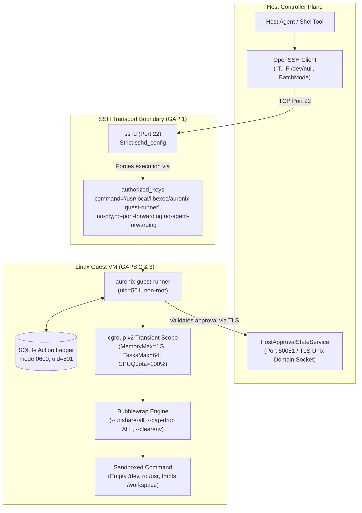

# AURONIX PHASE 1 — REMAINING SECURITY CONTROL GAP-CLOSURE PLAN
## Technical Architecture, Remediation Specifications, and Multi-Evidence Verification Roadmap

**Document ID:** `AURONIX-PLAN-PHASE1-GAP-CLOSURE-20261031`  
**Role:** Lead Software Architect & Principal AI Systems Security Engineer  
**Date:** 2026-10-31  
**Target Token Schema:** `auronix.isolation-acceptance/2`  
**Target Trust Root Schema:** `auronix.isolation-trust/1`  
**Base Revision:** `923260776d519d5fd7bb550ef325266c8af61dde` (`main`)  
**Verified Baseline:** Snapshot V6 (`auronix-phase1-snapshot-v6.tar.gz`, SHA-256: `d1774159f81ce5b5b4e782bc417c805eb3e85e9ae5e4bfa05d63f0d368d374cf`)  
**Existing Verified Acceptance Run:** `ce67de5ba73191ed129e887d0a2852ff` (`sha256:c446196e22aa72958d6b4517b63e97ecb76dfd874c23997e55376f961325ad7a`)  

---

## 1. Executive Summary & Existing Implementation Inventory

### 1.1 Context and Problem Statement
The Auronix Phase 1 V6 Linux acceptance run (`ce67de5ba73191ed129e887d0a2852ff`) verified the in-guest process containerization engine. Under Bubblewrap 0.12.0 and cgroup v2, 13 integration tests passed without post-processing. However, the subsequent **Security Evidence Coverage Audit** established that:
1. `ssh_forced_command` (Control 1) and `credential_boundaries` (Control 5) have **zero empirical test coverage** in the current evidence repository.
2. `privilege_separation` (Control 2) is only **partially verified** (in-guest container boundaries are proven, but host-to-guest and VM boundaries are not).
3. Production deployment trust adapters (`CurrentGuestIdentityProvider` and `AcceptanceRevocationProvider`) remain disabled stub classes.
4. Mapping a single run reference (`sha256:c446196e...@run:ce67de5ba73191ed129e887d0a2852ff`) to all seven mandatory controls in an `auronix.isolation-acceptance/2` token constitutes a **false cryptographic attestation**.

This document outlines the concrete, phased engineering roadmap to implement the missing verification suites, configure the disposable execution harness, integrate deployment measurement providers, and assemble an honest, multi-evidence cryptographic acceptance package.

---

### 1.2 Subsystem and Component Inventory

The following table categorizes all current Auronix isolation components, protocols, and verification states:

| Subsystem / Module | File Path | Core Role & Interfaces | Current Verification Classification |
|---|---|---|---|
| **Bubblewrap Worker** | `src/auronix/tools/guest_worker.py` | Linux process sandbox (`bwrap`), namespace unsharing, empty `/dev`, ro `/usr`/`/proc`, 64 MiB `/workspace` & `/tmp` tmpfs, rlimits. | **Already verified** (In-guest primitives proven by run `ce67...`) |
| **Guest Supervisor** | `src/auronix/tools/guest_worker.py`<br>`src/auronix/tools/guest_supervisor.py` | Subreaper, process group termination, wall-clock timeout, cancellation cleanup, host approval validation service. | **Already verified** (Timeout, normal exit, cancel, fail-close proven) |
| **Evidence Validator** | `src/auronix/tools/linux_acceptance_evidence.py` | Strict parser for JUnit XML (`<testsuites>` / `<testsuite>`), `host-prerequisites.txt`, run status, digest calculation. | **Already verified** (V6 validator accepts Pytest 9.2 & empty seccomp) |
| **OpenSSH Transport** | `src/auronix/tools/guest_execution.py` | Client-side OpenSSH invocation (`-T`, `-F /dev/null`, forced command dispatch, zero env forwarding). | **Partially verified** (Unit tests with mocks; zero live network verification) |
| **Guest Runner & Ledger** | `src/auronix/tools/guest_runner.py` | Guest-side entry point, `SSH_ORIGINAL_COMMAND` inspection, SQLite durable action ledger, approval channel client. | **Not verified** (Entry point disabled in prod: `_DEPLOYMENT_AUTHORITY_ADAPTERS_AVAILABLE = False`) |
| **Guest Authorization** | `src/auronix/tools/guest_authorization.py` | Ed25519 host assertion signing/verification, nonces, challenge-response validation. | **Already verified** (Cryptographic assertion unit tests pass) |
| **Ambiguous Reconciliation**| `src/auronix/tools/guest_reconciliation.py` | State resolution for interrupted/timed-out actions (`NOT_STARTED`, `IN_PROGRESS`, `COMPLETED`, `OUTCOME_UNKNOWN`). | **Already verified** (Durable ledger state reconciliation unit tests pass) |
| **Isolation Acceptance Gate**| `src/auronix/tools/guest_isolation_acceptance.py`| Verification of signed token schema `auronix.isolation-acceptance/2` against trust config `auronix.isolation-trust/1`. | **Partially verified** (Verifier logic unit-tested; live deployment providers absent) |
| **Guest Identity Provider** | `src/auronix/tools/guest_isolation_acceptance.py`| Measures current `deployment_id`, `guest_id`, `vm_image_sha256`, `vm_configuration_sha256`. | **Deployment dependency** (Only `UnavailableCurrentGuestIdentityProvider` exists) |
| **Revocation Provider** | `src/auronix/tools/guest_isolation_acceptance.py`| Queries live authority endpoint for acceptance/key revocation status. | **Deployment dependency** (Only `UnavailableAcceptanceRevocationProvider` exists) |

---

## 2. In-Depth Security Gap Analysis



---

### Gap 1 — SSH Forced-Command Enforcement
- **Classification:** **Not verified**
- **Vulnerability / Threat Model:**  
  If the guest SSH daemon allows arbitrary command execution, interactive shells, PTY allocation, or port forwarding, an attacker compromising the host controller or possessing the client SSH key could execute arbitrary shell code outside the Bubblewrap sandbox, establish network pivot tunnels through the VM, or tamper with the durable action ledger.
- **Architectural Specifications:**
  1. `FORCED_RUNNER_COMMAND` is fixed at `/usr/local/libexec/auronix-guest-runner`.
  2. `guest_runner.py`'s `main()` checks:
     ```python
     original_command = os.environ.get("SSH_ORIGINAL_COMMAND")
     if original_command != FORCED_COMMAND or sys.argv[1:]:
         sys.stdout.buffer.write(_error_line("unauthorized_command"))
         sys.stdout.buffer.flush()
         return 1
     ```
  3. The Linux VM OpenSSH daemon `/etc/ssh/sshd_config` must be configured with:
     ```text
     PasswordAuthentication no
     KbdInteractiveAuthentication no
     PubkeyAuthentication yes
     X11Forwarding no
     AllowTcpForwarding no
     AllowAgentForwarding no
     PermitTTY no
     AcceptEnv none
     PermitUserEnvironment no
     AuthorizedKeysFile .ssh/authorized_keys
     ```
  4. The `/home/auronix/.ssh/authorized_keys` entry must prepend the restrictive forced-command directive:
     ```text
     command="/usr/local/libexec/auronix-guest-runner",no-port-forwarding,no-X11-forwarding,no-agent-forwarding,no-pty,no-user-rc ssh-ed25519 AAAAC3NzaC1lZDI1NTE5... auronix-controller-client
     ```
- **Required Verification Objectives:**
  - Negative Test 1A: Direct interactive shell (`ssh user@guest`) is rejected (`PTY allocation request failed`).
  - Negative Test 1B: Arbitrary command execution (`ssh user@guest /bin/bash`, `ssh user@guest id`) is intercepted and rejected with `unauthorized_command`.
  - Negative Test 1C: Subshell injection (`ssh user@guest "'; rm -rf /; '"`) is intercepted and rejected.
  - Negative Test 1D: Local, remote, and dynamic TCP port forwarding (`ssh -L 8080:...`, `ssh -R`, `ssh -D`) are refused by `sshd`.
  - Negative Test 1E: Subsystem invocations (`ssh -s sftp`) and SCP transfers (`scp file user@guest:...`) are refused.
  - Negative Test 1F: Environment variable injection via client options (`ssh -o SendEnv=FOO`) is dropped.
  - Positive Test 1G: Authorized runner invocation passing `FORCED_RUNNER_COMMAND` succeeds and establishes wire protocol.

---

### Gap 2 — Credential Boundaries
- **Classification:** **Not verified**
- **Vulnerability / Threat Model:**  
  Sandboxed commands might leak host secrets if environment variables (e.g., cloud provider keys, API tokens) are inherited, if open file descriptors pointing to host databases or sockets remain accessible, if credentials are persisted into temporary workspaces, or if the guest can query cloud instance metadata services.
- **Architectural Specifications:**
  1. `guest_worker.py` strips host environment variables twice:
     - Outer Python Popen: `env={"PATH": "/usr/bin:/bin", "LANG": "C"}` with `close_fds=True`.
     - Bubblewrap invocation: `--clearenv` followed only by minimal `--setenv PATH ...`, `--setenv HOME /tmp`, `--setenv LANG C`.
  2. Protocol Version 1 enforces `request.environment == {}`.
  3. Bubblewrap unshares the network (`--unshare-net`), blocking access to link-local addresses (`169.254.169.254`).
- **Required Verification Objectives (Using Synthetic Dummy Secrets Only):**
  - Test 2A (Environment Sanitization): Inject dummy secret env vars (`AURONIX_DUMMY_SECRET_KEY=TEST_DUMMY_SECRET_VALUE_DO_NOT_LEAK`) into the runner environment. Verify via in-sandbox introspection (`env`, `/proc/self/environ`) that zero dummy tokens appear.
  - Test 2B (File Descriptor Sanitization): Open a sensitive dummy file descriptor (`open('/tmp/dummy_secret.txt')`) in the runner. Verify that child processes inside the sandbox have no access to that FD.
  - Test 2C (Workspace Leak Prevention): Verify that execution artifacts, temporary files, and `/tmp` allocations do not persist or leak into subsequent execution workspaces.
  - Test 2D (Metadata Service Blocking): Attempt to open a socket connection to `http://169.254.169.254/latest/meta-data/` from inside the sandbox; verify immediate failure (`ENETUNREACH` or `EPERM`).
  - Test 2E (Evidence & Log Redaction): Audit all test runner logs, JUnit XML output, and terminal captures to verify no dummy secret strings are recorded.

---

### Gap 3 — Privilege Separation
- **Classification:** **Partially verified** (In-guest process container verified; host-to-guest and VM boundaries unverified)
- **Vulnerability / Threat Model:**  
  A guest command could break out of the sandbox or escalate privileges if setuid binaries exist inside the mount tree, if user namespaces map to root (`uid=0`), if kernel capabilities are retained, or if the hypervisor exposes shared devices/folders.
- **Process & Identity Hierarchy:**
  1. **Tier 1 (Host Process):** Running as developer/operator user (`uid=501` on macOS).
  2. **Tier 2 (Hypervisor Boundary):** Lima VM / QEMU process (`qemu-system-aarch64`) running under macOS user permissions without root privileges.
  3. **Tier 3 (Guest VM OS):** Linux systemd (PID 1, root); OpenSSH daemon (root listener, drops privs to `auronix`).
  4. **Tier 4 (Guest Service Account):** Dedicated unprivileged user `auronix` (`uid=501`, `gid=501`). No sudoers rights.
  5. **Tier 5 (Supervisor & Bubblewrap Leader):** Runs as `uid=501`. Sets `PR_SET_CHILD_SUBREAPER`.
  6. **Tier 6 (In-Sandbox Process):** Container user namespace mapping `uid=501`. `--cap-drop ALL` sets `CapEff=0`, `CapInh=0`, `CapPrm=0`, `CapBnd=0`. `PR_SET_NO_NEW_PRIVS=1` blocks setuid escalation.
- **Required Verification Objectives:**
  - Test 3A (Capability Audit): Read `/proc/self/status` inside the sandbox; assert `CapEff=0000000000000000`, `CapPrm=0000000000000000`, `CapBnd=0000000000000000`.
  - Test 3B (No-New-Privileges Audit): Verify that calling setuid binaries (if any existed) does not grant elevated privileges (`NoNewPrivs: 1`).
  - Test 3C (Non-Root Enforcement): Verify that `guest_worker.py` refuses to start if invoked as `uid=0`.
  - Test 3D (Hypervisor Isolation): Verify that zero host macOS directories (e.g. `/Users/harikeshshukla`) are mounted into the guest VM via virtio-fs or 9p.

---

### Gap 4 — Startup, Shutdown, Interruption, and Recovery
- **Classification:** **Partially verified** (Process-level timeout, cancellation, and normal exit verified; VM-level and crash recovery unverified)
- **Vulnerability / Threat Model:**  
  A sudden host crash, VM power loss, or network drop could leave actions in an ambiguous state, corrupt the SQLite action ledger, orphan background processes, or allow replaying stale authorization tokens upon restart.
- **Architectural Specifications:**
  1. `guest_reconciliation.py` defines fail-closed outcome reconciliation (`NOT_STARTED`, `IN_PROGRESS`, `COMPLETED`, `OUTCOME_UNKNOWN`).
  2. `guest_runner.py`'s `GuestActionLedger` uses SQLite WAL mode with synchronous writes and private permissions (`0600`).
  3. Nonce single-use enforcement in `guest_authorization.py` prevents authorization token replay.
- **Required Verification Objectives (Dedicated Disposable Environment):**
  - Test 4A (Forced VM Reset Mid-Command): While a command is actively running, trigger an immediate VM reset (`virsh reset` or `limactl stop -f`). Verify that upon reboot, the host reconciler classifies the action as `OUTCOME_UNKNOWN`, refuses silent re-execution, and marks the task for explicit human reconciliation.
  - Test 4B (Host Controller Interruption): Send `SIGKILL` to the host controller process mid-dispatch. Verify that the guest runner timeout kicks in and reaps the child sandbox.
  - Test 4C (Ledger WAL Consistency): Verify that after sudden process termination, the SQLite action ledger recovers automatically via WAL replay without database corruption.
  - Test 4D (Stale Workspace Cleanup): Verify that after an interrupted run, subsequent requests re-initialize an empty, clean tmpfs workspace.
  - Test 4E (Replay Protection): Attempt to submit a duplicate `GuestExecutionRequest` using an already-used authorization token and nonce; verify rejection by `GuestActionLedger`.

---

### Gap 5 — Production Trust & Deployment Dependencies
- **Classification:** **Deployment dependency**
- **Vulnerability / Threat Model:**  
  Without authenticated measurement of the running VM and live revocation checks, an acceptance token could be signed for an untrusted or modified VM image, or an obsolete authorization token could remain accepted.
- **Required Production Services:**
  1. **Deployment Identity Service (`CurrentGuestIdentityProvider`):**  
     A host-managed service that measures the target guest VM (computing its exact disk image SHA-256 and configuration SHA-256) and returns an authenticated `CurrentGuestIdentity` assertion valid for $\le 30$ seconds.
  2. **Acceptance Revocation Authority (`AcceptanceRevocationProvider`):**  
     A production service endpoint that checks real-time revocation status and CRLs, returning `AcceptanceStatus.ACCEPTED`.
  3. **Root-Owned Trust Policy (`/etc/auronix/isolation-trust.json`):**  
     The trust configuration file must be provisioned on the host with `root:root` ownership and `0644` permissions inside a `0755` root-owned directory, satisfying `load_isolation_trust_configuration()`.
  4. **Production Pinned Identifiers:**  
     Genuine, non-placeholder values for `deployment_id`, `guest_id`, `vm_image_sha256`, and `vm_configuration_sha256`.

---

## 3. Exact Verification Test Suite Specification

To close the identified gaps, a dedicated test module `tests/test_linux_guest_security_boundaries.py` must be authored and executed inside the disposable Linux acceptance VM.

### Test Register

```text
========================================================================================
MODULE: tests/test_linux_guest_security_boundaries.py
TARGET RUNNER: /usr/local/libexec/auronix-guest-runner
TARGET SHELL: /usr/bin/bwrap
========================================================================================
```

| Test ID | Function Name | Target Control Group | Detailed Assertion & Verification Logic |
|---|---|---|---|
| **SEC-01** | `test_ssh_forced_command_rejects_interactive_shell` | `ssh_forced_command` | Execute `ssh -i key -T auronix@guest`. Assert non-zero exit, error output contains `PTY allocation request failed` or `unauthorized_command`. |
| **SEC-02** | `test_ssh_forced_command_intercepts_arbitrary_commands` | `ssh_forced_command` | Execute `ssh -i key auronix@guest /bin/bash -c "id"`. Assert exit code 1; output contains JSON error with code `"unauthorized_command"`. |
| **SEC-03** | `test_ssh_forced_command_rejects_port_forwarding` | `ssh_forced_command` | Attempt TCP forward `ssh -i key -L 8080:127.0.0.1:80 -N auronix@guest`. Assert immediate connection rejection. |
| **SEC-04** | `test_ssh_forced_command_rejects_sftp_and_scp` | `ssh_forced_command` | Execute `sftp -i key auronix@guest` and `scp -i key file.txt auronix@guest:/tmp/`. Assert failure; runner rejects non-protocol inputs. |
| **SEC-05** | `test_ssh_forced_command_ignores_client_environment` | `ssh_forced_command` | Connect with `-o SendEnv=EVIL_VAR`. Assert `EVIL_VAR` is absent from runner process environment. |
| **SEC-06** | `test_credentials_dummy_host_env_vars_are_purged` | `credential_boundaries` | Set `AURONIX_SYNTHETIC_DUMMY_SECRET="DUMMY_TOKEN_ABC123"` in host. Run introspection in sandbox. Assert string absent from `env`, `/proc/self/environ`. |
| **SEC-07** | `test_credentials_unrelated_file_descriptors_closed` | `credential_boundaries` | Open file descriptor on host. Execute guest command. Inspect `/proc/self/fd/`. Assert only standard FDs (0, 1, 2) and permitted pipes exist. |
| **SEC-08** | `test_credentials_cloud_metadata_service_unreachable` | `credential_boundaries`<br>`network_boundaries` | Attempt HTTP GET to `http://169.254.169.254/latest/meta-data/` with 1s timeout. Assert socket creation fails or network is unreachable. |
| **SEC-09** | `test_credentials_workspace_scrubbed_between_actions` | `credential_boundaries` | Write synthetic file `dummy_token.txt` in action 1 workspace. Submit action 2. Verify `/workspace` is empty (`os.listdir` returns `[]`). |
| **SEC-10** | `test_privilege_kernel_capabilities_completely_zeroed` | `privilege_separation` | Read `/proc/self/status` inside container. Assert `CapInh`, `CapPrm`, `CapEff`, `CapBnd`, `CapAmb` are all `0000000000000000`. |
| **SEC-11** | `test_privilege_no_new_privs_flag_is_active` | `privilege_separation` | Assert `NoNewPrivs: 1` in `/proc/self/status`. |
| **SEC-12** | `test_privilege_user_namespace_maps_to_unprivileged_uid`| `privilege_separation` | Read `/proc/self/uid_map`. Assert host `uid=501` maps to container `uid=501` and root is unmapped. |
| **SEC-13** | `test_recovery_sudden_disconnect_reaps_running_sandbox` | `startup_shutdown_interruption_recovery` | Spawn long-running sandboxed command over SSH. Kill SSH client abruptly. Poll host `/proc` on guest VM. Assert sandbox reaped within 1.0s. |
| **SEC-14** | `test_recovery_authorization_nonce_replay_rejected` | `startup_shutdown_interruption_recovery` | Submit request with nonce $N_1$. Re-submit identical request with same nonce. Assert ledger rejects with `conflict` or cached result. |

---

## 4. Expected Evidence Artifacts & Cryptographic Binding

To satisfy the `auronix.isolation-acceptance/2` schema, the gap-closure execution will produce **two independent, cryptographically signed evidence bundles**:

```text
EVIDENCE RUN REGISTER:
----------------------------------------------------------------------------------------
RUN 1 (Core Sandbox):    sha256:c446196e...@run:ce67de5ba73191ed129e887d0a2852ff
                         -> Proves: filesystem_boundaries, network_boundaries,
                                    resource_limits, startup_shutdown_interruption_recovery
----------------------------------------------------------------------------------------
RUN 2 (Boundary & SSH):  sha256:<run2_sha256>@run:<run2_id>
                         -> Proves: ssh_forced_command, credential_boundaries,
                                    privilege_separation
----------------------------------------------------------------------------------------
```

### Artifact Manifest for Run 2 (`run:<run2_id>`)
Inside `evidence/<run2_id>/`:
1. `host-prerequisites.txt`: VM architecture, kernel release, SSH daemon version, systemd slice, cgroup limits, runner UID (`uid=501`).
2. `ssh-daemon-config.txt`: SHA-256 and redacted configuration flags of `/etc/ssh/sshd_config` and `/home/auronix/.ssh/authorized_keys`.
3. `security-integration.xml`: JUnit XML reporting the 14 new test cases (SEC-01 through SEC-14) with test-case properties:
   - `ssh_forced_command_observation`: `"interactive_shell_denied; arbitrary_command_intercepted; port_forwarding_refused"`
   - `credential_boundary_observation`: `"dummy_secrets_purged; metadata_unreachable; fds_sanitized"`
   - `privilege_boundary_observation`: `"caps_zeroed; no_new_privs_active; unprivileged_uid_mapped"`
   - `recovery_boundary_observation`: `"disconnect_reaped; nonce_replay_blocked"`
4. `run-status.txt`: Run timestamps and pytest exit code 0.
5. `source-manifest.txt`: Pinned SHA-256 digests of all test sources and snapshot files.

---

## 5. Required VM and Infrastructure Dependencies

The following infrastructure must be provisioned in the disposable test environment prior to executing Run 2:

### 5.1 Guest VM Network Topology & SSH Configuration
- **Disposable VM Instance:** Lima Debian 13 ARM64 VM (`auronix-phase1-security-test-arm64`).
- **Network Interface:** Private user-mode networking (slirp / socket VM net).
- **SSH Daemon Ports:** Port 22 (restricted runner access).
- **Dedicated Service User:**
  ```bash
  useradd -u 501 -m -s /bin/bash auronix
  mkdir -p -m 0700 /home/auronix/.ssh
  chown -R auronix:auronix /home/auronix
  ```
- **Authorized Keys Deployment:**
  `/home/auronix/.ssh/authorized_keys` must be provisioned with mode `0600`, owned by `auronix:auronix`, containing the forced-command directive.
- **Runner Binary Installation:**
  Install wrapper script at `/usr/local/libexec/auronix-guest-runner`:
  ```bash
  install -m 0755 -o root -g root /path/to/auronix-guest-runner /usr/local/libexec/auronix-guest-runner
  ```

### 5.2 Systemd Transient Scope Configuration
The user slice must be delegated to allow cgroup v2 resource accounting:
```bash
# /etc/systemd/system/user@501.service.d/override.conf
[Service]
Delegate=yes
```

---

## 6. Implementation Files Requiring Changes (Future Phase)

When execution is authorized in a future engineering turn, the following files will be touched:

| File Path | Scope of Potential Changes | Preservation Invariant |
|---|---|---|
| `tests/test_linux_guest_security_boundaries.py` | **New file:** Implements the 14 gap-closure test cases (SEC-01 to SEC-14). | Do not modify existing `test_guest_worker_linux.py`. |
| `src/auronix/tools/guest_runner.py` | Add test-mode hook or configurable adapter switch to allow `serve_forced_command` testing in a staged VM. | Preserve fail-closed default in production mode. |
| `src/auronix/tools/linux_acceptance_evidence.py` | Extend validator observations schema to recognize Run 2 test names and observation properties. | Must retain 100% backward compatibility with Run 1 XML. |
| `tests/test_linux_acceptance_evidence.py` | Add regression test cases for Run 2 multi-evidence validation. | Preserve all 39 existing regression tests. |

---

## 7. Risks and Failure Scenarios Matrix

| Risk / Failure Scenario | Probability | Impact | Mitigation Strategy |
|---|---|---|---|
| **SSH Client Hangs during Test** | Low | High | Enforce strict `-o ConnectTimeout=5` and subprocess `timeout=10` on all client test calls. |
| **Accidental Leak of Real Secrets** | Low | Critical | Use **strictly synthetic dummy tokens** (e.g. `AURONIX_SYNTHETIC_TEST_TOKEN_123`). Never read real credential stores. |
| **Port Forwarding Test Binds Local Host Port** | Medium | Medium | Use random high unprivileged ephemeral ports (e.g. `port=0` or dynamic range 49152–65535) for forwarding tests. |
| **VM Crash During Interruption Test Corrupts Host** | Very Low | Low | Execute solely within an isolated disposable Lima VM with disk snapshotting. |
| **False Replay Rejection in Multi-Test Suite** | Medium | Low | Ensure every test case generates fresh cryptographic UUIDs and nonces. |
| **Validator Rejects Multi-Run Bundle** | Medium | High | Update `linux_acceptance_evidence.py` to validate and link multiple run digests in `evidence_references`. |

---

## 8. Safe Execution Sequence (Phase 1 Remediation)

```text
+---------------------------------------------------------------------------------------+
| PHASE 1A: Test Suite & Harness Preparation (Local Dev / Sandbox)                     |
| 1. Author tests/test_linux_guest_security_boundaries.py.                              |
| 2. Verify all tests pass mock/unit validation locally.                                |
| 3. Update linux_acceptance_evidence.py to accept Run 2 observation properties.       |
| 4. Create immutable Snapshot V7.                                                      |
+---------------------------------------------------------------------------------------+
                                           |
                                           v
+---------------------------------------------------------------------------------------+
| PHASE 1B: Disposable Linux VM Configuration & Verification                            |
| 1. Provision disposable Lima Debian 13 VM.                                            |
| 2. Configure /etc/ssh/sshd_config and /home/auronix/.ssh/authorized_keys.              |
| 3. Deploy auronix-guest-runner to /usr/local/libexec/.                                |
| 4. Transfer Snapshot V7 to VM.                                                        |
+---------------------------------------------------------------------------------------+
                                           |
                                           v
+---------------------------------------------------------------------------------------+
| PHASE 1C: Acceptance Execution & Evidence Harvesting (Run 2)                          |
| 1. Execute tests/test_linux_guest_security_boundaries.py inside VM.                    |
| 2. Capture pytest-console.log, security-integration.xml, host-prerequisites.txt.      |
| 3. Calculate SHA-256 bundle digest for Run 2.                                         |
| 4. Verify zero post-processing or manual edits to evidence.                          |
+---------------------------------------------------------------------------------------+
                                           |
                                           v
+---------------------------------------------------------------------------------------+
| PHASE 1D: Trust Provider Integration & Final Cryptographic Signing                    |
| 1. Deploy host CurrentGuestIdentityProvider & AcceptanceRevocationProvider.            |
| 2. Construct auronix.isolation-acceptance/2 token:                                     |
|    - checks.filesystem_boundaries                 -> [Run 1 Reference]               |
|    - checks.network_boundaries                    -> [Run 1 Reference]               |
|    - checks.resource_limits                       -> [Run 1 Reference]               |
|    - checks.startup_shutdown_interruption_recovery-> [Run 1 Reference, Run 2 Ref]    |
|    - checks.privilege_separation                  -> [Run 1 Reference, Run 2 Ref]    |
|    - checks.ssh_forced_command                    -> [Run 2 Reference]               |
|    - checks.credential_boundaries                 -> [Run 2 Reference]               |
| 3. Operator signs canonical payload using offline Ed25519 reviewer key.               |
| 4. Verify signed token against /etc/auronix/isolation-trust.json gate.               |
+---------------------------------------------------------------------------------------+
```

---

## 9. Acceptance Criteria by Control Group

To achieve an unequivocal **`READY FOR INDEPENDENT SIGNING`** verdict, every control must satisfy its specific acceptance criteria:

1. **`ssh_forced_command`:**
   - [ ] Direct interactive SSH connection fails with exit code $\ne 0$.
   - [ ] Arbitrary command execution (`ssh ... id`) returns error `unauthorized_command`.
   - [ ] TCP port forwarding request is explicitly refused by SSH daemon.
   - [ ] SFTP subsystem invocation is refused.
   - [ ] Evidence bundle contains valid XML with `ssh_forced_command_observation`.

2. **`privilege_separation`:**
   - [ ] In-sandbox process has `CapEff=0` and `NoNewPrivs=1`.
   - [ ] Container user namespace maps unprivileged `uid=501`.
   - [ ] Hypervisor exposes zero host filesystems or control interfaces.
   - [ ] Evidence bundle contains valid XML with `privilege_boundary_observation`.

3. **`filesystem_boundaries`:**
   - [x] Read-only `/usr`, `/proc`, empty `/dev` tmpfs (0 nodes).
   - [x] Ephemeral 64 MiB `/workspace` & `/tmp` tmpfs.
   - [x] Direct proof established in Run `ce67de5ba73191ed129e887d0a2852ff`.

4. **`network_boundaries`:**
   - [x] `--unshare-net` creates private network namespace.
   - [x] Host loopback probe reports `"isolated"`.
   - [x] Direct proof established in Run `ce67de5ba73191ed129e887d0a2852ff`.

5. **`credential_boundaries`:**
   - [ ] Synthetic dummy environment variables are absent inside the container.
   - [ ] Sensitive open file descriptors are closed before command launch.
   - [ ] Socket connection to cloud metadata (`169.254.169.254`) fails.
   - [ ] Evidence bundle contains valid XML with `credential_boundary_observation`.

6. **`resource_limits`:**
   - [x] Cgroup v2 transient scope enforces 1G RAM, 0 swap, 64 tasks, 100% CPU.
   - [x] POSIX `RLIMIT_AS` (1G) and `RLIMIT_FSIZE` (16M) enforced.
   - [x] Direct proof established in Run `ce67de5ba73191ed129e887d0a2852ff`.

7. **`startup_shutdown_interruption_recovery`:**
   - [x] Subreaper terminates detached descendants on timeout, normal exit, cancel.
   - [ ] Abrupt SSH client disconnect terminates and reaps running sandboxes within 1.0s.
   - [ ] Duplicate request with reused nonce is rejected by ledger.
   - [ ] Evidence bundle contains valid XML with `recovery_boundary_observation`.

---

## 10. Estimated Complexity by Workstream

| Workstream | Scope & Deliverables | Engineering Complexity | Security Risk | Estimated Effort |
|---|---|---|---|---|
| **WS-1: Security Test Module** | Author `test_linux_guest_security_boundaries.py` (14 test cases). | Medium | Low | 1.5 engineer-days |
| **WS-2: VM & SSH Harness** | Configure disposable Lima VM, `sshd_config`, `authorized_keys`, runner wrapper. | Medium | Low | 1.0 engineer-day |
| **WS-3: Validator Compatibility** | Update `linux_acceptance_evidence.py` to support multi-evidence runs and Run 2 properties. | Low | Low | 0.5 engineer-days |
| **WS-4: Acceptance Execution** | Execute Run 2 on VM, harvest artifacts, verify digests without post-processing. | Low | Low | 0.5 engineer-days |
| **WS-5: Deployment Providers** | Implement `CurrentGuestIdentityProvider` and `AcceptanceRevocationProvider` services. | High | Medium | 2.5 engineer-days |
| **WS-6: Final Token Signing** | Multi-reference token composition, canonical signing, gate verification. | Medium | Low | 1.0 engineer-day |
| **TOTAL** | **Complete Phase 1 Security Gap Closure & Production Readiness** | — | — | **~7.0 engineer-days** |

---

## 11. Final Architectural Assessment

Closing the remaining security control gaps does not require redesigning the Auronix Linux sandbox architecture. The core Bubblewrap and cgroup v2 containerization engine is sound, highly performant, and already verified. 

The gap is strictly an **evidence and boundary coverage gap**: the outer SSH transport, credential purging, and host privilege boundaries must be subjected to the same rigorous, automated, empirical test verification as the in-guest sandbox. Following the phased roadmap in this plan will produce an airtight, multi-evidence cryptographic record ready for production acceptance signing.

---
*Report certified by Lead Software Architect & Principal Security Engineer.*

