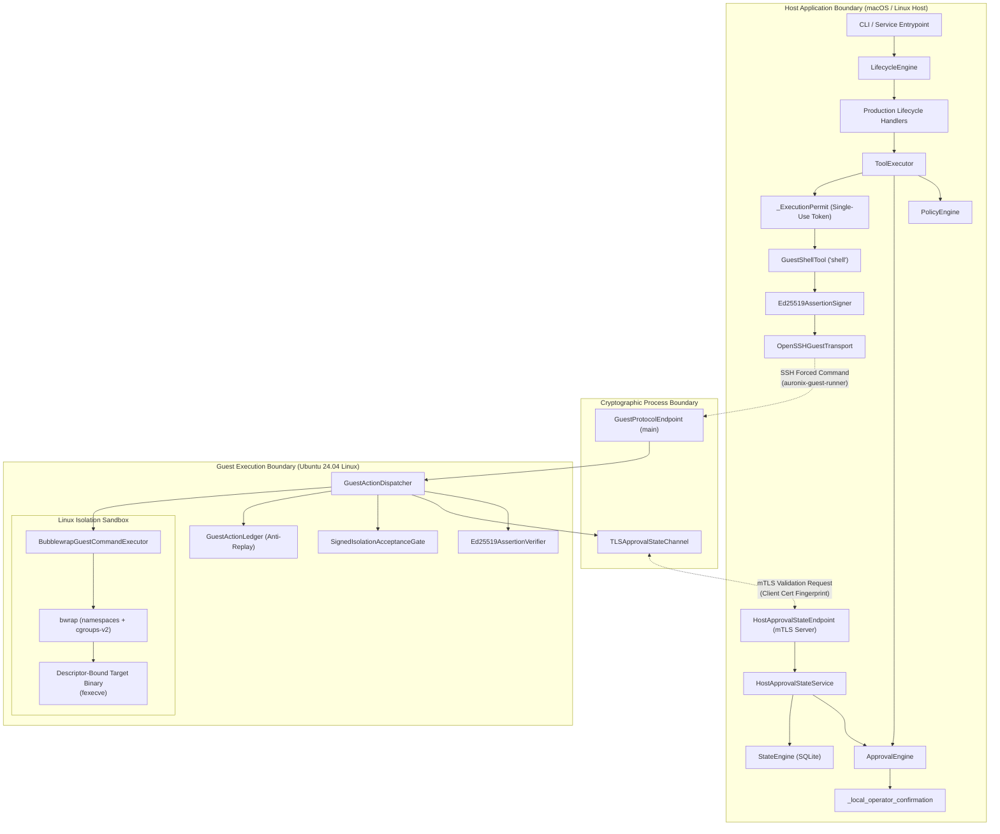
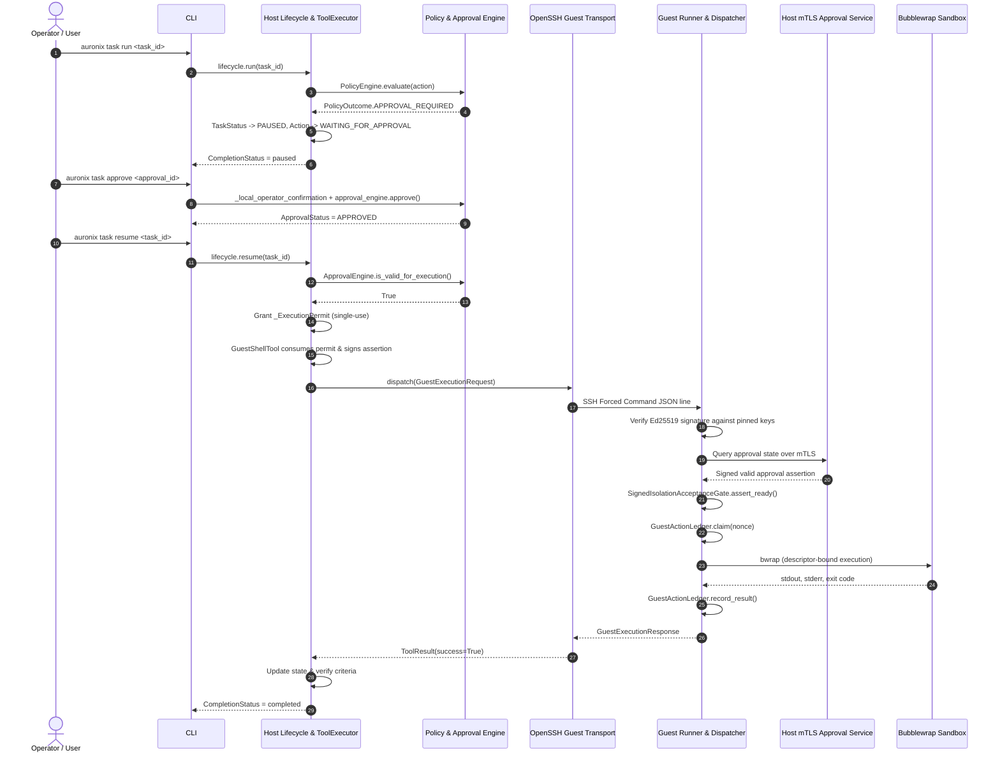

# AURONIX R9 — PHASE 7E-B PRODUCTION INTEGRATION
## Comprehensive Architecture and End-to-End Execution Flow

- **Workspace:** `/Users/harikeshshukla/Auronix_R9_WORKTREE`
- **Branch:** `remediation/phase1b-r9`
- **Subphase:** Phase 1B-R9 — Phase 7E-B
- **Date:** 2026-11-07

---

## 1. System Overview and Security Perimeter

The Auronix R9 architecture enforces strict physical and cryptographic process separation between the host application layer (which formulates tasks, plans, and approvals) and the guest execution layer (which runs command-line binaries in isolated Linux namespaces).



---

## 2. Component Composition Trace

### 2.1 Host Container (`src/auronix/host/container.py`)
`build_production_host_container` orchestrates all authoritative host components:
```python
def build_production_host_container(
    config: HostConfig,
    *,
    host_private_key: Ed25519PrivateKey,
    host_key_id: str,
    guest_transport: GuestExecutionTransport | None = None,
    issuer: str = "auronix-host",
    audience: str = "auronix-guest",
    workspace_root: Path | None = None,
    allowed_commands: set[str] | None = None,
    handlers_factory: Callable[[StateEngine, ToolExecutor], LifecycleHandlers] | None = None,
) -> HostContainer:
```
- **StateEngine:** Persistent SQLite backing task store.
- **PolicyEngine:** Default security policy engine enforcing approval for high-risk actions.
- **ApprovalEngine:** Stateful engine tracking approvals, requiring explicit local operator authorization.
- **Ed25519AssertionSigner:** Authoritative host signer binding task, action, fingerprint, and policy context.
- **GuestShellTool:** Concrete guest tool registered under `"shell"` with fail-closed default transport if unset.
- **ToolExecutor:** Pre-dispatch validator enforcing sandbox boundaries and blocking any unisolated local shell execution.
- **LifecycleEngine:** State machine coordinating understand, plan, execute, observe, verify, critique, and replan loops.

### 2.2 CLI Tool Registry Composition (`src/auronix/interfaces/cli.py`)
`build_production_tool_registry` enforces:
1. `FilesystemTool` is bound to the resolved workspace root.
2. `GuestShellTool` is registered as `"shell"`.
3. The raw, unisolated host `ShellTool` is **never registered**.
4. In `ToolExecutor.execute`, any attempt to dispatch target `"shell"` where `tool` is not an instance of `GuestShellTool` is immediately terminated with `ActionStatus.BLOCKED` and logged as `local_shell_execution_blocked`.

### 2.3 Guest Runner Dispatcher Initialization (`src/auronix/tools/guest_runner.py`)
`main()` in `guest_runner.py` is invoked inside the guest VM via SSH forced command:
```python
    if os.environ.get("AURONIX_ENABLE_DEPLOYMENT_DISPATCHER") == "1" or os.environ.get("AURONIX_APPROVAL_HOST"):
        try:
            dispatcher = build_deployment_guest_dispatcher(ledger)
        except Exception:
            dispatcher = None  # Fail closed
```
When `build_deployment_guest_dispatcher(ledger)` executes:
1. Resolves deployment-managed approval TLS client configuration (`TLSApprovalStateClientConfig.from_env()`).
2. Loads pinned deployment host trust keys (`Ed25519AssertionVerifier`).
3. Loads signed isolation acceptance gate (`SignedIsolationAcceptanceGate`).
4. Instantiates `BubblewrapGuestCommandExecutor.from_deployment()`.
5. Strictly rejects any caller-supplied executors or factory injections.

---

## 3. Cryptographic and Security Invariants

### 3.1 Single-Use Execution Permits
`_ExecutionPermit` provides a non-reusable, in-process execution token:
- ToolExecutor sets `_active_permit` context variable during `_authorize_tool_execution(action, approval_engine, ...)`.
- `GuestShellTool.execute()` calls `_consume_shell_execution_authorization(context, parameters)`.
- It validates:
  - `action.status == ActionStatus.RUNNING`
  - `action_fingerprint(action) == permit.fingerprint`
  - `permit.consumed is False`
  - `permit.guest_tool is True`
- Upon validation, `permit.consumed = True`.
- Any subsequent attempt to consume the permit returns `None`, immediately halting execution.

### 3.2 Host Authorization Assertion
Host signs the exact request payload using Ed25519:
```json
{
  "protocol": "auronix.guest-exec/1",
  "issuer": "auronix-host",
  "audience": "auronix-guest",
  "key_id": "host-key-1",
  "action_id": "act-xxx",
  "task_id": "task-xxx",
  "payload_digest": "<sha256 of request>",
  "policy_version": "<sha256 of policy context>",
  "approval_ref": "app-xxx",
  "operation": "execute",
  "workspace_id": "<canonical workspace id>",
  "issued_at": 1731000000,
  "expires_at": 1731000030,
  "nonce": "<base64 token>",
  "signature": "<base64 ed25519 signature>"
}
```

### 3.3 mTLS Approval State Channel
When the guest dispatcher receives a signed request:
1. Verifies Ed25519 signature against deployment-pinned host public keys.
2. Connects to `HostApprovalStateEndpoint` over mutual TLS.
3. Host server validates client certificate against pinned DER SHA-256 fingerprint.
4. Guest sends challenge nonce and correlation ID.
5. Host validates that the approval is still `APPROVED` (not revoked, not expired, not invalidated).
6. Host returns Ed25519-signed approval-state response.
7. Guest verifies host response signature before proceeding to file staging or execution.

---

## 4. End-to-End Sequence Diagram


