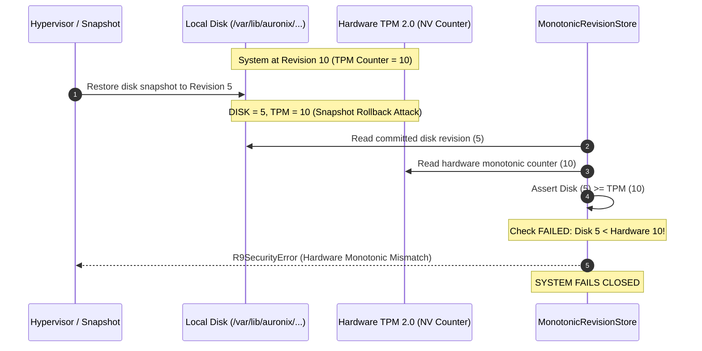
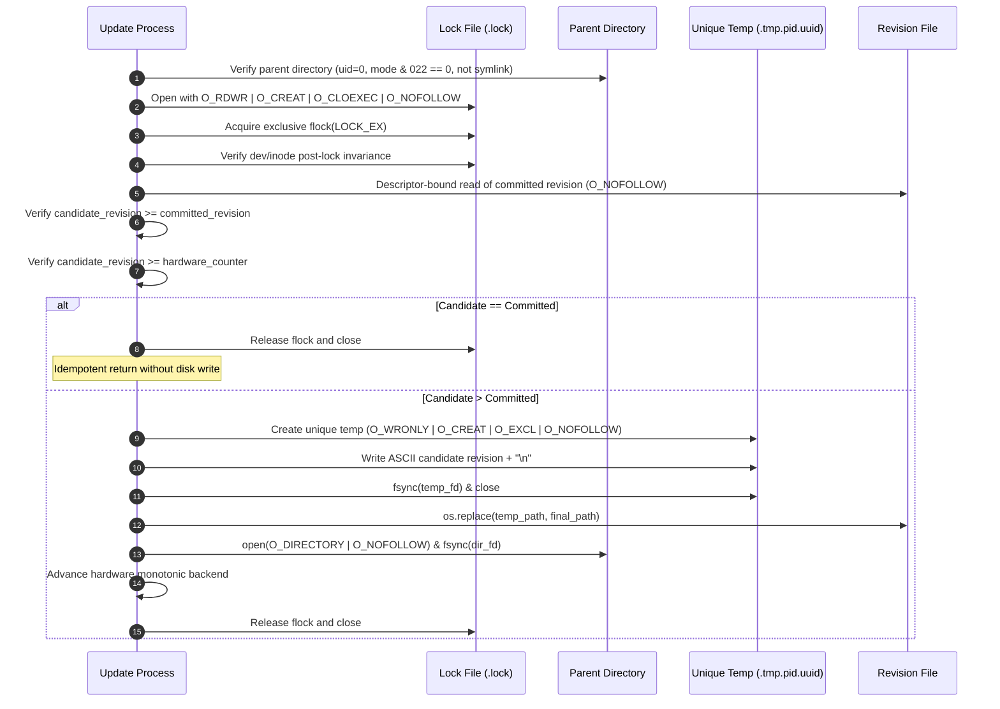

# Auronix Phase 1B-R9 — Phase 7E-C1: Trust State Design
## Monotonic Revision Store, Cadence Separation, and Hardware Attestation Architecture

```
Document Reference: AURONIX-P1B-R9-P7EC1-DES-001
Status: ACCEPTED FOR IMPLEMENTATION
Security Classification: HIGH INTEGRITY
Scope: Monotonic Revision Storage, Cadence Separation, Crash Safety & TPM Monotonic State
```

---

> [!WARNING]
> ### EXPLICIT STATEMENT OF PRODUCTION NON-READINESS
> Completion of Phase 7E-C1 delivers the verified, crash-safe `MonotonicRevisionStore` and pluggable `TPM20MonotonicCounterBackend`. However, **AURONIX R9 IS NOT READY FOR PRODUCTION**.
>
> Overall production readiness remains blocked pending:
> 1. **Phase 7E-C2**: Production Signing Key Lifecycle, Multi-Key Rotation, Emergency Revocation, and Monotonic Keyring Packaging.
> 2. **Phase 7E-C3**: Production HSM/KMS Root Authority Provisioning, TPM 2.0 Measured-Boot Attestation, and Mutual TLS mTLS Control Channel Integration.

---

## 1. Executive Summary

Phase 7E-C1 establishes the foundational tamper-resistant and rollback-proof monotonic state architecture for Auronix Phase 1B-R9. Prior to Phase 7E-C1, the system relied on an uncoordinated filesystem revision check without POSIX advisory locking, atomic directory fsync guarantees, symlink traversal prevention, or hardware monotonic binding.

Phase 7E-C1 resolves the core state durability and rollback questions:
1. **Cadence Separation:** Disentangles $R_{\text{keyring}}$ and $R_{\text{policy}}$ into independent monotonic revision tracks, matching their real-world administrative lifecycles.
2. **Hardware Counter Strategy:** Evaluates separate TPM NV counters versus a single global trust-generation counter, proving why a single global generation counter is structurally safer and more resilient against hypervisor snapshot rollbacks.
3. **Descriptor-Bound Atomicity:** Implements `MonotonicRevisionStore` utilizing POSIX advisory locking (`fcntl.flock`), `O_NOFOLLOW` descriptor pinning, unique PID/UUID temporary files, and dual data/parent directory `fsync` barriers.
4. **Pluggable TPM NV Integration:** Implements `TPM20MonotonicCounterBackend`, enforcing fail-closed semantics when physical or virtual TPM devices are unprovisioned, preventing hardcoded index security bypasses.

---

## 2. Revision Cadence Separation Analysis

### 2.1 The Problem with Coupled Revisions
If a single monotonic counter $R$ governs both the trusted keyring and the executable trust policy, every executable policy release (e.g., updating a binary digest or allowlisting a utility) forces a counter bump that invalidates older keyring envelopes, or vice versa.

In production:
* **Keyring Lifecycles ($R_{\text{keyring}}$):** Slow, deliberate, and high ceremony. Signing keys rotate annually or quarterly, or advance immediately during an emergency revocation.
* **Executable Policy Lifecycles ($R_{\text{policy}}$):** Fast, iterative, and operational. Binary patches, container recompilations, and tool additions advance policy revisions on a sprint or daily deployment cadence.

```mermaid
flowchart TD
    subgraph Root Authority [Root Authority Domain (Slow Cadence)]
        Anchor["authority.pub (Root Anchor)"]
        Keyring["trusted-keys.json (Keyring Envelope)"]
        RKeyring["keyring_revision (Monotonic Track 1)"]
        Anchor -->|Authenticates| Keyring
        Keyring -->|Enforces Monotonicity| RKeyring
    end

    subgraph Signing Authority [Signing Key Domain (Fast Cadence)]
        ActiveKey["Active Signer Key (e.g. signer-alpha)"]
        Keyring -->|Authorizes| ActiveKey
        Policy["policy.json (Executable Policy Envelope)"]
        ActiveKey -->|Authenticates| Policy
        RPolicy["revision (Monotonic Track 2)"]
        Policy -->|Enforces Monotonicity| RPolicy
    end
```

### 2.2 Independent Revision Files
Auronix provisions two distinct root-owned monotonic revision paths:
1. **Keyring Revision Path:** `/var/lib/auronix/executable-trust/keyring_revision`
   - Governed by root authority attestation.
   - Advances only upon signing key rotation, expiration, or revocation.
2. **Policy Revision Path:** `/var/lib/auronix/executable-trust/revision`
   - Governed by active delegated signing keys.
   - Advances upon changes to allowlisted executable ELF identities and revoked binary digests.

---

## 3. TPM NV Monotonic Counter Architecture

### 3.1 Separate TPM NV Counters vs. Single Global Trust-Generation Counter
We evaluated two competing hardware monotonic models:

| Dimension | Separate TPM NV Counters ($NV_{\text{keyring}}$, $NV_{\text{policy}}$) | Single Global Trust-Generation Counter ($G_{\text{TPM}}$) | Architectural Verdict |
|---|---|---|---|
| **TPM Resource Scarcity** | Consumes 2 NV indices (often constrained to 8–16 by platform policy). | Consumes 1 NV index (`0x01500001`). | **Single Global Counter Superior** |
| **Atomic Coordination** | TPM 2.0 cannot atomically increment two NV indices. A multi-counter update requires two independent round-trips susceptible to mid-flight failure. | Single atomic `TPM2_NV_Increment` command per trust transition. | **Single Global Counter Superior** |
| **Disk Snapshot Rollback Resistance** | Requires matching both counters independently. | $G_{\text{TPM}} \ge R_{\text{keyring}} + R_{\text{policy}}$ or sequential state generation. | **Single Global Counter Superior** |
| **Crash Durability** | Partial failure leaves disk and hardware out of phase across two indices. | Disk and single hardware index sync cleanly under a single monotonic assertion. | **Single Global Counter Superior** |

### 3.2 Hypervisor Disk Snapshot Threat Model
In virtualized or cloud guest environments, a malicious or compromised hypervisor operator can restore a virtual disk snapshot to an earlier timestamp $T_{\text{snapshot}} < T_{\text{current}}$, rolling back revoked keys or vulnerable binary digests.



### 3.3 Fail-Closed Pluggable Interface
The TPM interface is governed by `MonotonicHardwareBackend`:
```python
class MonotonicHardwareBackend(Protocol):
    def read_counter(self) -> int: ...
    def advance_counter(self, target: int) -> int: ...
```

In `TPM20MonotonicCounterBackend`:
- Does **NOT** hardcode an unprovisioned TPM index as active.
- Validates that `/dev/tpmrm0` (or configured device) exists and is accessible.
- If TPM hardware or the NV index is missing, corrupted, or unavailable, it **fails closed** with `R9SecurityError`.

---

## 4. Durability & Transaction Lifecycle

`MonotonicRevisionStore` guarantees crash consistency and race freedom across read, verify, and advance operations.



---

## 5. Crash Recovery Matrix

| Crash Point | Filesystem State | Recovery Behavior | Integrity Invariant |
|---|---|---|---|
| **Stage 0: Before Lock Acquisition** | Unmodified. | Next caller proceeds normally. | No state mutation occurred. |
| **Stage 1: Under Lock, Before Temp File** | Lock held; released automatically by kernel on process death. | Next caller acquires lock, reads unmutated state. | Clean recovery. |
| **Stage 2: During Temp File Write** | Temp file `.{name}.tmp.{pid}.{uuid}` partially written. | Temp file unlinked in `finally` or ignored on restart (unique name prevents collisions). Committed file unmutated. | Committed revision intact. |
| **Stage 3: After Temp File fsync, Before `os.replace`** | Temp file fully written and synced to non-volatile storage. Target unmutated. | Target remains original committed revision. Orphaned temp file unlinked or superseded. | Rollback impossible; original revision persists. |
| **Stage 4: After `os.replace`, Before Directory `fsync`** | Inode pointer atomically swapped in filesystem cache. | POSIX atomic rename semantics guarantee target is either 100% old revision or 100% new revision. Never torn or partial. | Inode swap atomicity guaranteed. |
| **Stage 5: After Directory `fsync`, Before TPM Increment** | Disk committed to $R_{\text{new}}$; TPM at $R_{\text{old}}$. | On next verification, `hw_counter < candidate_revision` is detected as a self-healing opportunity: hardware counter advances to match disk state. | Forward monotonicity preserved. |
| **Stage 6: After TPM Increment, Before Lock Release** | Both disk and hardware at $R_{\text{new}}$. | Lock released by kernel on process death. Next caller observes synchronized $R_{\text{new}}$. | Full convergence achieved. |

---

## 6. Security Analysis & Threat Boundaries

1. **Symlink and Path Traversal Resistance:**
   - Parent directory verified with `lstat`; directory cannot be a symlink (`stat.S_ISLNK` rejected).
   - All file openings employ `os.O_NOFOLLOW` and verify descriptor `fstat` dev/inode against pre-open `lstat`.
   - Temporary file creation utilizes `os.O_CREAT | os.O_EXCL | os.O_NOFOLLOW` with random UUIDs.
2. **Advisory Lock Exhaustion and Deadlock Resistance:**
   - Non-blocking lock attempts with 5-second deadline and backoff prevents indefinite hangs.
   - Shared locks (`fcntl.LOCK_SH`) allow concurrent readers without writer starvation.
3. **Data Corruption & Truncation:**
   - Any non-digit character, negative integer, leading minus, empty payload, or length > 19 digits fails closed with `R9SecurityError("Monotonic revision storage corrupted.")`.
4. **Read-Only / Unprivileged Execution:**
   - Guest workers verifying existing policies ($candidate == committed$) use shared read access without attempting write operations on root-owned directories.

