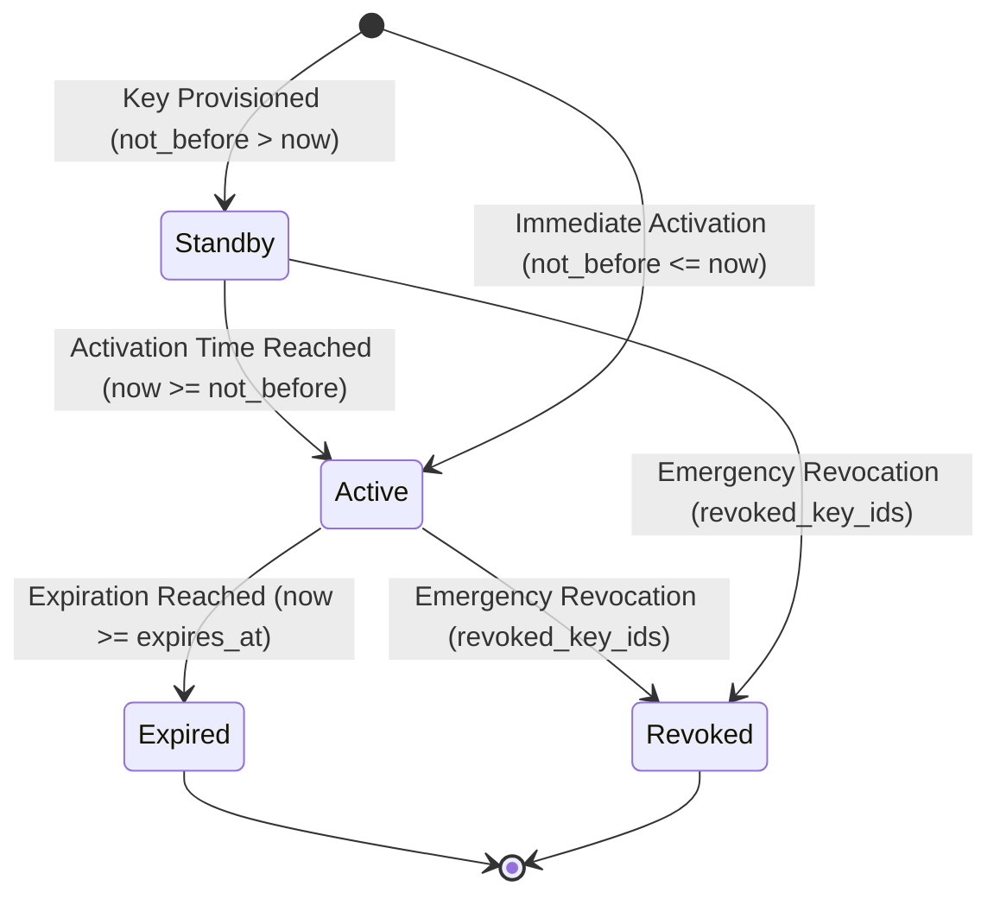
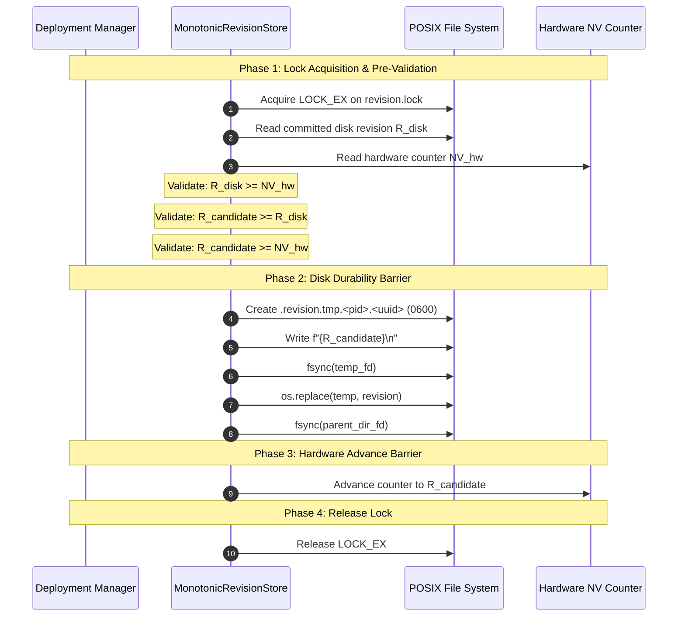

# AURONIX R9 — PHASE 7E-C2 IMPLEMENTATION PLAN
## Multi-Signing-Key Lifecycle, Independent Hardware Counters, & Coordinated Monotonic Transitions

```
Document Reference: AURONIX-P1B-R9-P7EC2-PLAN-001
Phase: 1B-R9 / Phase 7E-C2
Author: Lead Software Architect & Principal Security Engineer
Workspace: /Users/harikeshshukla/Auronix_R9_WORKTREE
Target Branch: remediation/phase1b-r9
Baseline: Phase 7E-C1 Independent Audit ACCEPTED WITH FINDINGS (1,198 passed)
Status: IMPLEMENTATION IN PROGRESS
```

---

> [!WARNING]
> ### FORMAL STATEMENT OF PRODUCTION NON-READINESS
> This engineering plan remediates the four audit findings from Phase 7E-C1 and implements multi-signing-key lifecycle management. However, **AURONIX R9 IS NOT READY FOR PRODUCTION**.
>
> Production readiness remains strictly blocked pending:
> 1. Complete implementation, multi-process testing, and independent audit of Phase 7E-C2.
> 2. **Phase 7E-C3**: Production HSM/KMS Root Authority Provisioning, Hardware TPM 2.0 Measured-Boot Attestation, and Mutual TLS Control Channel Integration.
> 3. **Physical TPM Hardware Verification**: Genuine TPM 2.0 NV counter operation on real silicon (software mocks do not prove silicon conformance).
>
> Deploying Auronix R9 into production prior to the implementation, provisioning, and independent audit of Phase 7E-C3 is strictly prohibited.

---

## 1. Executive Summary & Audit Finding Remediation

The Phase 7E-C1 independent adversarial security audit (`AURONIX_PHASE1B_R9_PHASE7E_C1_INDEPENDENT_AUDIT.md`) returned **ACCEPTED WITH FINDINGS** and identified four key architectural findings that must be remediated in Phase 7E-C2:

| Finding ID | Severity | Description | Phase 7E-C2 Remediation Strategy |
|---|---|---|---|
| **7E-C1-01** | **HIGH** | Compensatory rollback vulnerability in additive invariant $G_{\text{TPM}} \ge R_{\text{keyring}} + R_{\text{policy}}$. | Eliminate additive sum. Implement dual dedicated TPM NV counters ($NV_{\text{keyring}} \le R_{\text{keyring}} \land NV_{\text{policy}} \le R_{\text{policy}}$) and a unified, cryptographically bound trust-state transition tuple $(G, R_{\text{keyring}}, R_{\text{policy}})$. |
| **7E-C1-02** | **MEDIUM** | Hardware counter collision when sharing a single `MonotonicHardwareBackend` instance across decoupled stores. | Decouple `load_signed_executable_trust_policy_from_paths` parameters into distinct `keyring_hardware_backend` and `policy_hardware_backend`. |
| **7E-C1-03** | **LOW** | TPM CLI driver invokes commands without supporting authenticated hierarchy sessions (`-C`, `-P`, `-p`). | Extend `TPM20MonotonicCounterBackend` with protected auth handle, auth session, and descriptor/file-based credentials, avoiding command-line argv or environment variable leakage. |
| **7E-C1-04** | **INFO** | Concurrency testing relied on in-process threads under GIL rather than separate OS processes. | Add a dedicated multi-process test harness using `multiprocessing.Process` proving cross-process `fcntl.flock` mutual exclusion and crash safety. |

---

## 2. Mathematical Foundation & Rollback Defense

### 2.1 Formal Proof: Elimination of Compensatory Rollback

#### The Vulnerability in Additive Invariant:
In Phase 7E-C1, the proposed model $G_{\text{TPM}} \ge R_{\text{keyring}} + R_{\text{policy}}$ allowed an attacker who rolled back $R_{\text{keyring}}$ by $\delta$ to compensate by inflating $R_{\text{policy}}$ by $\ge \delta$, satisfying the invariant while reinstating a revoked key.

#### The Dual Dedicated Counter Invariant (Model A):
Let $NV_{\text{keyring}} \in \mathbb{N}^+$ and $NV_{\text{policy}} \in \mathbb{N}^+$ be independent TPM NV counters provisioned at distinct NV indices (e.g., `0x01800001` and `0x01800002`).

$$\text{Keyring Invariant: } R_{\text{candidate, keyring}} \ge R_{\text{committed, keyring}} \quad \land \quad R_{\text{candidate, keyring}} \ge NV_{\text{keyring}}$$
$$\text{Policy Invariant: } R_{\text{candidate, policy}} \ge R_{\text{committed, policy}} \quad \land \quad R_{\text{candidate, policy}} \ge NV_{\text{policy}}$$

**Theorem 1:** *Under Model A, no alteration of $R_{\text{policy}}$ or $NV_{\text{policy}}$ can compensate for a rollback of $R_{\text{keyring}}$.*
*Proof:* The domain of verification for $R_{\text{keyring}}$ depends strictly on $NV_{\text{keyring}}$. Because $\frac{\partial \text{KeyringCheck}}{\partial R_{\text{policy}}} = 0$ and $\frac{\partial \text{KeyringCheck}}{\partial NV_{\text{policy}}} = 0$, the verification checks are mathematically orthogonal. If an attacker restores a disk snapshot with $R_{\text{keyring}} < NV_{\text{keyring}}$, the keyring check fails closed immediately. $\blacksquare$

#### The Unified Monotonic State Transition Invariant (Model B):
For platforms where only a single TPM NV counter $G_{\text{TPM}}$ is allocated:
Let $S_t = (G_t, R_{k,t}, R_{p,t}, H_t)$ be the committed state tuple on disk, where $H_t = \text{HMAC-SHA256}(G_t \mathbin{\Vert} R_{k,t} \mathbin{\Vert} R_{p,t})$.

$$\text{Transition Rule: } S_t \to S_{t+1} \iff \begin{cases} 
R_{k,t+1} \ge R_{k,t} \\
R_{p,t+1} \ge R_{p,t} \\
(R_{k,t+1} > R_{k,t} \lor R_{p,t+1} > R_{p,t}) \implies G_{t+1} = G_t + 1 \\
R_{k,t+1} = R_{k,t} \land R_{p,t+1} = R_{p,t} \implies G_{t+1} = G_t \quad (\text{Idempotent}) \\
G_t \ge G_{\text{TPM}} \quad (\text{Pre-condition}) \\
G_{t+1} \ge G_{\text{TPM}} \quad (\text{Post-condition})
\end{cases}$$

**Theorem 2:** *Under Model B, snapshot rollback of either coordinate fails closed.*
*Proof:*
1. Suppose at $t_1$, state is $(G=6, R_k=2, R_p=10)$ with $G_{\text{TPM}}=6$.
2. Attacker restores disk snapshot to $t_0$ where state is $(G=5, R_k=1, R_p=10)$.
3. On boot/execution, the verifier checks precondition $G_t \ge G_{\text{TPM}}$: $5 \ge 6 \implies \text{FALSE}$.
4. The system fails closed immediately with `R9SecurityError("Trust state rollback detected: disk generation lags hardware counter")`.
5. The attacker cannot craft a forged disk state $(G=6, R_k=1, R_p=12)$ because:
   - Any valid transition from $t_0$ requires $R_k \ge R_{k, \text{committed}}$. But $R_{k, \text{committed}}$ was 2 in the true historical sequence.
   - If attempting to transition from the rolled-back snapshot $(5, 1, 10)$, the precondition check $5 \ge 6$ fails before any transition can be initiated. $\blacksquare$

---

## 3. Multi-Signing-Key Lifecycle Specification

### 3.1 Key Lifecycle State Machine
Each delegated signing key in `trusted-keys.json` transitions through well-defined lifecycle states:



### 3.2 Key Attributes & Verification Rules
1. **Identifier (`key_id`):** Strict ASCII string `^[A-Za-z0-9._-]{1,128}$`.
2. **Public Key (`public_key`):** Base64url-encoded raw 32-byte Ed25519 public key.
3. **Status (`state`):** Optional advisory string (`"active"`, `"standby"`).
4. **Activation Timestamp (`not_before`):** Integer UTC epoch timestamp. If `now < not_before`, key is rejected as not yet active.
5. **Expiration Timestamp (`expires_at`):** Integer UTC epoch timestamp. If `now >= expires_at`, key is rejected as expired.
6. **Revocation (`revoked_key_ids`):** Top-level array of key IDs. Any key whose ID appears in `revoked_key_ids` is disqualified unconditionally, superseding all timestamps or state attributes.

### 3.3 Key Rotation Protocol
1. **Stage 1 (Add Standby/Active Key):** Administrator provisions Key $K_{B}$ into `trusted-keys.json`. Sets $R_{\text{keyring}} \leftarrow R_{\text{keyring}} + 1$. Signs keyring with root private key. Both $K_A$ and $K_B$ are trusted.
2. **Stage 2 (Promote & Sign Policy):** Administrator creates `policy.json` signed with $K_B$. Sets $R_{\text{policy}} \leftarrow R_{\text{policy}} + 1$. Host verifies policy using $K_B$ from active keyring.
3. **Stage 3 (Retire/Revoke Old Key):** When $K_A$ reaches retirement, administrator moves $K_A$ to `revoked_key_ids` or sets `expires_at` in past. Sets $R_{\text{keyring}} \leftarrow R_{\text{keyring}} + 1$. Signs and deploys updated keyring.

---

## 4. Crash Durability & Commit Ordering Protocol

To guarantee consistency across disk and non-volatile hardware registers, updates MUST follow strict commit ordering:



### Crash Recovery Matrix:

| Crash Point | Disk State | Hardware State | Recovery Behavior |
|---|---|---|---|
| **Crash before `os.replace`** | $R_{\text{disk}}$ unchanged | $NV$ unchanged | Temp file cleaned up. System remains at previous valid revision. |
| **Crash between `os.replace` and dir fsync** | $R_{\text{disk}} = R_{\text{new}}$ | $NV = R_{\text{old}}$ | Journal replay ensures new revision on disk. On next verification, $R_{\text{disk}} \ge NV$ holds. Hardware counter is caught up to $R_{\text{disk}}$. |
| **Crash between dir fsync and TPM increment** | $R_{\text{disk}} = R_{\text{new}}$ | $NV = R_{\text{old}}$ | Disk is durable. Hardware counter lags disk ($R_{\text{disk}} > NV$). System detects valid forward state and advances hardware counter. |
| **Snapshot rollback after commit** | $R_{\text{disk}} = R_{\text{old}}$ | $NV = R_{\text{new}}$ | $R_{\text{disk}} < NV$. Monotonic check fails closed. Execution halted. |

---

## 5. Security & Verification Strategy

1. **Unit & Lifecycle Testing:**
   - Multi-key keyring parsing with active, standby, expired, and revoked keys.
   - Exact timestamp evaluation (`not_before`, `expires_at`).
   - Emergency revocation taking precedence over valid signatures.
   - Unknown key ID rejection.
2. **Decoupled Hardware Counters:**
   - Independent test verifying `keyring_hardware_backend` advances independently of `policy_hardware_backend` without collision.
3. **Authenticated TPM Invocation:**
   - Test verifying auth handle (`-C`) and protected auth file/session usage without argv leakage.
4. **Multi-Process Concurrency (`multiprocessing.Process`):**
   - True OS processes concurrently contending for exclusive locks.
   - Verification of monotonic increments, zero corruption, and crash tolerance.
5. **Full Regression Execution:**
   - Run 1,198+ Darwin unit/integration tests.
   - Run 52+ Linux VM acceptance tests under cgroups-v2 limits.

