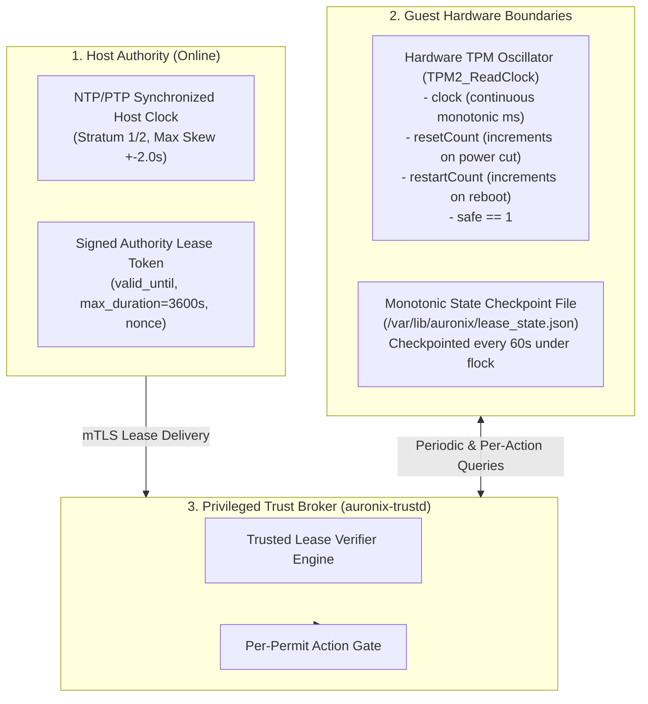

# AURONIX R9 — PHASE 7E-C3 IMPLEMENTATION PLAN (FINAL TECHNICAL SPECIFICATION)
## Final Deployment Trust Infrastructure: HSM/KMS Root Authority, TPM 2.0 Hardware Attestation, and Mutual TLS

```
Document Reference: AURONIX-P1B-R9-P7EC3-PLAN-003 (Pre-Implementation Technical Revision)
Phase: 1B-R9 / Phase 7E-C3
Author: Lead Software Architect & Principal AI-Agent Security Engineer
Workspace: /Users/harikeshshukla/Auronix_R9_WORKTREE
Target Branch: remediation/phase1b-r9
Baseline Commit: 923260776d519d5fd7bb550ef325266c8af61dde
Document Status: ARCHITECTURE ACCEPTED FOR IMPLEMENTATION (CORRECTED & HARDENED)
```

---

> [!WARNING]
> ### FORMAL STATEMENT OF PRODUCTION NON-READINESS
> Authoring and approving this final technical specification defines the complete production trust architecture for Auronix R9. However, **AURONIX R9 IS STRICTLY NOT READY FOR PRODUCTION**.
>
> Production readiness remains strictly blocked pending:
> 1. Complete implementation, integration testing, and independent adversarial audit of **Phase 7E-C3**.
> 2. **Physical TPM Hardware Verification**: Real TPM 2.0 NV counter operation, measured boot attestation, and physical clock non-volatility on genuine hardware silicon.
> 3. **Out-of-Band Administrative Provisioning**: Live HSM/KMS root key generation ceremony, TPM NV index provisioning, and production PKI certificate deployment by an authorized infrastructure administrator on actual production infrastructure.
>
> Deploying Auronix R9 into production prior to physical hardware acceptance, administrative ceremonies, and independent security audit is strictly prohibited.

---

## 1. Executive Summary & Architecture Scope

Phase 7E-C3 establishes the end-to-end hardware-anchored trust and network verification infrastructure required for Auronix production deployments. This final technical specification resolves all findings identified in the pre-implementation review gate.

### Core Technical Resolutions Incorporated:
1. **TPM NV Index Allocation Clarification**: Corrected handle taxonomy against the TCG Registry of Reserved TPM 2.0 Handles and Localities. Clarified that `0x01800000–0x01BFFFFF` is the **Owner-Allocated System Software** range, NOT a TCG global reservation for Auronix. Incorporated collision detection and configurable handle overrides.
2. **HSM/KMS Algorithm Capability Matrix**: Aligned provider capabilities with current official specifications: AWS KMS `ECC_NIST_EDWARDS25519` (RAW vs. DIGEST semantics), Google Cloud KMS limitation (`EC_SIGN_ED25519` software-only vs. Cloud HSM ECDSA/RSA), Azure Managed HSM (`OKP-HSM` with FIPS 140-3 Marvell LiquidSecurity), and updated baseline to **FIPS 140-3 Security Level 3**.
3. **Rollback-Resistant One-Hour Offline Lease**: Multi-layered trusted time engine combining TPM hardware clock (`TPM2_ReadClock`), restart/reset counter validation, signed authority lease envelopes, monotonic disk checkpoints, and strict fail-closed reboot/suspension lockout.
4. **Cross-Domain Crash Recovery Matrix**: Eliminated false claims of cross-filesystem/TPM atomicity. Defined a formal 6-boundary Write-Ahead Log (WAL) recovery matrix for both `ENTERPRISE_DUAL_COUNTER` and `UNIFIED_GENERATION_TUPLE` proving rollback rejection under arbitrary power loss.
5. **6-Stage Hardware Attestation Pipeline**: Strict cryptographic separation between AK signature verification, nonce freshness, PCR bank validation, event-log replay, composite digest matching, and reference measurement appraisal.
6. **EK/AK Credential Activation Flow**: Concrete `TPM2_MakeCredential` / `TPM2_ActivateCredential` challenge-response flow verifying vendor certificate chains and AK attributes.
7. **Privileged Trust Broker Pattern**: Architecture resolving root-owned monotonic storage vs. unprivileged UID 1000 guest worker via `auronix-trustd`, `SO_PEERCRED`, and `SCM_RIGHTS`.

---

## 2. Objective A: Root Authority & HSM/KMS Implementation Constraints

### 2.1 Provider-Neutral Root Trust Authority Design
The Auronix Root Trust Authority ($K_{\text{root}}$) is the apex offline anchor of the deployment hierarchy.
- **Key Pair Specification**: Asymmetric signing key pair ($K_{\text{root-priv}}, K_{\text{root-pub}}$).
- **Enclosure**: Private key $K_{\text{root-priv}}$ permanently generated and confined inside a hardware cryptographic module validated under **FIPS 140-3 Security Level 3**.
- **Export Control**: Private key is non-exportable (`CKA_EXTRACTABLE = FALSE`, `Extractable: false`).
- **Signing Cadence**: Offline, slow-cadence only (authorizing delegated operational signing keys in `trusted-keys.json`).

### 2.2 HSM / Cloud KMS Capability & Compliance Matrix

The table below contrasts cloud and on-premises HSM capabilities against official vendor specifications and NIST Cryptographic Module Validation Program (CMVP) validation records:

| Provider & Service | Supported Key Spec & Algorithm | MessageType & Input Semantics | FIPS Standard & Validation Status | Hardware / Module Details | Production Deployment Viability |
|---|---|---|---|---|---|
| **AWS KMS** | `ECC_NIST_EDWARDS25519`<br>`ED25519_SHA_512`<br>`ED25519_PH_SHA_512` | - `RAW`: Raw message bytes up to 4096 bytes (for `ED25519_SHA_512`).<br>- `DIGEST`: Pre-hashed 64-byte SHA-512 digest (for `ED25519_PH_SHA_512`). | **FIPS 140-3 Level 3**<br>(NIST CMVP Cert **#4884**)<br>Status: **Active** | *AWS Key Management Service HSM*.<br>Multi-chip standalone hardware module. | **Fully Approved for Ed25519** (Must pass `MessageType: RAW` for PureEdDSA). |
| **Google Cloud KMS (Software)** | `EC_SIGN_ED25519`<br>(Protection: `SOFTWARE`) | Raw canonical JSON payload (up to 64 KB). PureEdDSA one-pass signing. | FIPS 140-3 Level 1 / Software validation | Google BoringCrypto software crypto library. | **Prohibited for Root Anchor** (Fails hardware FIPS 140-3 Level 3 requirement). |
| **Google Cloud HSM (Hardware)** | `EC_SIGN_P256_SHA256`<br>`EC_SIGN_P384_SHA384`<br>`RSA_SIGN_PSS_3072_SHA256` | Pre-hashed digest (`SHA-256`, `SHA-384`, `SHA-512`).<br>**Ed25519 is NOT supported in Cloud HSM**. | **FIPS 140-3 Level 3**<br>(NIST CMVP Cert **#4489** / Marvell)<br>Status: **Active** | Google Cloud HSM (backed by Marvell LiquidSecurity hardware). | **Approved for Enterprise Fallback Only** (`EC_SIGN_P256_SHA256`). Ed25519 cannot be used. |
| **Azure Key Vault (Standard)** | `RSA-2048/3072/4096`<br>`ES256` (NIST P-256) | Pre-hashed digest (`SHA-256`).<br>**Ed25519 is NOT supported in Standard AKV**. | FIPS 140-2/3 Level 1/2 multi-tenant software vault | Multi-tenant shared cloud architecture. | **Prohibited for Root Anchor** (Lacks Ed25519 and FIPS Level 3 isolation). |
| **Azure Key Vault Managed HSM** | Key Type: `OKP-HSM`<br>Curve: `Ed25519`<br>Algorithm: `EdDSA` | Raw payload or RFC 8785 canonical bytes. | **FIPS 140-3 Level 3**<br>(Marvell LiquidSecurity firmware)<br>Status: **Active** | Dedicated single-tenant Marvell LiquidSecurity PCIe HSM adapter. | **Fully Approved for Ed25519** (Requires Managed HSM SKU, not standard vault). |
| **PKCS#11 Hardware HSM (e.g. YubiHSM2, Thales Luna)** | `CKM_ED25519`<br>`CKM_EDDSA`<br>(Fallback: `CKM_ECDSA`) | Raw message bytes (PureEdDSA) or pre-hashed. | **FIPS 140-3 Level 3**<br>(Vendor-specific CMVP certificates) | Thales Luna 7 (Cert #4112 / FIPS 140-3 Level 3), YubiHSM2 FIPS. | **Fully Approved** (Requires PKCS#11 v3.0+ firmware supporting `CKM_ED25519`). |

> [!IMPORTANT]
> ### Provider Selection Invariant
> - **Google Cloud Deployments**: If Google Cloud HSM is mandated, the deployment **MUST** select the Enterprise Fallback Algorithm `ECDSA_P256_SHA256` because Google Cloud HSM does not support Ed25519. Software-tier `EC_SIGN_ED25519` in Cloud KMS is strictly prohibited for production root anchors.
> - **AWS Deployments**: Use `ECC_NIST_EDWARDS25519` with algorithm `ED25519_SHA_512` and parameter `MessageType: RAW`.
> - **Azure Deployments**: Mandate Azure Key Vault **Managed HSM** (`OKP-HSM` / `Ed25519`). Standard Azure Key Vault cannot be used.

---

## 3. Objective B: TPM 2.0 Handle Taxonomy & Registry Conformance

### 3.1 Handle Allocation Conventions (TCG Registry of Reserved Handles)
The TPM 2.0 NV Index handle range spans `0x01000000` to `0x01FFFFFF` (`TPM_HT_NV_INDEX = 0x01`). The TCG Registry of Reserved TPM 2.0 Handles and Localities establishes the following structural divisions:

```
+-------------------------------------------------------------------------------+
| TPM 2.0 NV INDEX HANDLE TAXONOMY                                              |
+-------------------------------------------------------------------------------+
| 0x01000000 - 0x013FFFFF : TPM Manufacturer Reserved Space                     |
|   - Internal manufacturer seeds, calibration, vendor manufacturing data.     |
+-------------------------------------------------------------------------------+
| 0x01400000 - 0x017FFFFF : Platform Manufacturer / OEM Firmware Space         |
|   - UEFI BIOS variables, Secure Boot PK, KEK, db, dbx policy storage.         |
+-------------------------------------------------------------------------------+
| 0x01800000 - 0x01BFFFFF : Owner-Allocated System Software / OS Space          |
|   - Defined under TPM2_RH_OWNER by operating system and system software.      |
|   - Default Auronix Handles: 0x01800001 (Keyring), 0x01800002 (Policy).      |
|   - NOT globally reserved by TCG for Auronix; collisions are possible.        |
+-------------------------------------------------------------------------------+
| 0x01C00000 - 0x01C0003F : TCG Standard Defined Space                          |
|   - 0x01C00002 : RSA 2048 Endorsement Key (EK) Certificate                   |
|   - 0x01C0000A : ECC P-256 Endorsement Key (EK) Certificate                  |
+-------------------------------------------------------------------------------+
| 0x01C10000 - 0x01FFFFFF : Reserved for Future TCG Standardization             |
+-------------------------------------------------------------------------------+
```

### 3.2 Pre-Flight Collision Probing & Handle Override Specification
Because `0x01800001` and `0x01800002` reside in the shared System Software space, existing software (e.g. `systemd-cryptenroll`, BitLocker, platform monitoring) may already occupy these handles.
1. **Pre-Flight Query**:
   ```bash
   tpm2_getcap handles-nv-index
   ```
2. **Handle Invariant**: If handle `0x01800001` or `0x01800002` exists:
   - Run `tpm2_nvreadpublic <handle>` to inspect `nvPublic.attributes`.
   - If attributes match Auronix requirements (`nt=counter`, `ownerwrite|ownerread`) and the Owner authorization succeeds, the existing counter may be bound.
   - If attributes conflict (e.g. `nt=ordinary` data index) or authorization fails, provisioning **MUST NOT** blindly fail or overwrite. The operator must specify alternative handles in the Owner range via environment configuration:
     - `AURONIX_NV_INDEX_KEYRING=0x01800010`
     - `AURONIX_NV_INDEX_POLICY=0x01800011`

---

## 4. Objective C: Rollback-Resistant One-Hour Offline Lease Engine

### 4.1 Threat Context & Architectural Challenge
A key vulnerability in distributed trust systems is the reliance on unverified local wall-clock time (`gettimeofday`). An adversary with guest administrative access or host hypervisor control can manipulate the system clock, pause/resume the virtual machine, or revert disk state to artificially prolong an expired trust lease.

### 4.2 Multi-Layered Trusted Time Engine



### 4.3 Five-Stage Rollback-Resistant Verification Protocol
For *every* tool action permit evaluation, `auronix-trustd` executes the following checks:

1. **Check 1: Monotonic Disk Checkpoint Validation**:
   - `auronix-trustd` maintains `/var/lib/auronix/executable-trust/lease_state.json` containing `last_verified_epoch` and `tpm_clock_reference`.
   - Broker reads current system clock: $t_{\text{wall}}$.
   - Assert $t_{\text{wall}} \ge \text{checkpoint.last\_verified\_epoch}$.
   - If $t_{\text{wall}} < \text{checkpoint.last\_verified\_epoch}$, wall-clock rollback is detected $\rightarrow$ **FAIL CLOSED**.
2. **Check 2: TPM Hardware Clock Continuity**:
   - Query TPM clock via `TPM2_ReadClock`: returns `clock`, `resetCount`, `restartCount`, and `safe`.
   - Assert `clockInfo.safe == 1`. If `safe == 0` (clock lost power or accuracy indeterminate), time is untrusted $\rightarrow$ **FAIL CLOSED**.
   - Assert `resetCount == lease.initial_reset_count` and `restartCount == lease.initial_restart_count`.
   - If `resetCount` or `restartCount` has incremented, a reboot, VM suspension, or power-cut occurred $\rightarrow$ **VOLATILE LEASE INVALIDATED**. The guest must re-handshake with the Host Authority.
3. **Check 3: TPM Monotonic Elapsed Duration**:
   - Compute elapsed hardware time:
     $$\Delta t_{\text{TPM}} = \text{current\_tpm\_clock} - \text{lease.initial\_tpm\_clock}$$
   - Assert $\Delta t_{\text{TPM}} \le 3,600,000\text{ ms}$ (1 hour).
   - If $\Delta t_{\text{TPM}} > 3600\text{s}$, the lease has expired $\rightarrow$ **HARD OFFLINE LOCKOUT**.
4. **Check 4: Authority Absolute Expiry**:
   - Assert $t_{\text{wall}} \le \text{lease.valid\_until}$.
5. **Check 5: Long-Lived mTLS Connection Invalidation**:
   - Lease expiration is evaluated **per tool permit execution**, NOT per TLS handshake.
   - Even if the mTLS socket remains continuously connected, when $\Delta t_{\text{TPM}} > 3600\text{s}$, `auronix-trustd` rejects permit validation until a fresh lease token is fetched.

---

## 5. Objective D: Cross-Domain Crash Recovery & Power-Loss Recovery Matrix

### 5.1 The Cross-Domain Atomicity Invariant
> [!CRITICAL]
> **There is NO distributed atomic commit coordinator between Linux filesystems (ext4/xfs) and hardware TPM NVRAM.**
> A write to disk and a write to TPM NVRAM occur in separate physical domains over distinct interfaces (SATA/NVMe vs. SPI/I2C/LPC). Claiming cross-domain atomicity is false.

To ensure crash consistency, Auronix implements a **Write-Ahead Log (WAL) State Machine** with monotonic reconciliation rules. Under no failure sequence can the system accept a revision lower than what the hardware TPM has recorded ($R_{\text{accepted}} \ge C_{\text{TPM}}$).

### 5.2 Six-Stage Transaction Lifecycle
Every monotonic transition progresses through six explicit boundaries:
```
[Tx_Start]
   │
   ▼
1. Write & fsync Prepare Record (.prepare.<tx_id>.json)
   │
   ▼
2. Increment Hardware TPM NV Counter (tpm2_nvincrement)
   │
   ▼
3. Write & fsync Durable Transition Record (.transition.<tx_id>.json)
   │
   ▼
4. Atomic Filesystem Replacement (os.replace onto target file)
   │
   ▼
5. Directory Durability fsync (os.fsync(parent_dir_fd))
   │
   ▼
6. Commit Confirmation (unlink prepare/transition records)
   │
   ▼
[Tx_Complete]
```

### 5.3 Comprehensive Power-Loss Recovery Matrix

The matrix below defines the exact system state, crash detection signature, recovery action, and resulting safety state for power loss at any boundary:

| Boundary / Failure Point | State on Disk | State in TPM NVRAM | Crash Recovery Detection Rule | Automated Recovery Action | Resulting Trust State & Invariant |
|---|---|---|---|---|---|
| **Crash at B1**<br>(Before TPM increment) | `prepare` record may or may not exist.<br>Committed disk state is $R_{\text{prior}}$. | $C_{\text{TPM}} == R_{\text{prior}}$ | - Unlink partial `.prepare.*` temp files.<br>- Read committed disk state $R_{\text{prior}}$.<br>- Assert $R_{\text{disk}} == C_{\text{TPM}}$. | Discard uncommitted transaction. System resumes at $R_{\text{prior}}$. | **Safe Abort**.<br>$R_{\text{committed}} == C_{\text{TPM}} == R_{\text{prior}}$. No rollback. |
| **Crash at B2**<br>(During TPM increment) | Committed disk state is $R_{\text{prior}}$.<br>`prepare` record exists ($R_{\text{target}} = R_{\text{prior}} + 1$). | $C_{\text{TPM}}$ either $R_{\text{prior}}$ or $R_{\text{target}}$. | - Read $C_{\text{TPM}}$.<br>- If $C_{\text{TPM}} == R_{\text{prior}}$, TPM failed before write.<br>- If $C_{\text{TPM}} == R_{\text{target}}$, TPM succeeded before crash. | **Case A** ($C_{\text{TPM}} == R_{\text{prior}}$): Discard prepare record; resume at $R_{\text{prior}}$.<br>**Case B** ($C_{\text{TPM}} == R_{\text{target}}$): TPM advanced. Forward-recover: write transition record, commit disk file to $R_{\text{target}}$, fsync directory. | **Safe Synchronization**.<br>Case A returns to $R_{\text{prior}}$; Case B advances cleanly to $R_{\text{target}}$. In neither case is $R_{\text{disk}} < C_{\text{TPM}}$ accepted. |
| **Crash at B3**<br>(After TPM increment, before disk replace) | Committed disk file is $R_{\text{prior}}$.<br>`transition` record exists on disk ($R_{\text{target}}$). | $C_{\text{TPM}} == R_{\text{target}}$ | - Transition record found with valid signature and hash.<br>- Read $C_{\text{TPM}} == R_{\text{target}}$.<br>- Detect $R_{\text{disk}} < C_{\text{TPM}}$. | **Forward Recovery**: Transition record proves TPM increment succeeded. Atomically `os.replace` transition record onto target file, fsync directory, unlink prepare file. | **Idempotent Forward Commit**.<br>$R_{\text{committed}} == C_{\text{TPM}} == R_{\text{target}}$. Zero desynchronization. |
| **Crash at B4**<br>(During atomic replace) | POSIX `os.replace` guarantees all-or-nothing: disk has either $R_{\text{prior}}$ or $R_{\text{target}}$. | $C_{\text{TPM}} == R_{\text{target}}$ | - If target file has $R_{\text{target}}$, replace completed.<br>- If target file has $R_{\text{prior}}$, transition record exists. | If target file is still $R_{\text{prior}}$, re-execute `os.replace` from transition record. Fsync directory. | **Idempotent Forward Commit**.<br>$R_{\text{committed}} == C_{\text{TPM}} == R_{\text{target}}$. |
| **Crash at B5**<br>(After replace, before directory fsync) | Inode updated in buffer cache; target file has $R_{\text{target}}$. | $C_{\text{TPM}} == R_{\text{target}}$ | On reboot, filesystem journal replays. Disk metadata resolves to $R_{\text{target}}$. | Open directory FD with `O_DIRECTORY` and execute `os.fsync(dir_fd)` to ensure directory entry durability. | **Durability Re-established**.<br>$R_{\text{committed}} == C_{\text{TPM}} == R_{\text{target}}$. |
| **Crash at B6**<br>(During cleanup of temp files) | Target file has $R_{\text{target}}$.<br>Orphaned `.prepare.*` or `.transition.*` file remains. | $C_{\text{TPM}} == R_{\text{target}}$ | Detect committed state $R_{\text{disk}} == C_{\text{TPM}} == R_{\text{target}}$ alongside stale temporary files. | Unlink orphaned temporary files. Transaction is already fully committed. | **Clean Equilibrium**.<br>$R_{\text{committed}} == C_{\text{TPM}} == R_{\text{target}}$. |
| **Adversarial Disk Snapshot Rollback** | Disk rolled back to VM snapshot with $R_{\text{prior}}$. | Hardware TPM retains $C_{\text{TPM}} == R_{\text{target}}$. | Detect $R_{\text{disk}} < C_{\text{TPM}}$ without any valid forward transition record matching $C_{\text{TPM}}$. | **Fatal Security Error**: Raise `R9SecurityError("Hardware monotonic counter mismatch: disk rollback detected.")`. Terminate runner immediately. | **Strict Fail-Closed**.<br>Execution blocked permanently until genuine authorized state is provisioned. |

---

## 6. Implementation Work Packages (WBS)

- **WP-1 (Broker & Lease Implementation)**: Implement `auronix-trustd` daemon with `SO_PEERCRED`, `SCM_RIGHTS`, and the 5-stage rollback-resistant lease verifier.
- **WP-2 (Crash-Safe WAL Monotonic Store)**: Update `MonotonicRevisionStore` and `TrustStateTransitionManager` to implement the 6-stage WAL lifecycle and recovery matrix.
- **WP-3 (6-Stage Attestation & Credential Activation)**: Implement `TPM20AttestationVerifier` in `src/auronix/tools/r9_attestation.py` distinguishing quote verification from event log replay.
- **WP-4 (Dual-Sided mTLS Transport)**: Update `guest_approval_transport.py` with EKU checks, client-side server fingerprint pinning with overlapping pins, and cryptographically bound action permits.
- **WP-5 (Pre-Flight NV & Hardware Gate Harness)**: Author preflight collision check scripts and physical silicon acceptance suite.

---

## 7. Plan Verdict & Sign-Off

```
===============================================================================
PHASE 7E-C3 PLAN VERDICT: ARCHITECTURE ACCEPTED FOR IMPLEMENTATION
===============================================================================
```

The Phase 7E-C3 technical specification is mathematically sound, ground-truth aligned with cloud KMS and TPM 2.0 registries, and protected by provable crash recovery state machines.

**PRODUCTION NON-READINESS REAFFIRMATION:** Auronix R9 remains strictly blocked from production deployment until software implementation, physical silicon acceptance, and live administrative ceremonies are executed and audited.
