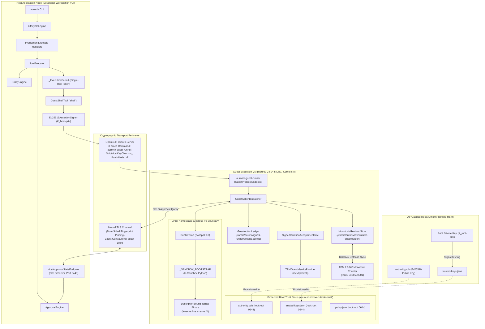
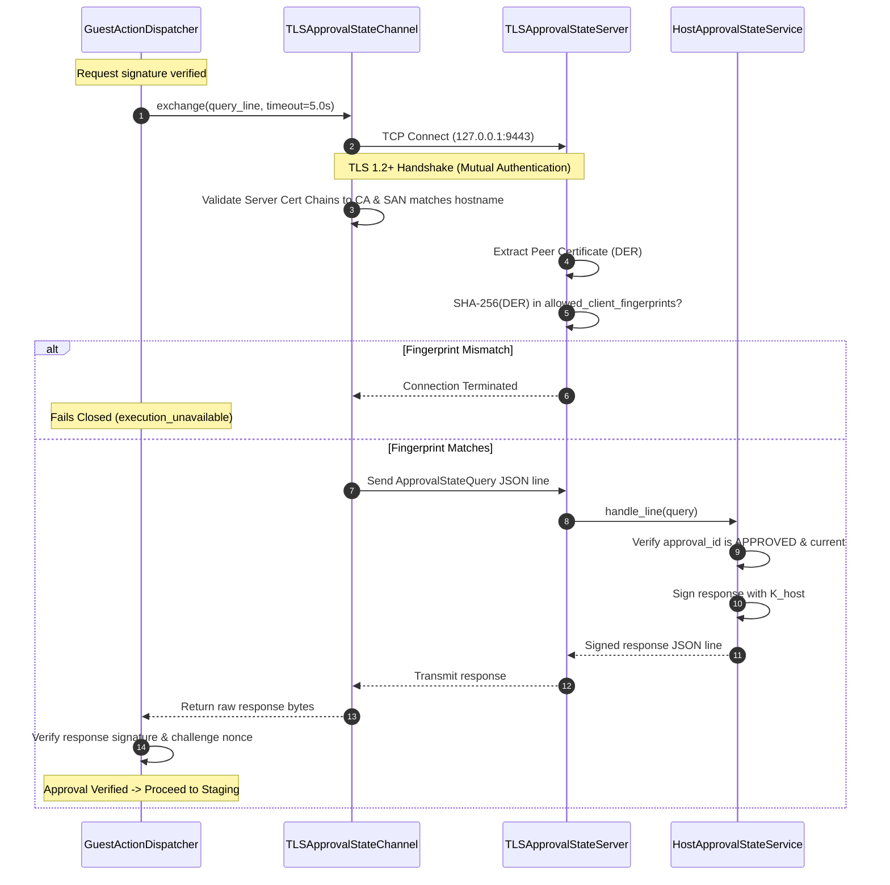
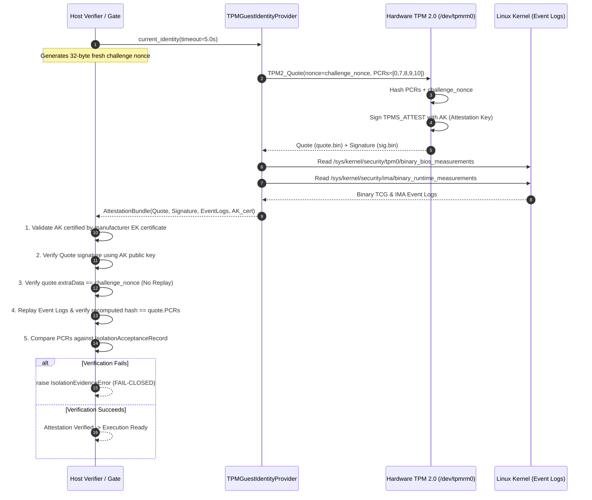

# AURONIX R9 — PHASE 7E-C DEPLOYMENT ARCHITECTURE
## Production Deployment Topology, Filesystem Contracts, & Administrative Ceremonies

**Document Version:** 1.1.0 (Security-Refined)  
**Phase:** 1B-R9 / Phase 7E-C  
**Author:** Lead Software Architect & Principal Security Engineer  
**Workspace:** `/Users/harikeshshukla/Auronix_R9_WORKTREE`  
**Branch:** `remediation/phase1b-r9`  
**Date:** 2026-11-08  
**Status:** COMPLETE (PENDING REVIEW)  

---

> [!CAUTION]
> ### OVERALL AURONIX R9 PRODUCTION READINESS STATUS: STRICTLY BLOCKED
> This deployment architecture defines the authoritative operational target for Auronix R9.
> Production readiness remains strictly blocked pending full code implementation, hardware provisioning, and independent audit.

---

## 1. End-to-End Production Topology

The Auronix R9 deployment topology separates the **Host Application Workstation**, the **Offline Root Authority**, and the **Isolated Linux Execution VM**:



---

## 2. Filesystem Hierarchy & Permission Contracts

All deployment directories on the guest VM strictly enforce the principle of least privilege:

```text
/etc/auronix/                                          root:root  0755
└── executable-trust/                                  root:root  0755
    ├── authority.pub                                  root:root  0644 (or 0444)
    ├── trusted-keys.json                              root:root  0644 (or 0444)
    ├── policy.json                                    root:root  0644 (or 0444)
    └── assertion-authority.pub                        root:root  0644 (or 0444)

/etc/auronix/isolation/                                root:root  0755
    ├── record.json                                    root:root  0644 (or 0444)
    └── trust.json                                     root:root  0644 (or 0444)

/var/lib/auronix/                                      root:root  0755
└── executable-trust/                                  root:root  0700
    ├── revision                                       root:root  0600
    └── revision.lock                                  root:root  0600

/var/lib/auronix/guest-runner/                         auronix-guest:auronix-guest  0700
    ├── actions.sqlite3                                auronix-guest:auronix-guest  0600
    ├── actions.sqlite3-wal                            auronix-guest:auronix-guest  0600
    └── actions.sqlite3-shm                            auronix-guest:auronix-guest  0600

/etc/auronix/pki/                                      root:root  0700
    ├── ca.pem                                         root:root  0644
    ├── guest-client.pem                               root:root  0644
    └── guest-client.key                               auronix-guest:auronix-guest  0600
```

### Permission Enforcement Rules:
1. **Immutable Configuration:** Configuration files in `/etc/auronix/` are owned exclusively by `root:root` and must not be group- or world-writable (`st_mode & 0o022 == 0`).
2. **State Directory Privacy:** `/var/lib/auronix/executable-trust/` is restricted to mode `0700`, preventing non-root processes from viewing, linking, or replacing the revision counter.
3. **Execution Ledger Isolation:** `/var/lib/auronix/guest-runner/` is owned by `auronix-guest` with mode `0700`. The guest runner enforces `_ledger_storage_is_private()` on startup.
4. **Private Key Protection:** Private keys (`guest-client.key`, host private keys) must be mode `0600` and accessible only to their respective execution principal.

---

## 3. Cryptographic Envelopes, Schemas, & Data Structures

All Auronix trust artifacts use canonical RFC 8785 JSON Canonicalization Scheme (JCS) envelopes.

### 3.1 Keyring Schema (`auronix.executable-trust-keyring/1`)
File: `/etc/auronix/executable-trust/trusted-keys.json`
```json
{
  "schema": "auronix.attestation/2",
  "key_id": "root",
  "algorithm": "ed25519",
  "payload": {
    "schema": "auronix.attestation/2",
    "key_id": "root",
    "policy_type": "auronix.executable-trust-keyring/1",
    "revision": 1,
    "keys": {
      "ops-signer-2026a": {
        "public_key": "4c8f...base64url...",
        "created_at": 1794000000,
        "expires_at": 1825536000
      }
    },
    "revoked_key_ids": []
  },
  "signature": "base64url_ed25519_signature..."
}
```

### 3.2 Executable Trust Policy Schema (`auronix.executable-trust/1`)
File: `/etc/auronix/executable-trust/policy.json`
```json
{
  "schema": "auronix.attestation/2",
  "key_id": "ops-signer-2026a",
  "algorithm": "ed25519",
  "payload": {
    "schema": "auronix.attestation/2",
    "key_id": "ops-signer-2026a",
    "policy_type": "auronix.executable-trust/1",
    "revision": 1,
    "executable_digests": {
      "/usr/bin/python3": {
        "sha256": "3a88...lowercase_hex...",
        "owner_uid": 0,
        "mode": 493,
        "file_type": "elf",
        "parent_owner_uid": 0,
        "parent_mode": 493
      },
      "/usr/bin/cat": {
        "sha256": "b712...lowercase_hex...",
        "owner_uid": 0,
        "mode": 493,
        "file_type": "elf",
        "parent_owner_uid": 0,
        "parent_mode": 493
      },
      "/usr/bin/echo": {
        "sha256": "9f31...lowercase_hex...",
        "owner_uid": 0,
        "mode": 493,
        "file_type": "elf",
        "parent_owner_uid": 0,
        "parent_mode": 493
      },
      "/usr/bin/ls": {
        "sha256": "4e1a...lowercase_hex...",
        "owner_uid": 0,
        "mode": 493,
        "file_type": "elf",
        "parent_owner_uid": 0,
        "parent_mode": 493
      }
    },
    "revoked_digests": []
  },
  "signature": "base64url_ed25519_signature..."
}
```

### 3.3 Host Assertion Schema (`auronix.guest-exec/1`)
Wire format passed via stdin over OpenSSH:
```json
{
  "protocol": "auronix.guest-exec/1",
  "issuer": "auronix-host",
  "audience": "auronix-guest",
  "key_id": "host-key-1",
  "action_id": "act-12345678",
  "task_id": "task-abcdef01",
  "payload_digest": "sha256_of_canonical_request",
  "policy_version": "sha256_of_policy_context",
  "approval_ref": "app-87654321",
  "operation": "execute",
  "workspace_id": "canonical_workspace_id",
  "issued_at": 1731000000,
  "expires_at": 1731000030,
  "nonce": "random_token_base64",
  "signature": "base64url_signature"
}
```

---

## 4. Mutual TLS Approval Channel Specification



### Wire Protocol Contracts:
1. **Query Framing:** Strictly single JSON line, terminated with `\n`, bounded to 65,536 bytes.
2. **Response Framing:** Strictly single JSON line, terminated with `\n`, bounded to 65,536 bytes.
3. **Challenge Nonce:** A 32-byte cryptographic random nonce (`secrets.token_bytes(32)`) generated per query. The host response must echo the exact challenge nonce.
4. **Timeouts:** Hard timeout of 5.0 seconds for connection, handshake, and query response.

---

## 5. Hardware Attestation & TPM 2.0 Integration

### 5.1 Fresh Nonce-Bound Attestation Protocol



### 5.2 TPM Non-Volatile (NV) Monotonic Counter Mapping
To protect against hypervisor disk snapshot rollback:
- **TPM NV Index:** `0x01500001`
- **Attribute:** `TPMA_NV_COUNTER` (monotonically incremented, cannot be decremented).
- **Access Policy:** Requires owner or platform authentication.
- **Verification Rule:** `revision_on_disk >= tpm2_nvreadcounter(0x01500001)`. If disk revision is behind the TPM hardware counter, snapshot rollback is detected and dispatch is blocked.

---

## 6. Administrative Operations & Ceremonies

### 6.1 Ceremony 1: Root Key Generation & Initial Provisioning
1. **Air-Gapped Generation:**
   - On an offline machine running an ephemeral Linux live OS:
     ```bash
     openssl genpkey -algorithm ED25519 -out root-private.key
     openssl pkey -in root-private.key -pubout -out authority.pub
     ```
   - `root-private.key` is stored on encrypted offline USB tokens stored in physical safes.
2. **Host Installation:**
   - Copy `authority.pub` to `/etc/auronix/executable-trust/authority.pub` (mode `0644`, owner `root:root`).

### 6.2 Ceremony 2: Delegated Keyring Rotation
1. **Generate Signer Key Pair:**
   ```bash
   openssl genpkey -algorithm ED25519 -out signer-2026b.key
   openssl pkey -in signer-2026b.key -pubout -out signer-2026b.pub
   ```
2. **Formulate Keyring Payload:**
   - Create payload including `signer-2026a` and `signer-2026b`, setting `expires_at` to the desired retirement date for `signer-2026a`.
3. **Sign with Root Authority:**
   - Using the offline root key, wrap and sign via `sign_attestation_payload(payload, key_id="root", private_key=root_key)`.
4. **Deploy:**
   - Atomically replace `/etc/auronix/executable-trust/trusted-keys.json`.

### 6.3 Ceremony 3: Emergency Key Revocation
1. If `signer-2026a` is suspected compromised:
   - Formulate new keyring with `"revoked_key_ids": ["signer-2026a"]`.
   - Sign with root key.
   - Deploy immediately across all guest hosts.
   - All subsequent policies signed by `signer-2026a` fail verification instantly.

---

## 7. Administrator vs. Runtime Privilege Separation Matrix

| Capability / Path | Linux Deployment Administrator | Host Application Runtime (`auronix-host`) | Guest Runner Service (`auronix-guest`) | Sandbox Child Process |
|---|:---:|:---:|:---:|:---:|
| Read `/etc/auronix/executable-trust/authority.pub` | YES | NO (Host OS) | YES | NO |
| Write `/etc/auronix/executable-trust/*` | YES | NO | NO | NO |
| Update `/var/lib/auronix/executable-trust/revision` | YES | NO | YES (via MonotonicStore) | NO |
| Read/Write `/var/lib/auronix/guest-runner/actions.sqlite3` | YES | NO | YES | NO |
| Spawn OpenSSH Process | NO | YES | NO | NO |
| Execute `bwrap` Container | NO | NO | YES | NO |
| Call `os.execve(fd)` / `fexecve` | NO | NO | NO | YES (in sandbox) |
| Access Local Host Shell (`/bin/sh`) | YES | **BLOCKED** | **BLOCKED** | **BLOCKED** |

---
*Certified by Lead Software Architect & Principal Security Engineer.*
