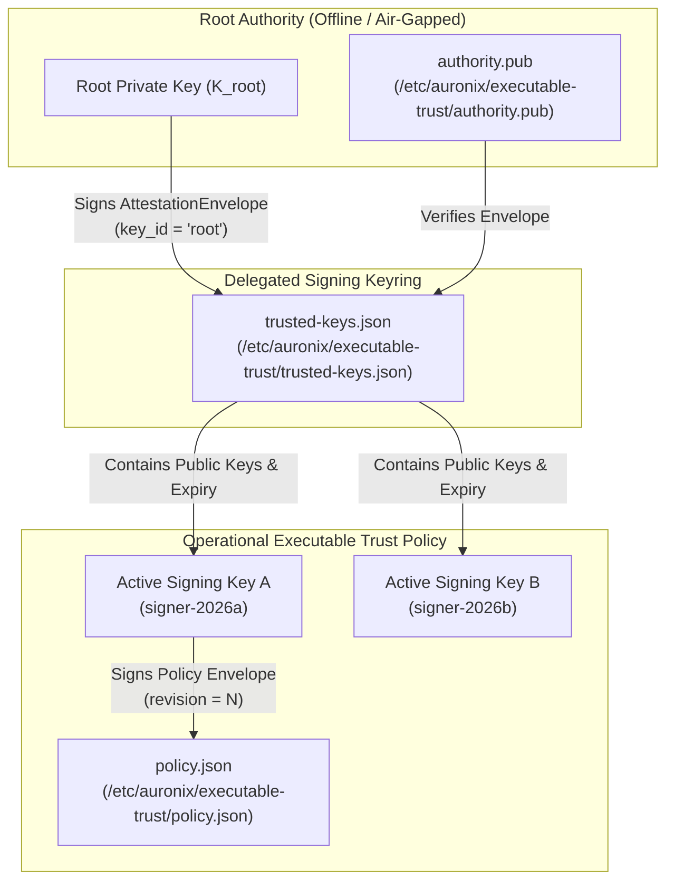
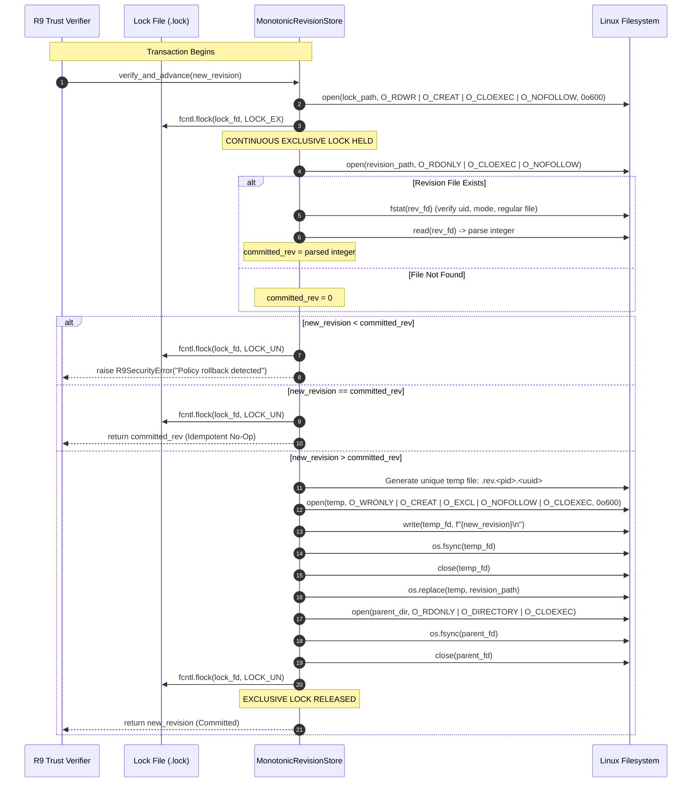
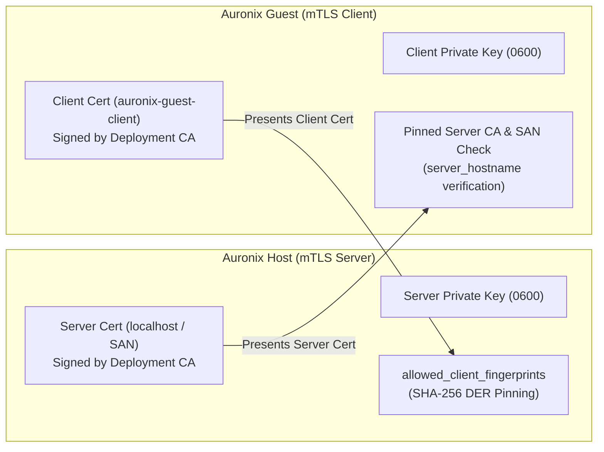
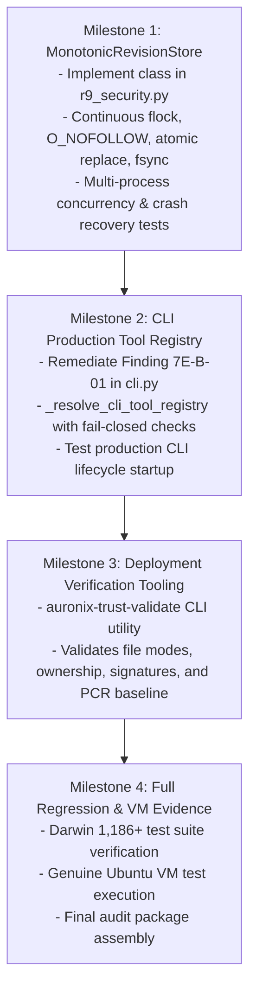

# AURONIX R9 — PHASE 7E-C IMPLEMENTATION PLAN
## Deployment Trust Infrastructure, Monotonic Revision Storage, & Production Readiness

**Document Version:** 1.1.0 (Security-Refined)  
**Phase:** 1B-R9 / Phase 7E-C  
**Author:** Lead Software Architect & Principal Security Engineer  
**Workspace:** `/Users/harikeshshukla/Auronix_R9_WORKTREE`  
**Branch:** `remediation/phase1b-r9`  
**Date:** 2026-11-08  
**Plan Status:** READY FOR IMPLEMENTATION (PENDING REVIEW)  

---

> [!CAUTION]
> ### OVERALL AURONIX R9 PRODUCTION READINESS STATUS: STRICTLY BLOCKED
> Authoring this refined security implementation plan defines the exact contracts for Auronix deployment trust infrastructure. However, **AURONIX R9 PRODUCTION READINESS REMAINS STRICTLY BLOCKED**.
> 
> Production deployment requires:
> 1. Formal architecture plan review and sign-off.
> 2. Implementation and test verification of `MonotonicRevisionStore` and CLI production tool registry wiring.
> 3. Out-of-band administrative provisioning of root trust anchors and deployment PKI by an authorized Linux system administrator on actual Linux host infrastructure.
> 4. Hardware-backed TPM 2.0 attestation validation with fresh nonce-bound quotes.
> 
> Deploying Auronix R9 into production prior to the implementation, provisioning, and independent audit of Phase 7E-C is strictly prohibited.

---

## 1. Executive Summary & Scope

Phase 7E-C represents the final architectural remediation subphase of Auronix Phase 1B-R9. While Phase 7E-A validated descriptor-bound Bubblewrap execution on Linux kernels and Phase 7E-B integrated the host lifecycle with the guest dispatcher, **Phase 7E-C establishes the persistent cryptographic trust infrastructure and operational administration** required for production.

### Core Objectives & Refined Security Areas:
1. **Root Trust Authority (Objective A):** Codify root-owned public trust anchor specifications (`/etc/auronix/executable-trust/authority.pub`), ensuring the root private key remains strictly offline.
2. **Signing Key Lifecycle (Objective B):** Support multiple active signing keys, key rotation, explicit timestamp expiration (`expires_at`), emergency key revocation (`revoked_key_ids`), and monotonic policy revision.
3. **Hardened Monotonic Revision Storage (Objective C):** Replace uncoordinated file I/O with a hardened `MonotonicRevisionStore` featuring continuous exclusive locking (`LOCK_EX`) across read-verify-update, atomic replacement (`os.replace`), file and parent directory `fsync`, symlink rejection (`O_NOFOLLOW`), crash recovery, and hypervisor snapshot rollback defense via TPM NVRAM monotonic counters.
4. **Production PKI & Mutual TLS (Objective D):** Standardize out-of-band certificate generation, dual-sided verification (host verifies client, guest verifies server and SAN), SHA-256 DER fingerprint pinning on both endpoints, rotation overlap windows, and trust failure recovery.
5. **Live Hardware Attestation (Objective E):** Specify the production hardware-backed identity provider interface using TPM 2.0 fresh nonce-bound quotes, AK/EK certificate chain validation, PCR 0/7/8/9/10 evaluation, and measured-boot event log replay, strictly separating development test doubles and enforcing fail-closed rejection when hardware attestation is missing or invalid.
6. **Production CLI Composition (Objective F):** Remediate Audit Finding 7E-B-01 in `cli.py` by ensuring production environments wire `GuestShellTool` into `ToolRegistry`, treating environment variables strictly as configuration hints, failing closed on missing configuration, and never enabling raw `ShellTool`.
7. **Production Deployment Runbook (Objective G):** Provide a comprehensive administrator guide for Ubuntu 24.04.5 LTS, including AppArmor user namespace configuration, canonical ELF paths, permissions, and operational ceremonies.

---

## 2. R9 Baseline Status & Security Posture

### 2.1 Current Working Tree State
- **Workspace:** `/Users/harikeshshukla/Auronix_R9_WORKTREE`
- **Branch:** `remediation/phase1b-r9`
- **Darwin Regression Suite:** **1,186 passed, 52 skipped, 0 failed** in 38.38s.
- **Linux VM Acceptance Suite:** **10 passed in 0.75s** on Ubuntu 24.04 LTS (`auronix-phase1-acceptance-vm`).
- **Historical Fixtures:** Intact and verified bit-for-bit against historical SHA-256 digests (`855a56...`, `23c2bc...`, `101e4a...`).

### 2.2 Audit Findings Being Remediated
- **Finding 7E-B-01 (CLI Production Composition):** In `cli.py`, `_make_lifecycle_handlers` defaults to `_build_default_tool_registry()` (filesystem only) when `tool_registry` is omitted, causing production tasks to fail closed with `local_shell_execution_blocked`. Phase 7E-C provides automated production configuration loading to wire `GuestShellTool` cleanly.
- **Finding 7E-B-02 (Guest Runner Unprovisioned State):** `guest_runner.py::main()` currently falls back to `executor=None` when deployment trust files are unprovisioned. Phase 7E-C provides deployment provisioning runbooks and attestation adapters to operationalize the guest daemon.

---

## 3. Objective A: Root Trust Authority Specification

### 3.1 Offline Root Architecture
The Root Trust Authority is the apex of the Auronix trust hierarchy.
- **Root Key Pair:** An Ed25519 key pair ($K_{\text{root-priv}}, K_{\text{root-pub}}$).
- **Private Key Isolation:** $K_{\text{root-priv}}$ is generated on an air-gapped administrative machine or dedicated Hardware Security Module (HSM). It is **NEVER** present in application repositories, source code, environment variables, build artifacts, or deployment hosts.
- **Public Trust Anchor:** Only $K_{\text{root-pub}}$ is installed onto target hosts at `/etc/auronix/executable-trust/authority.pub`.

### 3.2 Trust Anchor Invariants & Host Permissions
The file `/etc/auronix/executable-trust/authority.pub` must satisfy strict POSIX security properties, enforced by `load_signed_executable_trust_policy()` in `src/auronix/tools/r9_security.py`:
1. **Ownership:** Must be owned by `root` (`uid == 0`).
2. **Permissions:** Maximum mode `0644` (recommended `0444`, read-only for all, writable by none). Must not be group-writable or world-writable (`st_mode & 0o022 == 0`).
3. **Parent Directory:** `/etc/auronix/executable-trust/` must be owned by `root:root`, mode `0755` or `0700`, non-writable by group/others.
4. **Symlink Immunity:** Opened exclusively via `os.open(TRUST_ANCHOR_PATH, os.O_RDONLY | os.O_CLOEXEC | os.O_NOFOLLOW)`.
5. **Descriptor Verification:** Post-open `os.fstat(fd)` must confirm that `st_dev`, `st_ino`, and `st_uid` match the pre-open `lstat()`.

---

## 4. Objective B: Signing Key Lifecycle & Monotonic Revisions

### 4.1 Keyring Architecture & Envelope Schema
The root key does not sign individual policy files directly; instead, it delegates signing authority to operational deployment signing keys via `trusted-keys.json`.



### 4.2 Keyring Envelope Schema (`auronix.executable-trust-keyring/1`)
```json
{
  "schema": "auronix.attestation/2",
  "key_id": "root",
  "algorithm": "ed25519",
  "payload": {
    "schema": "auronix.attestation/2",
    "key_id": "root",
    "policy_type": "auronix.executable-trust-keyring/1",
    "revision": 2,
    "keys": {
      "signer-2026a": {
        "public_key": "x509_or_raw_base64url_public_key...",
        "created_at": 1794000000,
        "expires_at": 1825536000
      },
      "signer-2026b": {
        "public_key": "x509_or_raw_base64url_public_key...",
        "created_at": 1794000000,
        "expires_at": 1857072000
      }
    },
    "revoked_key_ids": [
      "compromised-key-2025"
    ]
  },
  "signature": "base64url_signature_over_canonical_jcs..."
}
```

### 4.3 Atomic Trust Lifecycle & Transition Semantics
To prevent inconsistent states between the keyring and the executable policy, updates must follow strict transactional ordering:

1. **Key Addition Order:**
   - Always deploy updated `trusted-keys.json` ($R_{\text{keyring}} \leftarrow N+1$) containing the new public key **before** deploying any `policy.json` signed by that key.
   - If a host receives the policy first, verification fails closed because the signer ID is unknown.
2. **Key Revocation Order:**
   - Always deploy updated `policy.json` ($R_{\text{policy}} \leftarrow M+1$) signed by an uncompromised key **before** revoking the compromised key in `trusted-keys.json`.
   - If the keyring is revoked first, the active running policy becomes immediately invalid and halts execution.
3. **Independent Monotonic Tracking:**
   - Keyring revision ($R_{\text{keyring}}$) and Policy revision ($R_{\text{policy}}$) are tracked monotonically and independently.
4. **Forward-Only Recovery (No Decrementing Revisions):**
   - In the event that revision $M$ contains an erroneous policy, the administrator **cannot** revert by re-issuing revision $M-1$.
   - The administrator must issue revision $M+1$ with contents matching the desired prior configuration.
   - Forward-only monotonicity ensures rollback attacks remain impossible.
5. **Idempotent Re-evaluation:**
   - If an update is submitted where $R_{\text{new}} == R_{\text{committed}}$, signatures and digests are re-verified, no write occurs, and the operation returns cleanly (idempotent no-op).

---

## 5. Objective C: Hardened Monotonic Revision Storage

### 5.1 Lock Scope Across Read, Verification, and Update
To eliminate TOCTOU race conditions between concurrent worker processes or administrative updates, the lock scope must be **continuous and exclusive**:

> [!IMPORTANT]
> The exclusive advisory lock (`fcntl.flock(lock_fd, fcntl.LOCK_EX)`) must be acquired **before** reading the committed revision, held across verification and comparison of the candidate revision, held across writing the temporary file and fsyncing, and held across the atomic `os.replace` and parent directory `fsync`. It is released **only after** the update is durably committed to disk.



### 5.2 `MonotonicRevisionStore` Class Specification
```python
class MonotonicRevisionStore:
    """Crash-safe, concurrent, descriptor-bound monotonic revision store.

    Enforces POSIX advisory locking across the full read-verify-update cycle,
    O_NOFOLLOW descriptor binding, atomic replacement with unique temporary
    files, and dual file/directory fsync durability.
    """

    def __init__(
        self,
        path: Path = TRUST_REVISION_PATH,
        *,
        owner_uid: int = 0,
        expected_dir_mode: int = 0o755,
        expected_file_mode: int = 0o600,
        lock_timeout_seconds: float = 5.0,
    ) -> None:
        self.path = Path(path).expanduser().resolve()
        self.parent_dir = self.path.parent
        self.owner_uid = owner_uid
        self.expected_dir_mode = expected_dir_mode
        self.expected_file_mode = expected_file_mode
        self.lock_timeout_seconds = lock_timeout_seconds
        self.lock_path = self.parent_dir / (self.path.name + ".lock")

    def read_revision(self) -> int:
        """Read committed revision under a shared lock with O_NOFOLLOW."""
        ...

    def verify_and_advance(self, new_revision: int) -> int:
        """Atomically advance monotonic revision under a continuous exclusive lock."""
        ...
```

### 5.3 Defense Against Disk Snapshot Rollback & Hypervisor Attacks
Local filesystem locking and atomic operations defend against guest OS process races and uncoordinated updates. However, **local filesystem state cannot protect against root-level VM disk snapshot rollback** (where an infrastructure operator or hypervisor rolls back virtual disk blocks from $T_1$ to $T_0$).

#### Architectural Protection Boundaries & Countermeasures:
1. **Local Filesystem Boundary:** Detects and prevents in-OS tampering, process races, power failures, and concurrent updater collisions.
2. **TPM 2.0 Non-Volatile (NV) Monotonic Counter:**
   - In environments equipped with physical TPM 2.0 hardware or vTPM, a dedicated TPM NV index is provisioned with attribute `TPMA_NV_COUNTER`.
   - The TPM counter resides in tamper-resistant hardware NVRAM, physically separate from VM disk storage.
   - When advancing policy revision, the provider increments the TPM counter via `TPM2_NV_Increment`.
   - If a hypervisor rolls back the disk snapshot, the local disk revision ($R=1$) will not match the hardware TPM NV counter ($R=2$), immediately failing verification.
3. **Remote Host Approval State Validation (mTLS):**
   - The authoritative Auronix Host maintains state across executions.
   - For every action, the guest must query the host over mTLS (`HostApprovalStateEndpoint`).
   - If a guest VM disk is rolled back to an older state, the host rejects execution requests because the request nonces and policy contexts no longer align with the authoritative host lifecycle.

---

## 6. Objective D: Production PKI & Mutual TLS Channel

### 6.1 Dual-Sided Mutual TLS Verification
Both endpoints must actively verify the cryptographic identity of their peer:



1. **Host-Side Verification (Validating Guest):**
   - `TLSApprovalStateServer` enforces `ssl.CERT_REQUIRED`.
   - Validates client certificate against `client_ca_file`.
   - Extracts raw DER client certificate bytes: `cert_der = connection.getpeercert(binary_form=True)`.
   - Computes SHA-256 hash: `fp = hashlib.sha256(cert_der).hexdigest()`.
   - Asserts `fp in allowed_client_fingerprints`. Non-matching clients are dropped immediately at the TLS layer.
2. **Guest-Side Verification (Validating Host):**
   - `TLSApprovalStateChannel` enforces `ssl.CERT_REQUIRED` and `check_hostname = True`.
   - Validates server certificate against `ca_file`.
   - Validates server hostname matches `server_hostname` (e.g. `localhost` or internal cluster IP).
   - Verifies server identity before transmitting sensitive action queries.

### 6.2 Rotation Overlap & Revocation Procedures
1. **Certificate Lifetime:** Recommended 90 days.
2. **Rotation Overlap Window (30 Days):**
   - Host server configuration accepts both the current active fingerprint and the next-generation fingerprint:
     ```python
     allowed_client_fingerprints = frozenset({active_fingerprint, next_fingerprint})
     ```
   - Guest client updates its certificate and key.
   - Once all guest nodes report successful communication, `active_fingerprint` is removed from the host config.
3. **Emergency Revocation:**
   - If a client certificate is compromised, immediately remove its fingerprint from `allowed_client_fingerprints` and restart `HostApprovalStateEndpoint`.
   - The compromised client is rejected instantly upon handshake.

---

## 7. Objective E: Hardware-Backed Live Attestation Architecture

### 7.1 Fresh Nonce-Bound Quotes
A TPM quote without a fresh verifier nonce can be replayed from a previous boot or previous valid state.
1. The host verifier generates an ephemeral 32-byte challenge nonce: `challenge_nonce = secrets.token_bytes(32)`.
2. The guest identity provider passes this nonce to `TPM2_Quote`:
   ```bash
   tpm2_quote -c ak.ctx -l sha256:0,7,8,9,10 -q <challenge_nonce> -m quote.bin -s sig.bin
   ```
3. The TPM cryptoprocessor hashes the specified PCRs and the challenge nonce, signing the combined `TPMS_ATTEST` structure using the restricted Attestation Key (AK).
4. The verifier validates the signature, verifies that `quote.extraData == challenge_nonce`, and asserts that the PCR values match policy.

### 7.2 Attestation Key (AK) & Endorsement Key (EK) Validation
1. **Endorsement Key (EK):** The primary identity key burned into the TPM hardware by the manufacturer (Infineon, STMicro, AMD, Intel) or provisioned by the cloud hypervisor (AWS Nitro, GCP vTPM). Accompanied by an X.509 Endorsement Certificate (EK cert) in NVRAM (`0x1c00002`).
2. **Attestation Key (AK):** A restricted signing key generated under the EK hierarchy.
3. **AK Certification:** The verifier validates the manufacturer EK certificate chain, then verifies that the AK was certified by this EK using standard credential activation (`TPM2_MakeCredential` / `TPM2_ActivateCredential`).

### 7.3 PCR Selection & Platform-Specific Policy

> [!WARNING]
> Never assume PCR meanings without platform-specific architectural evidence. Different firmware implementations (UEFI vs. Coreboot vs. U-Boot vs. Nitro) map measurements differently.

For Ubuntu 24.04 on standard UEFI / KVM platforms:
- **PCR 0 (CRTM & Firmware):** Measures UEFI firmware executable code.
- **PCR 7 (Secure Boot Policy):** Measures SecureBoot state (`SecureBoot=1`), PK, KEK, db, and dbx certificates.
- **PCR 8 (Kernel Code & Command Line):** Measures the Linux kernel image (`/boot/vmlinuz-*`) and kernel boot command line arguments.
- **PCR 9 (Initrd Image):** Measures the initial ramdisk (`/boot/initrd.img-*`).
- **PCR 10 (IMA / Root Configuration):** Measures critical system files and Auronix trust configuration recorded by Linux Integrity Measurement Architecture.

### 7.4 Measured-Boot Event Log Replay & Verification
1. PCRs only store rolling hash extensions ($PCR \leftarrow \text{SHA-256}(PCR \parallel \text{digest})$).
2. To verify *why* a PCR has a particular value, the provider reads the TCG event log from `/sys/kernel/security/tpm0/binary_bios_measurements` and the IMA event log from `/sys/kernel/security/ima/binary_runtime_measurements`.
3. The verifier replays the event log from an initial zero state, re-computing the hash extensions.
4. If the recomputed hash matches the signed PCR quote, every measured binary, kernel module, and boot parameter is validated individually against the approved baseline.

### 7.5 Strict Fail-Closed Enforcement
- If `/dev/tpmrm0` or `/dev/tpm0` is absent, or if the TSS raises an error, `SignedIsolationAcceptanceGate` strictly fails closed (`assert_ready()` raises `IsolationEvidenceError("Hardware TPM 2.0 device is missing or unverified")`).
- Test fakes (`TestIdentityProvider`, `TestRevocationProvider`) are prohibited in production builds and remain strictly in `tests/`.

---

## 8. Objective F: Production CLI Composition (Finding 7E-B-01 Remediation)

### 8.1 Treating Environment Variables as Hints Only
Environment variables are configuration hints indicating where deployment assets reside; **they are never trusted authority declarations**.
1. **Immutable Anchor:** The trust anchor path `/etc/auronix/executable-trust/authority.pub` is pinned. Environment variables cannot redirect root verification to an unprivileged directory.
2. **Permission Checks:** All paths referenced via configuration hints must be inspected:
   - Must be owned by the expected UID (`root` for trust files).
   - Mode must not be group/world writable (`& 0o022 == 0`).
   - Must be opened with `O_NOFOLLOW | O_CLOEXEC`.

### 8.2 Production Tool Registry Resolution
In `src/auronix/interfaces/cli.py`:
```python
def _resolve_cli_tool_registry(workspace_root: Path) -> ToolRegistry:
    """Resolve production ToolRegistry with fail-closed configuration enforcement."""
    is_production = os.getenv("AURONIX_ENABLE_PRODUCTION_HANDLERS") == "1" or os.getenv("AURONIX_GUEST_HOST")
    if not is_production:
        return _build_default_tool_registry(workspace_root)

    # Production Mode Requested: Validate required deployment configuration
    guest_host = os.getenv("AURONIX_GUEST_HOST")
    guest_port = int(os.getenv("AURONIX_GUEST_PORT", "22"))
    identity_file = os.getenv("AURONIX_GUEST_KEY_FILE")
    known_hosts = os.getenv("AURONIX_GUEST_KNOWN_HOSTS")
    host_key_file = os.getenv("AURONIX_HOST_KEY_FILE")
    host_key_id = os.getenv("AURONIX_HOST_KEY_ID", "host-key-1")

    if not (guest_host and identity_file and known_hosts and host_key_file):
        raise CLIError(
            "Production guest execution requested, but required deployment "
            "configuration (AURONIX_GUEST_HOST, AURONIX_GUEST_KEY_FILE, "
            "AURONIX_GUEST_KNOWN_HOSTS, AURONIX_HOST_KEY_FILE) is missing or incomplete."
        )

    # Securely load host signing key
    key_path = Path(host_key_file).expanduser().resolve()
    _check_file_permissions(key_path, expected_uid=os.geteuid(), max_mode=0o600)
    host_private_key = serialization.load_pem_private_key(key_path.read_bytes(), password=None)
    
    signer = Ed25519AssertionSigner(
        private_key=host_private_key,
        key_id=host_key_id,
        issuer="auronix-host",
        audience="auronix-guest",
    )
    transport = OpenSSHGuestTransport(
        target=guest_host,
        port=guest_port,
        identity_file=Path(identity_file),
        known_hosts_file=Path(known_hosts),
    )
    return build_production_tool_registry(
        workspace_root=workspace_root,
        guest_transport=transport,
        assertion_signer=signer,
    )
```

---

## 9. Objective G: Production Deployment Runbook & Administrator Guide

### 9.1 Operating System Prerequisites (Ubuntu 24.04 LTS)
1. **OS & Kernel:** Ubuntu 24.04.5 LTS (Noble Numbat), Linux Kernel 6.8+.
2. **Package Installation:**
   ```bash
   sudo apt-get update && sudo apt-get install -y \
       bubblewrap \
       openssh-server \
       openssh-client \
       python3-full \
       python3-cryptography \
       tpm2-tools \
       libtss2-dev
   ```
3. **AppArmor Unprivileged User Namespace Configuration:**
   ```bash
   sudo tee /etc/apparmor.d/bwrap << 'EOF'
   abi <abi/4.0>,
   include <tunables/global>

   profile bwrap /usr/bin/bwrap flags=(unconfined) {
     userns,
   }
   EOF
   sudo systemctl reload apparmor
   ```
4. **cgroup-v2 Configuration:** Ensure `/sys/fs/cgroup/cgroup.controllers` contains `cpu memory pids io`.

### 9.2 Production Directory Setup Commands
```bash
# 1. Configuration directories (root-owned, read-only to others)
sudo mkdir -p /etc/auronix/executable-trust /etc/auronix/isolation /etc/auronix/pki
sudo chown -R root:root /etc/auronix
sudo chmod 0755 /etc/auronix /etc/auronix/executable-trust /etc/auronix/isolation
sudo chmod 0700 /etc/auronix/pki

# 2. Monotonic state directory (root-owned, private 0700)
sudo mkdir -p /var/lib/auronix/executable-trust
sudo chown -R root:root /var/lib/auronix /var/lib/auronix/executable-trust
sudo chmod 0755 /var/lib/auronix
sudo chmod 0700 /var/lib/auronix/executable-trust

# 3. Guest runner ledger directory (service user owned 0700)
sudo useradd -r -s /bin/bash -d /var/lib/auronix/guest-runner auronix-guest
sudo mkdir -p /var/lib/auronix/guest-runner
sudo chown -R auronix-guest:auronix-guest /var/lib/auronix/guest-runner
sudo chmod 0700 /var/lib/auronix/guest-runner
```

---

## 10. Implementation Phasing & Task Breakdown



---

## 11. Safety Commitments & Boundaries

Throughout Phase 7E-C, the following boundaries are strictly observed:
1. **No Host OS File Modifications:** Never execute `sudo` or touch `/etc/auronix` or `/var/lib/auronix` on the macOS developer host.
2. **No Production Private Keys:** No real production private keys will ever be generated or stored on local disk or in git. All unit tests generate ephemeral, temporary Ed25519 keys in `tmp_path`.
3. **No Unisolated Shell Fallback:** Under no circumstance will unisolated `ShellTool` execution be enabled or permitted.
4. **Historical Fixture Protection:** Historical fixtures in `historical-references/` and `auronix-phase1-snapshot-v6/` remain read-only and immutable.
5. **No Release Operations:** No git commits, pushes, tags, or deployment rollouts.

---

## 12. Final Plan Review Verdict

### Plan Status: **READY FOR IMPLEMENTATION**

**Statement:**  
This refined implementation plan comprehensively addresses all five review areas: continuous locking and snapshot defense for monotonic revisions, fresh nonce-bound TPM quotes and event logs, dual-sided mTLS verification with fingerprint pinning, hardened production configuration handling, and atomic trust lifecycles. Implementation will commence once this plan has been reviewed and approved.
