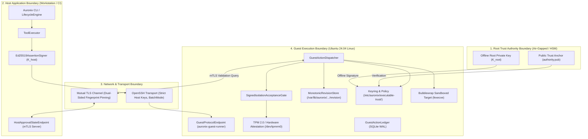

# AURONIX R9 — PHASE 7E-C THREAT MODEL
## Adversarial Threat Model & Attack Surface Decomposition for Deployment Trust Infrastructure

**Document Version:** 1.1.0 (Security-Refined)  
**Phase:** 1B-R9 / Phase 7E-C  
**Author:** Lead Software Architect & Principal Security Engineer  
**Workspace:** `/Users/harikeshshukla/Auronix_R9_WORKTREE`  
**Branch:** `remediation/phase1b-r9`  
**Date:** 2026-11-08  
**Status:** COMPLETE (PENDING REVIEW)  

---

> [!CAUTION]
> ### OVERALL AURONIX R9 PRODUCTION READINESS STATUS: STRICTLY BLOCKED
> This threat model identifies critical failure modes that must be fully mitigated before Auronix R9 can be released.
> Production readiness remains strictly blocked pending implementation, live testing, and independent audit of the controls specified herein.

---

## 1. Scope & System Decomposition

Phase 7E-C hardens the deployment-level security boundaries of Auronix R9. The threat model evaluates all interfaces, files, sockets, and processes across five physical and logical domains:



---

## 2. Threat Actors & Adversarial Capabilities

| Threat Actor | Description | Capabilities & Access Level |
|---|---|---|
| **TA-1: Malicious Host Tenant / Prompt Injector** | An unprivileged user, compromised LLM tool prompt, or rogue plugin running in the host process. | Can submit arbitrary tasks, manipulate CLI parameters, inject poisoned tool arguments, or attempt to trigger unisolated shell tools. |
| **TA-2: Compromised Guest VM Attacker** | An attacker who has achieved code execution inside the guest VM (either in an isolated container or guest user context). | Can manipulate non-root guest files, attempt race conditions, sniff local loopback sockets, send malformed responses over stdout, or attempt to overwrite files in `/var/lib/` or `/tmp/`. |
| **TA-3: Network Eavesdropper / MITM** | An adversary on the local network between the host and guest VM. | Can sniff packets, attempt TLS interception, forge TCP resets, replay captured protocol frames, or perform traffic delay attacks. |
| **TA-4: Compromised Policy Signing Key** | An adversary who has extracted or compromised an active operational signing key ($K_{\text{signer}}$). | Can forge policy documents (`policy.json`) authorizing malicious ELF binaries or modifying resource limits. Cannot sign the root keyring (`trusted-keys.json`). |
| **TA-5: Hypervisor / Infrastructure Operator** | A privileged host administrator or cloud infrastructure actor with disk snapshot rollback capabilities. | Can restore entire virtual machine disk images to an earlier point in time ($T_0$). |
| **TA-6: Concurrent Process / System Crash** | Weaponized concurrent process execution, kernel panic, power loss, or filesystem interruption. | Causes torn writes, partially written revision files, lock contention, or race conditions during monotonic updates. |

---

## 3. Attack Surface 1: Trust Anchor & Keyring Compromise

### 3.1 Threat Vector: Exfiltration of Root Authority Key
- **Attack Scenario:** An attacker accesses the source code repository, CI environment variables, or deployment host to steal the private key and authorize arbitrary policies.
- **Severity:** CRITICAL
- **Mitigation:**
  1. $K_{\text{root-priv}}$ is **strictly offline** (generated and held in an air-gapped machine or HSM).
  2. The codebase contains zero private keys, and build automation does not accept root keys via environment variables.
  3. Only the raw public key `authority.pub` is provisioned to target hosts.
- **Verification Invariant:** `load_signed_executable_trust_policy()` requires only the public key to verify `trusted-keys.json`.

### 3.2 Threat Vector: Use of Expired or Revoked Signing Keys
- **Attack Scenario:** An adversary steals an older signing key or uses a revoked key to sign a malicious `policy.json`.
- **Severity:** HIGH
- **Mitigation:**
  1. `_load_signed_keyring()` parses each key's `expires_at` timestamp:
     ```python
     if value.get("expires_at") is not None and value["expires_at"] <= now:
         continue # Key is expired and discarded
     ```
  2. If the key ID is listed in `revoked_key_ids`, it is strictly omitted from `trusted`:
     ```python
     if key_id in revoked:
         continue # Key is revoked
     ```
  3. If no active, unexpired, unrevoked keys remain in the keyring, verification fails closed with `R9SecurityError("Executable trust keyring has no active signing keys.")`.

### 3.3 Threat Vector: Inlined Envelope Forgery & Algorithm Confusion
- **Attack Scenario:** An attacker modifies the signature algorithm (e.g. `none` or RSA) or tampers with the RFC 8785 canonical JSON bytes.
- **Severity:** CRITICAL
- **Mitigation:**
  1. `AttestationEnvelope.signed_bytes()` strictly requires `algorithm == "ed25519"` and `schema == "auronix.attestation/2"`.
  2. Canonical bytes are computed using RFC 8785 JSON Canonicalization Scheme (JCS).
  3. Constant-time signature verification via `cryptography.hazmat.primitives.asymmetric.ed25519`.

---

## 4. Attack Surface 2: Monotonic Revision Counter Rollback & Concurrency

### 4.1 Threat Vector: Time-of-Check to Time-of-Use (TOCTOU) Lock Race
- **Attack Scenario:** A system reads the revision under a shared lock, releases it, verifies the policy, and then takes an exclusive lock to update. Two concurrent processes read revision 1 simultaneously; both attempt to advance to revision 2, resulting in clobbered state or corrupted temporary files.
- **Severity:** HIGH
- **Mitigation:**
  1. **Continuous Exclusive Lock Scope:** The exclusive advisory lock (`fcntl.flock(lock_fd, fcntl.LOCK_EX)`) is acquired **before** reading the committed revision, held across verification and comparison, held across writing the unique temporary file, and held across atomic `os.replace` and parent directory `fsync`.
  2. **Unique Temp Files:** Temp files use process-unique names (`.rev.tmp.<pid>.<uuid>`), preventing collision.
  3. **Idempotent Updates:** If $R_{\text{new}} == R_{\text{committed}}$, verification succeeds without writing to disk.

### 4.2 Threat Vector: Unclean Power Failure / Torn Writes
- **Attack Scenario:** System crashes or power is lost while writing the revision counter, leaving a 0-byte or corrupted revision file on disk.
- **Severity:** HIGH
- **Mitigation:**
  1. Temporary file is written with `O_CREAT | O_EXCL | O_NOFOLLOW`.
  2. `os.fsync(temp_fd)` commits data blocks before closing.
  3. `os.replace` atomically swaps the directory entry.
  4. `os.fsync(parent_dir_fd)` commits the directory inode.
  5. If the file is corrupted, `read_revision()` fails closed (`R9SecurityError`), requiring manual operator recovery without decrementing.

### 4.3 Threat Vector: Hypervisor VM Disk Snapshot Rollback
- **Attack Scenario:** An attacker with cloud console or hypervisor access restores a VM disk snapshot from $T_0$, rolling back the filesystem revision from 5 to 1.
- **Severity:** CRITICAL
- **Mitigation & Protection Boundaries:**
  1. **Filesystem vs. Hypervisor Boundary:** Local filesystem permissions and file locks cannot prevent out-of-band virtual disk block restoration. This boundary is explicitly acknowledged.
  2. **TPM 2.0 Non-Volatile (NV) Counter:**
     - A dedicated TPM NV index is provisioned with attribute `TPMA_NV_COUNTER`.
     - The TPM hardware NVRAM is decoupled from virtual disk snapshots.
     - When policy revision advances, the TPM counter increments via `TPM2_NV_Increment`.
     - Upon reboot or execution, verification asserts that local disk revision matches or exceeds the hardware TPM counter.
  3. **Authoritative Host mTLS Validation:**
     - The host tracks the latest approved policy version. If a guest VM disk is rolled back, the host rejects mTLS queries because request nonces and policy contexts are stale.

---

## 5. Attack Surface 3: Production PKI & Mutual TLS MITM / Impersonation

### 5.1 Threat Vector: Rogue Client Connecting to Approval State Endpoint
- **Attack Scenario:** An unauthorized process on the guest or local network attempts to query the host's `HostApprovalStateEndpoint` or spoof an approval response.
- **Severity:** HIGH
- **Mitigation:**
  1. **Strict Mutual TLS:** The server sets `ssl.CERT_REQUIRED`. Connections without a valid client certificate signed by the deployment CA are terminated during the TLS handshake.
  2. **SHA-256 DER Fingerprint Pinning:** The host server verifies the raw DER SHA-256 fingerprint of the peer certificate:
     ```python
     peer_cert = connection.getpeercert(binary_form=True)
     fingerprint = hashlib.sha256(peer_cert).hexdigest()
     if fingerprint not in self.allowed_client_fingerprints:
         return # Drop connection immediately
     ```
  3. **Ed25519 Response Signatures:** Every approval response is digitally signed with the host's private key ($K_{\text{host}}$). The guest verifier rejects any unsigned or forged response.

### 5.2 Threat Vector: Rogue Server Impersonation & MITM
- **Attack Scenario:** An attacker on the local bridge network intercepts outbound guest connections and presents a fake server certificate to spoof approval responses.
- **Severity:** HIGH
- **Mitigation:**
  1. Guest client enforces `check_hostname = True` and validates against `ca_file`.
  2. Server certificate must include exact Subject Alternative Name (SAN) matching `server_hostname`.
  3. All responses must contain a valid Ed25519 signature from $K_{\text{host-priv}}$ echoing the ephemeral 32-byte `challenge_nonce`.

---

## 6. Attack Surface 4: Forged, Replayed, or Unmeasured Guest Attestation

### 6.1 Threat Vector: Replay of Stale TPM Quotes
- **Attack Scenario:** An attacker records a valid TPM quote from an earlier boot and replays it over the attestation interface to execute commands on an unmeasured or modified kernel.
- **Severity:** CRITICAL
- **Mitigation:**
  1. **Fresh Nonce Binding:** Verifier generates an ephemeral 32-byte random challenge nonce (`challenge_nonce`).
  2. The TPM quote must be computed with this exact nonce in `TPM2_Quote -q <challenge_nonce>`.
  3. The verifier validates that the TPM-signed `extraData` matches `challenge_nonce`. Stale or replayed quotes fail verification instantly.

### 6.2 Threat Vector: Forged Attestation Key (Rogue TPM)
- **Attack Scenario:** An attacker emulates a TPM in software or uses an unauthorized hardware device with self-signed attestation keys.
- **Severity:** CRITICAL
- **Mitigation:**
  1. Attestation Key (AK) must be certified by an Endorsement Key (EK).
  2. The EK holds a manufacturer-signed X.509 Endorsement Certificate (EK cert) in NVRAM (`0x1c00002`).
  3. Verifier asserts that the EK cert chains to an approved hardware vendor root (AMD, Intel, Infineon, STMicro) or cloud provider (AWS Nitro, GCP vTPM).

### 6.3 Threat Vector: Assumption of PCR Meanings Without Evidence
- **Attack Scenario:** Software assumes PCR 8 measures the kernel without verifying platform boot architecture, allowing an attacker to boot a custom kernel on a platform where PCR 8 is unused.
- **Severity:** HIGH
- **Mitigation:**
  1. The verifier validates the complete TCG Event Log (`binary_bios_measurements` and `binary_runtime_measurements`).
  2. Verifier replays the event log from 0, recomputing hash extensions and verifying that every event description corresponds to the approved OS baseline.
  3. If PCR values do not match replayed event log hashes, verification fails closed.

---

## 7. Attack Surface 5: Production Configuration & CLI Downgrade Attacks

### 7.1 Threat Vector: Environment Variable Authority Override
- **Attack Scenario:** An attacker sets environment variables (e.g. `AURONIX_TRUST_ANCHOR=/tmp/evil.pub` or `AURONIX_DISABLE_ISOLATION=1`) to redirect trust verification or disable security boundaries.
- **Severity:** CRITICAL
- **Mitigation:**
  1. **Configuration Hints Only:** Environment variables indicate network endpoints or optional file locations; they **never** declare authority or override security policy.
  2. Pinned trust paths (`/etc/auronix/executable-trust/authority.pub`) are hardcoded constants.
  3. All referenced files are subjected to ownership (`root:root`) and permission checks (`& 0o022 == 0`) with `O_NOFOLLOW | O_CLOEXEC`.

### 7.2 Threat Vector: Downgrading to Raw Host Shell
- **Attack Scenario:** A malicious task or misconfigured CLI environment attempts to register the raw unisolated `ShellTool` to execute commands directly on the host OS via `subprocess.Popen`.
- **Severity:** CRITICAL
- **Mitigation:**
  1. `ToolExecutor.execute` checks `if action.target == "shell" and not _is_guest_shell_tool(tool): return ToolResult(success=False, error="Local host-shell execution is disabled...")`.
  2. `_ExecutionPermit` requires `type(tool) is GuestShellTool`.
  3. `_resolve_cli_tool_registry()` in `cli.py` fails closed if guest execution is configured but credentials or transport are missing. Under no circumstances is raw `ShellTool` registered.

---

## 8. Threat Mitigation Matrix

| Threat ID | Threat Vector | Primary Countermeasure | Invariant Verified |
|---|---|---|---|
| **TM-7E-01** | Root Key Exfiltration | Offline air-gapped root authority | No private keys in repository, CI, or host environment. |
| **TM-7E-02** | Expired/Revoked Signing Keys | Keyring timestamp and revocation parsing | Keys in `revoked_key_ids` or `expires_at <= now` are discarded. |
| **TM-7E-03** | TOCTOU Lock Race on Revision | Continuous exclusive `flock(LOCK_EX)` | Lock held continuously across read, verify, write, and fsync. |
| **TM-7E-04** | Torn Writes / Crash during Update | Unique temp file, dual fsync, atomic rename | Zero lost updates, zero torn writes, crash durable via `fsync`. |
| **TM-7E-05** | VM Disk Snapshot Rollback | TPM 2.0 NV Counter & Host mTLS State | Local disk revision must match non-volatile hardware counter. |
| **TM-7E-06** | TPM Quote Replay | Ephemeral 32-byte challenge nonce | `tpm2_quote` binds fresh verifier nonce into signed `extraData`. |
| **TM-7E-07** | Rogue Attestation Key | EK X.509 Certificate Chain Validation | AK must be certified by manufacturer/cloud-signed EK. |
| **TM-7E-08** | Client Impersonation on mTLS | Dual SHA-256 DER fingerprint pinning | Dropped at TLS layer if client cert fingerprint is not pinned. |
| **TM-7E-09** | Env Var Authority Override | Treat env vars as hints; strict permissions | Pinned trust paths; non-root or group-writable paths rejected. |
| **TM-7E-10** | Host Shell Downgrade | Exact type check `type(tool) is GuestShellTool` | Zero local process spawning; fail-closed `local_shell_execution_blocked`. |

---

## 9. Residual Risk Assessment & Non-Readiness Statement

### Residual Risks:
1. **Physical Host Tampering:** An attacker with physical hardware access to the host machine could conceivably tamper with TPM chips or hypervisor memory. Mitigation relies on secure boot and measured firmware.
2. **OS Kernel Vulnerabilities:** A 0-day privilege escalation in the Linux 6.8 kernel could compromise namespace isolation. Mitigation relies on Ubuntu 24.04 security patching and minimal container attack surface.

### Production Readiness Statement:
While all architectural threat vectors are addressed by the controls specified in this threat model, **Auronix R9 remains NOT READY FOR PRODUCTION DEPLOYMENT** until Phase 7E-C implementation is executed, tested, and independently audited.
