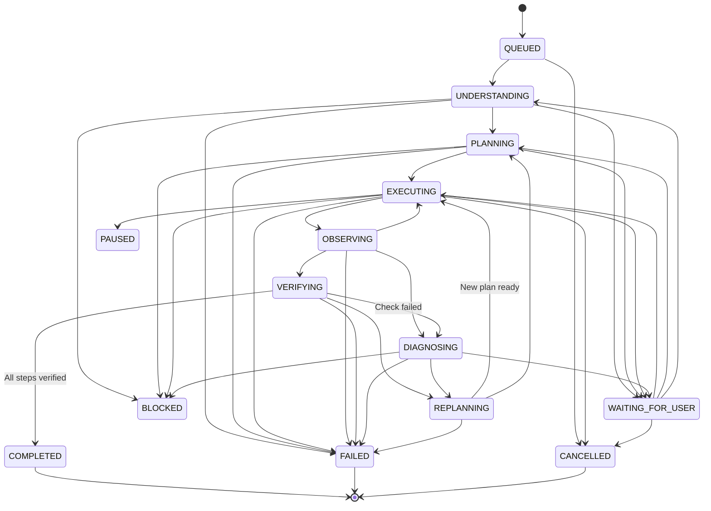
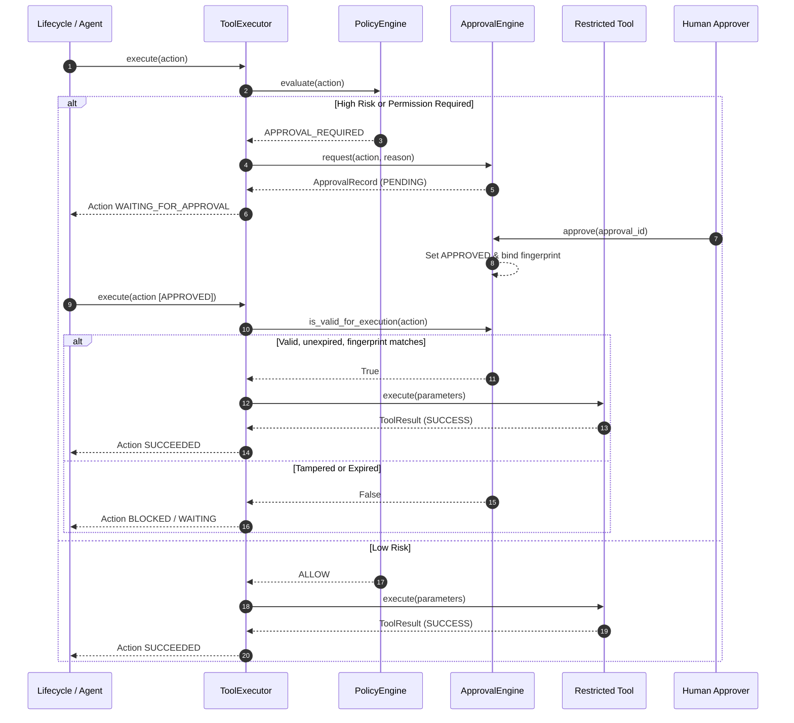

# Auronix Architecture

Auronix is a **controlled autonomous personal intelligence system**. It is designed to execute multi-step objectives under deterministic state boundaries, restricted tool execution, and action approval governance. Shell path checks are not OS-level isolation.

---

## 1. Core Principles

Auronix is engineered around five fundamental principles:

1. **Controlled Autonomy**: Autonomy must always operate within explicit policy boundaries. High-risk operations are paused and require explicit, tamper-evident approvals.
2. **Decoupled Policy & Intelligence**: The policy engine and approval mechanisms are strictly independent from model generation, planning logic, and tool code. An agent cannot declare its own actions safe or bypass policy rules.
3. **Deterministic State Transitions**: Tasks follow a formal finite state machine. Every lifecycle progression is verified and recorded as an auditable state event.
4. **Continuous Verification & Self-Correction**: Execution is an active loop of `Execute -> Observe -> Verify`. If verification fails, the system transitions to `DIAGNOSING` (critique) and `REPLANNING` rather than looping blindly.
5. **Persistent Event-Sourced Auditability**: All tasks, plans, actions, approvals, observations, verifications, and state transitions are stored in durable, queryable storage (SQLite with Write-Ahead Logging).

---

## 2. High-Level Architecture

The system is organized into modular layers:

```
+-------------------------------------------------------------+
|                     Lifecycle Engine                        |
|   (Understand -> Plan -> Execute -> Observe -> Verify)      |
+------------------------------+------------------------------+
                               |
       +-----------------------+-----------------------+
       |                                               |
       v                                               v
+-------------------------------+       +-------------------------------+
|         State Engine          |       |         Tool Executor         |
|  - Task State & Events        |       |  - Tool Registry              |
|  - Transitions & Invariants   |       |  - Restricted Filesystem      |
|  - SQLite / Memory Stores     |       +---------------+---------------+
+---------------+---------------+                       |
                |                                       |
                |                     +-----------------+-----------------+
                |                     |                                   |
                v                     v                                   v
+-------------------------------+ +-------------------------------+ +-----+-------------------------+
|        Approval Engine        | |         Policy Engine         | |      Verification Engine      |
|  - Action Fingerprinting      | |  - Risk Evaluation            | |  - Criteria Verification      |
|  - Cryptographic Validation   | |  - Allow / Require / Block    | |  - Anomaly Detection          |
|  - Expiration & TTL           | +-------------------------------+ +-------------------------------+
+-------------------------------+
```

---

## 3. Component Breakdown

### 3.1 Core Lifecycle Engine (`auronix.core.lifecycle`)
- **`LifecycleEngine`**: Orchestrates task execution through its complete lifecycle. It enforces transitions in the state engine and drives handlers.
- **`LifecycleHandlers`**: Pluggable protocol supplying intelligence for `understand`, `plan`, `execute`, `observe`, `verify`, `critique`, and `replan`. Intelligence can be backed by deterministic code, LLMs, external agents, or hybrid systems.

### 3.2 State Engine & Storage (`auronix.state`)
- **`StateEngine`**: Central coordinator for all state mutations. Guarantees that only valid transitions occur, appends state events, records plan attachments, actions, approvals, observations, verifications, and results.
- **`TaskStore`**: In-memory storage backend for testing and rapid ephemeral tasks.
- **`SQLiteTaskStore`**: Production persistence backend using SQLite in WAL mode. Persists complete JSON state snapshots with indexed lookup by `task_id` and `status`.

### 3.3 Policy Engine (`auronix.policy.engine`)
- **`PolicyEngine`**: Independent evaluator that inspects an `Action` before execution.
- Categorizes actions into risk tiers:
  - `low`: Permitted automatically.
  - `moderate`, `high`, `critical`: Require approval.
  - Actions with `permission_required=True` always require approval.
  - Unrecognized risk levels or malformed actions are blocked.
- Evaluates outcome to `ALLOW`, `APPROVAL_REQUIRED`, or `BLOCK`.

### 3.4 Persistent Approval Engine (`auronix.policy.approval`)
- **`action_fingerprint`**: Computes a deterministic SHA-256 digest over the canonical JSON representation of the action's intent (`task_id`, `action_id`, `action_type`, `purpose`, `actor`, `target`, `parameters`, `risk_level`, `permission_required`).
- **`ApprovalEngine`**: Manages the approval lifecycle:
  - Creates pending `ApprovalRecord` bound to the action's fingerprint.
  - Approves or rejects requests with approver identity and timestamp.
  - Enforces `is_valid_for_execution`: verifies approval status, fingerprint equality (detecting parameter tampering), and expiration TTL.

### 3.5 Execution & Tool Restrictions (`auronix.execution`, `auronix.tools`)
- **`ToolExecutor`**: Executes tool calls while strictly enforcing `PolicyEngine` rules and validating approvals with `ApprovalEngine`.
- **`ToolRegistry`**: Central registry maintaining available tool instances.
- **`FilesystemTool`**: Workspace path-checked file operations:
  - Read access permitted across `workspace/**`.
  - Write access restricted to `workspace/output/**` and `workspace/scratch/**`.
  - Path traversal outside workspace root is blocked.
  - File deletions are deliberately unsupported.
- **`ShellTool`**: Uses a small executable allowlist, argument checks, bounded output, and timeouts. It is not an OS sandbox; commands retain the Auronix process user's host permissions.

### 3.6 Verification Engine (`auronix.verification`)
- **`Verifier`**: Evaluates step success criteria against observations, action results, and evidence.
- Flags observation anomalies, calculates confidence scores, identifies unresolved issues, and enables pluggable custom checks.

### 3.7 Multi-agent Orchestration (`auronix.agents.orchestration`)
- **`AgentOrchestrator`**: Persists a bounded child-task plan, dispatches specialists in dependency order through child `LifecycleEngine` instances, and verifies the aggregate parent result.
- **`PlannerAgent`, `SpecialistAgent`, `ReviewerAgent`**: Typed in-process interfaces for decomposition, child proposals, and bounded review. Specialist tool intents are converted to actions only by the orchestrator and routed through `ToolExecutor`.
- Agent callbacks are trusted Python code, not isolated processes. Timeout bounds the controller's wait; Python threads cannot be forcibly stopped. See [ORCHESTRATION.md](ORCHESTRATION.md).

### 3.8 Persistent Memory (`auronix.memory`)
- **`SQLiteMemoryStore`**: Stores provenance-tagged contextual entries in a separate schema in SQLite, with bounded size/retention and relevance search.
- Memory remains untrusted context and cannot change task state, policy, or approvals. See [MEMORY.md](MEMORY.md).

### 3.9 Model Routing (`auronix.agents.routing`)
- **`ModelRouter`**: Selects from explicitly configured provider/model routes by task type and capabilities; explicit fallbacks, bounded retries, timeouts, and dry-run inspection are supported.
- Gemini lifecycle integration is optional. Live provider behavior, provider costs, and deployment-specific route configuration are not validated here. See [MODEL_ROUTING.md](MODEL_ROUTING.md).

### 3.10 Local CLI and operations
- **`auronix.interfaces.cli`**: Task, approval, memory, and read-only diagnostics commands. The CLI does not expose a remote service. See [OPERATIONS.md](OPERATIONS.md).

---

## 4. Lifecycle State Machine

Auronix tasks transition through an explicit state machine:



---

## 5. Security & Approval Workflow



---

## 6. Directory Structure

```
Auronix/
├── docs/
│   ├── ARCHITECTURE.md          # Architecture and design principles
│   ├── CORE_SPEC.md             # Data model, transition, and security specifications
│   ├── SECURITY.md              # Security boundaries and residual risks
│   ├── ORCHESTRATION.md         # Multi-agent execution boundary
│   ├── MEMORY.md                # Persistent contextual memory
│   ├── MODEL_ROUTING.md         # Explicit provider routing
│   └── OPERATIONS.md            # Local operations and recovery
├── src/auronix/
│   ├── agents/                  # Gemini handlers, orchestration, routing
│   ├── memory/                  # SQLite contextual memory
│   ├── interfaces/              # Local CLI
│   ├── observability.py         # Structured lifecycle events
│   ├── core/
│   │   └── lifecycle.py         # LifecycleEngine & LifecycleHandlers
│   ├── models/
│   │   ├── task.py              # Task, TaskStatus, Complexity, RiskLevel
│   │   ├── plan.py              # Plan, Step
│   │   ├── action.py            # Action, ActionStatus, ActionType
│   │   ├── approval.py          # ApprovalRecord, ApprovalStatus
│   │   ├── observation.py       # Observation
│   │   ├── verification.py      # Verification
│   │   ├── critique.py          # Critique
│   │   └── result.py            # Result
│   ├── state/
│   │   ├── engine.py            # StateEngine
│   │   ├── store.py             # In-memory TaskStore & TaskState
│   │   └── sqlite_store.py      # SQLiteTaskStore with WAL mode
│   ├── policy/
│   │   ├── engine.py            # PolicyEngine & PolicyDecision
│   │   └── approval.py          # ApprovalEngine & action_fingerprint
│   ├── tools/
│   │   ├── base.py              # Tool, ToolContext, ToolResult
│   │   ├── registry.py          # ToolRegistry
│   │   └── filesystem.py        # Workspace path-checked FilesystemTool
│   ├── execution/
│   │   └── executor.py          # ToolExecutor with policy & approval validation
│   └── verification/
│       └── verifier.py          # Verifier & CheckResult
├── tests/                       # Comprehensive pytest suite
├── workspace/
│   ├── input/                   # Read-only input files
│   ├── output/                  # Writable output files
│   └── scratch/                 # Writable temporary files
└── pyproject.toml
```
