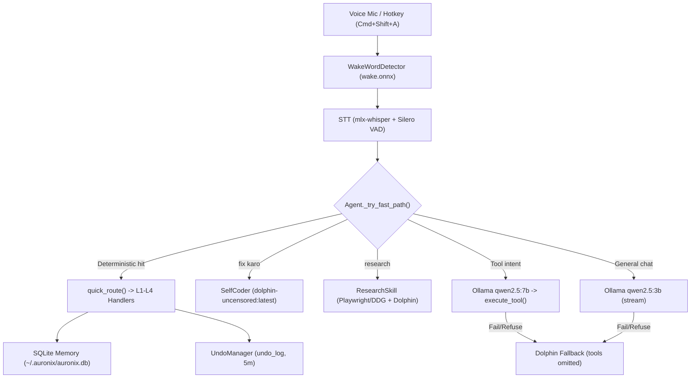
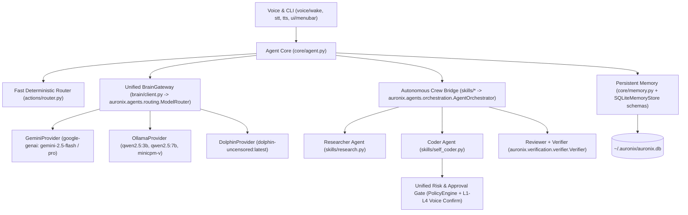

# Auronix 2.0 — Technical Architecture (Current vs Target)

- **Workspace:** `/Users/harikeshshukla/Auronix`
- **Baseline Commit:** `32083e4` (`Phase F & G: Autonomous research, Dolphin uncensored integration, Self-coding safety gates`)
- **Python Runtime:** Python `3.11.18` (`.venv`), `auronix` package version `0.2.0` (`pyproject.toml`)
- **Status:** Stage 1 Architectural Discovery (Zero source modifications)

---

## 1. Executive Summary

The repository currently contains **two distinct Python packages** under `src/`:

1. **`src/auronix_product/`** (36 Python files, ~5,725 LOC): The live macOS voice assistant launched by `auronix` (`auronix_product.__main__:main`), `/Applications/Auronix.app`, and `~/Library/LaunchAgents/com.auronix.assistant.plist`. It implements wake-word detection, STT/TTS, deterministic regex + LLM routing, macOS control, daily briefings, SQLite conversation memory/undo/reminders, autonomous Playwright/DuckDuckGo research (`ResearchSkill`), and guarded self-coding (`SelfCoder`).
2. **`src/auronix/`** (20 subdirectories/modules, plus `src/auronix/tools/r9_*.py`): A security-hardened orchestration, policy, approval, state-machine, memory, and cryptographic attestation foundation (`LifecycleEngine`, `AgentOrchestrator`, `ModelRouter`, `GeminiLifecycleHandlersBuilder`, `PolicyEngine`, `ApprovalEngine`, `ToolExecutor`, `Verifier`, `SQLiteMemoryStore`). `src/auronix/improvement/__init__.py` is currently an empty placeholder (0 bytes), and the external R9 worktree (`/Users/harikeshshukla/Auronix_R9_WORKTREE`) sits separately outside the product runtime.

**Auronix 2.0 Vision:** Map model-independent LLM routing (Ollama/Dolphin + Gemini), autonomous multi-agent collaboration (`Researcher`, `Coder`, `Reviewer`), non-destructive self-improvement, and provenance-tracked SQLite memory **directly into the existing `src/auronix_product/` + `src/auronix/` directory structure** without moving folders or touching R9 security modules.

---

## 2. Current 1.x Architecture Inventory

### 2.1 `src/auronix_product/` Module Map (Baseline)

| Layer | Module(s) | LOC | Key Implemented Symbols & Responsibilities |
|---|---|---|---|
| **Entry & Config** | `__main__.py`, `config.py` | 121 | `main()`, `warn_if_daemon_running()`, `OLLAMA_MODEL="qwen2.5:3b"`, `OLLAMA_SMART_MODEL="qwen2.5:7b"`, `OLLAMA_DOLPHIN_MODEL="dolphin-uncensored:latest"`, `WHISPER_MODEL="mlx-community/whisper-large-v3-turbo"` (STT warms/uses configured Whisper), `KOKORO_VOICE="af_sky"`, `DB_PATH="~/.auronix/auronix.db"`, `WAKE_THRESHOLD=0.85` |
| **Voice I/O** | `voice/wake.py`, `voice/stt.py`, `voice/tts.py`, `voice/audio_guard.py`, `voice/sfx.py` | 1,188 | `WakeWordDetector` (Heed ONNX `wake.onnx` + 1.2s rolling buffer + `calibrate()`), `Hotkey` (`Cmd+Shift+A`); `STT` (`mlx-whisper`, Silero VAD, Hinglish `DOMAIN_PROMPT`, `CORRECTIONS`, repeat filter, CoreAudio `-50` retry); `TTS` (`kokoro` `KPipeline` + macOS `say`, `speak_stream()`); `ResilientAudioStream`, `is_barge_in_command()`, `should_discard_transcript()`, macOS `.aiff` SFX |
| **Deterministic Routing & Actions** | `actions/patterns.py`, `actions/router.py`, `actions/handlers.py`, `actions/schemas.py`, `actions/executor.py`, `actions/undo.py`, `actions/scheduler.py` | 1,584 | `quick_route()`, `RoutedCommand`, L1–L4 risk gates (`needs_confirm`), pending intents (`search`, `open_app`, `research`, `code_fix`), 16 JSON `TOOLS` schemas + `execute_tool()`, L1–L4 handlers + AppleScript Dolphin repair (`_run_applescript_safe`, `run_pending_fix`), `UndoManager` (`undo_log`, 300s window), `ReminderScheduler` (10s poll) |
| **Brain Client** | `brain/client.py`, `brain/prompts.py` | 217 | `LLM` HTTP client (`httpx.Client` to `http://localhost:11434/api/chat`), `chat()`, `chat_stream()`, `vision_chat(model="minicpm-v")`, `is_refusal()`, automatic fallback to `dolphin-uncensored:latest` (`tools` omitted on Dolphin due to HTTP 400), `SYSTEM_PROMPT`, `EMOJI_RE_PATTERN` |
| **Core Loop & Memory** | `core/agent.py`, `core/context_tracker.py`, `core/memory.py` | 1,025 | `Agent` loop (`run`, `_execute_and_reply`, `_try_fast_path`, `_llm_with_tools`, `_stream_reply`, `_handle_code_fix_issue`, `_apply_code_patch`, `_run_research`), `PendingIntent`, `ConversationContext` (10-turn RAM deque), `Memory` (`messages`, `facts`, `reminders` tables in SQLite) |
| **Daily Briefing** | `briefing/briefing.py`, `calendar.py`, `reminders.py`, `system_status.py`, `weather.py` | 561 | `BriefingBuilder` (`~/.auronix/state.json`, `profile.json`, 3-sentence daily summary), Calendar/Reminders `osascript` adapters (cached 60s), `psutil` battery/CPU, wttr.in/HTTP weather |
| **Skills (v1.x)** | `skills/research.py`, `skills/self_coder.py` | 735 | `ResearchSkill` (Playwright / optional `peruse-ai` + DuckDuckGo fallback + Dolphin cited summary, 60s timeout); `SelfCoder` (`dolphin-uncensored:latest`, `DOLPHIN_SYSTEM_PROMPT`, `validate_target_path`, `classify_risk`, `propose_fix`, `_extract_patch_from_diff`, `apply_fix`) |
| **UI** | `ui/menubar.py`, `ui/notify.py` | 146 | `rumps` menubar state indicator (`listening`/`thinking`/`speaking`/`error`), macOS `display notification` helper |

### 2.2 `src/auronix/` Foundation & Untouched R9 Layer

| Subsystem | Key Modules | Reusable Capabilities for Auronix 2.0 |
|---|---|---|
| **Provider Routing** | `src/auronix/agents/routing.py`, `src/auronix/agents/llm_handlers.py` | `ModelRouter`, `ModelRoute`, `ModelRequest`, `ModelReply`, `ModelProvider` Protocol, `GeminiLifecycleHandlersBuilder` (`google-genai 2.34.0`), bounded concurrency (`BoundedSemaphore`), strict fail-closed `TimeoutError` handling |
| **Multi-Agent Coordination** | `src/auronix/agents/orchestration.py` | `AgentOrchestrator`, `AgentRole` (`PLANNER`, `RESEARCHER`, `IMPLEMENTER`, `REVIEWER`), `ChildTaskSpec`, `AgentPlan`, `ToolIntent`, `AgentRequest`, `AgentOutput`, `ReviewResult` |
| **Lifecycle & Budgets** | `src/auronix/core/lifecycle.py`, `src/auronix/core/retry_budget.py` | `LifecycleEngine`, `LifecycleHandlers`, global 128-attempt `execution_budgeted` safety cap |
| **Policy, Approval & Verification** | `src/auronix/policy/engine.py`, `src/auronix/policy/approval.py`, `src/auronix/verification/verifier.py`, `src/auronix/execution/executor.py` | `PolicyEngine` (`ALLOW`, `APPROVAL_REQUIRED`, `BLOCK`), `ApprovalEngine` (SHA-256 `action_fingerprint` & `task_intent_fingerprint`), `Verifier` (`CheckResult`, `Verification`), `ToolExecutor` |
| **Structured Memory & State** | `src/auronix/memory/store.py`, `src/auronix/state/*` | `SQLiteMemoryStore` (`MemoryKind`: `summary`, `decision`, `preference`, `lesson`, `outcome`; `MemoryProvenance`; `_SECRET_PATTERNS` heuristic secret redaction; retention bounds) |
| **Improvement Placeholder** | `src/auronix/improvement/__init__.py` | Empty (0 bytes) — ready for clean integration with `SelfCoder` verification contracts |
| **R9 Attestation (Untouched)** | `src/auronix/tools/r9_*.py`, `src/auronix/tools/guest_*.py` | Cryptographic executable trust broker & isolated Linux guest specs; paired with external `/Users/harikeshshukla/Auronix_R9_WORKTREE` (**must remain untouched**) |

### 2.3 Current 1.x Flow Diagram

---

## 3. Target Auronix 2.0 Architecture (Mapped Into Existing Folders)

All Auronix 2.0 additions live strictly inside existing packages (`src/auronix_product/` and `src/auronix/improvement/` if needed), leaving folder hierarchy and R9 security modules intact:

### 3.1 Key Architectural Integrations in Target 2.0

1. **Model-Independent Routing (`brain/client.py` + `brain/router.py` or adapter inside `brain/` wrapping `auronix.agents.routing.ModelRouter`)**:
   - Exposes task-typed routing (`fast_chat`, `tool_calling`, `reasoning`, `research`, `coding`, `review`, `vision`) across **Ollama**, **Dolphin**, and **Gemini**.
   - Enforces capability checks (`supports_tools`, `supports_json`, `supports_vision`, `local_only`) so `dolphin-uncensored:latest` is never sent native tool payloads and sensitive/offline tasks never leave localhost.
   - Preserves backward compatibility for all existing `Agent` & `LLM` callers (`LLM.chat()`, `LLM.chat_stream()`, `LLM.vision_chat()`).
2. **Autonomous Multi-Agent Loop (`Researcher -> Coder -> Reviewer`)**:
   - Maps cleanly to [`AgentRole`](file:///Users/harikeshshukla/Auronix/src/auronix/agents/orchestration.py#L33-L37) (`PLANNER`, `RESEARCHER`, `IMPLEMENTER`, `REVIEWER`) using `AgentOrchestrator` for multi-step goals (`"research X and implement Y"`, complex diagnostics, guarded self-fixes).
   - Specialists produce structured `AgentOutput` + `ToolIntent` proposals (never bypassing `PolicyEngine` or executing raw shell commands without validation).
   - `Reviewer` + `Verifier` inspect diffs, pytest results, and requirement coverage before reporting pass or recommending replan.
3. **Persistent Structured SQLite Memory (`core/memory.py` + `auronix.memory.store.SQLiteMemoryStore`)**:
   - Extends `~/.auronix/auronix.db` alongside existing `messages`, `facts`, `reminders`, and `undo_log` tables to persist `memory_entries` (`summary`, `decision`, `preference`, `lesson`, `outcome`) and session context snapshots (replacing volatile RAM-only `last_app`/`last_url` loss on LaunchAgent restart).
   - Enforces secret scrubbing (`_SECRET_PATTERNS`), explicit provenance tags (`user`/`model`/`tool`/`reviewer`), and non-authority rules (retrieved memory is context, never policy bypass).
4. **Non-Destructive Self-Improvement & Security Boundaries**:
   - Replaces `SelfCoder.apply_fix()`'s `git reset --hard HEAD` with safe isolated verification (backup/sandboxed copy or targeted single-file restore on test failure — zero `reset --hard`, zero `clean -fd`, zero auto-commit/auto-push).

