# Auronix 2.0 — Autonomous Self-Improvement Design

- **Baseline Component:** [`src/auronix_product/skills/self_coder.py`](file:///Users/harikeshshukla/Auronix/src/auronix_product/skills/self_coder.py) (411 LOC)
- **Foundation Bridge:** [`src/auronix/improvement/__init__.py`](file:///Users/harikeshshukla/Auronix/src/auronix/improvement/__init__.py) (currently 0 bytes), [`src/auronix/agents/orchestration.py`](file:///Users/harikeshshukla/Auronix/src/auronix/agents/orchestration.py), [`src/auronix/verification/verifier.py`](file:///Users/harikeshshukla/Auronix/src/auronix/verification/verifier.py)

---

## 1. Current Baseline Behavior & Limitations

Phase G introduced `SelfCoder` wired to `"fix karo"`, `"code update karo"`, and `"apna bug fix karo"`:
1. `_identify_target_file()` asks `dolphin-uncensored:latest` to pick a file under `src/auronix_product/`.
2. `propose_fix()` sends up to 20,000 chars of that file with `DOLPHIN_SYSTEM_PROMPT` to generate `old_code`/`new_code` JSON (or a fenced diff hunk parsed by `_extract_patch_from_diff()`), computes a unified diff, and assigns `LOW` / `MEDIUM` / `HIGH` via `classify_risk()`.
3. `Agent._handle_code_fix_issue()` gates on risk (`LOW` auto-applies; `MEDIUM` asks `"I want to modify <file>. Proceed?"`; `HIGH` displays diff + asks confirmation).
4. **Current Limitation in `apply_fix()`:** Runs `git add -A`, creates an auto-commit (`"pre-autofix checkpoint"`), overwrites the file, runs `pytest tests/product/ -v`, and executes **`git reset --hard HEAD`** on failure.
   - *Why upgrade in Auronix 2.0:* `git add -A` + auto-commits + `git reset --hard HEAD` conflict with strict non-destructive VCS guarantees (can clobber unrelated dirty work or pollute commit history) and lack an independent Reviewer / static AST verification step before mutation.

---

## 2. Auronix 2.0 Multi-Agent Verification Loop

Target 2.0 integrates [`AgentOrchestrator`](file:///Users/harikeshshukla/Auronix/src/auronix/agents/orchestration.py#L115-L120) (`AgentRole.RESEARCHER -> IMPLEMENTER -> REVIEWER`) with non-destructive verification and SQLite lesson learning:

```mermaid
flowchart LR
    Issue["User Issue / Failing Symptom"] --> Researcher["Researcher Agent (logs, docs, codebase, SQLite lessons)"]
    Researcher --> Coder["Coder / Implementer Agent (Dolphin or Gemini via ModelRouter)"]
    Coder --> StaticCheck["Static Gate (AST parse + FORBIDDEN_PATH_TOKENS + diff size cap)"]
    StaticCheck --> Reviewer["Reviewer Agent (semantics, scope, secret/policy audit)"]
    Reviewer -- "Rejected" --> LessonFail["Record LESSON in SQLite -> Replan (bounded retry)"]
    Reviewer -- "Approved" --> Gate{"Risk Tier Gate"}
    Gate -- "MEDIUM / HIGH" --> Human["Human Approval (action_fingerprint + diff preview)"]
    Gate -- "LOW" --> SafeApply["Snapshot Backup -> Apply Patch -> Run pytest + Verifier"]
    Human -- "Confirmed" --> SafeApply
    SafeApply -- "Verify FAIL" --> Restore["Restore Exact Pre-Patch Bytes (No git reset --hard)"]
    Restore --> LessonFail
    SafeApply -- "Verify PASS" --> Audit["Write Verification + OUTCOME to SQLite & /tmp/auronix_self_updates.log"]
```

---

## 3. Core 2.0 Components & Rules

### 3.1 Non-Destructive Rollback Contract (Stage 5)
Instead of `git commit` or `git reset --hard HEAD`, `apply_fix()` uses a deterministic **Snapshot Manager**:
1. Refuse mutation if target file has unrecorded lock conflicts or fails `validate_target_path()`.
2. Write the exact pre-patch byte content to an isolated backup path (`~/.auronix/patch_backups/<timestamp>_<sha256_prefix>_<filename>`).
3. Apply the targeted replacement (`old_code -> new_code`, exact match count check — refuse ambiguous `count > 1` substitutions unless explicitly scoped).
4. Run fast verification suite:
   - `python -m py_compile <target_file>` (catches syntax defects in <50ms)
   - Targeted test file first (if mapped) followed by full `pytest tests/product/ -v`
   - [`Verifier.verify()`](file:///Users/harikeshshukla/Auronix/src/auronix/verification/verifier.py#L38-L120) evaluating custom checks + test exit code cleanly into a structured `Verification` object.
5. **On ANY failure:** Restore the exact saved pre-patch bytes (`Path.write_bytes`), verify SHA-256 matches original pre-patch digest, keep workspace git index untouched, and log a structured `MemoryKind.LESSON` record so the next attempt doesn't repeat the same broken diff.
6. **On pass:** Preserve changes unstaged in the working tree for user review (`git diff`), record `MemoryKind.OUTCOME` with `verification_id`, and append audit entry to `/tmp/auronix_self_updates.log` (**never auto-commit or auto-push**).

### 3.2 `Reviewer` Agent Responsibilities (`src/auronix_product/skills/reviewer.py`)
Implements [`ReviewerAgent`](file:///Users/harikeshshukla/Auronix/src/auronix/agents/orchestration.py#L104-L106):
- Inspects proposed diff for:
  - Syntactic validity (`ast.parse` on projected output before writing)
  - Scope discipline (single cohesive concern; diff hunk size cap; no unrelated deletions)
  - Security checks (`shell=True` injection, hardcoded secrets, forbidden imports, modifications to `FORBIDDEN_PATH_TOKENS` or `r9_*`)
  - Regression alignment (verifies proposed change addresses the stated symptom)
- Produces `ReviewResult(approved=bool, summary=str, issues=tuple[str, ...])`.

### 3.3 Retry Budget & Anti-Looping
- Bounded by [`execution_budgeted`](file:///Users/harikeshshukla/Auronix/src/auronix/core/retry_budget.py) and maximum replan attempts (`max_revisions <= 2` per fix request).
- Prior failed diff hashes for the same issue within the session are passed back to the Coder alongside failed pytest output so Dolphin/Gemini iterates constructively rather than repeating identical broken patches.

